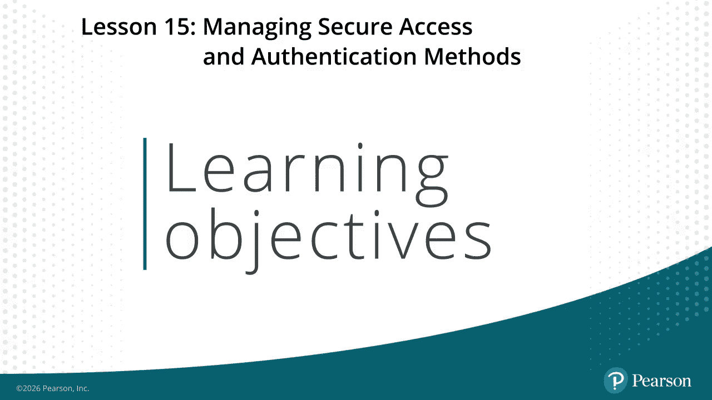
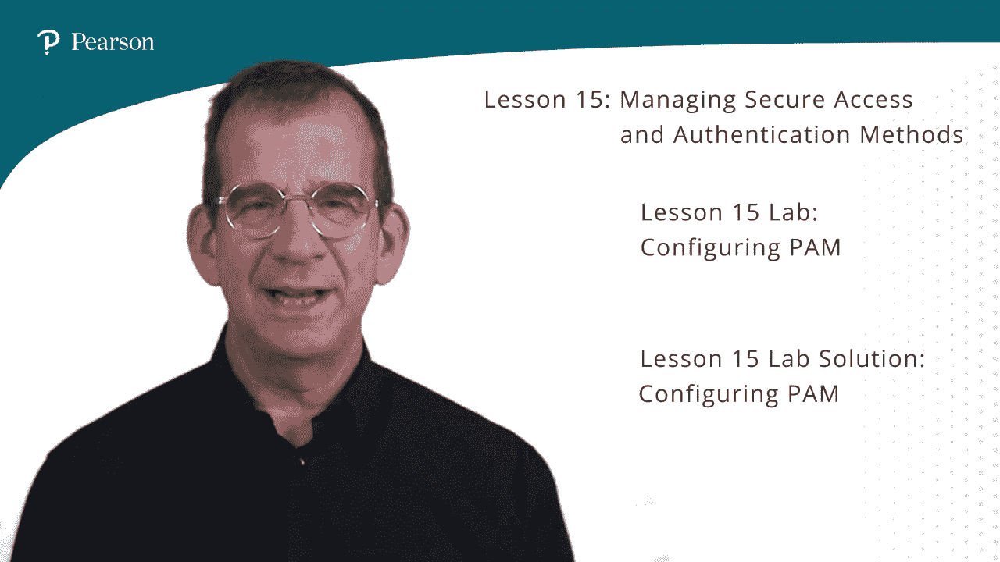

# CompTIA Linux+ V8：第4部分第84课：管理安全访问与身份验证 🔐

在本节课中，我们将一起学习如何在 Linux 系统里管理安全访问和身份验证方式。内容涵盖可插拔认证模块、集中式认证服务，以及课程末尾的实验环节和解答，适合刚接触 Linux 安全配置的初学者。

我们先来看看这一节课的整体安排，方便你心里有个底，知道接下来会讲哪些知识点。

以下是本节课的主要学习目标：
- 理解安全访问与身份验证的基本管理方法。
- 掌握可插拔认证模块的工作原理。
- 了解集中式认证中常用的服务与协议。
- 完成一次实验并查看实验解答。

说完了课程目标，接下来我们重点介绍第一个核心概念。

可插拔认证模块是 Linux 系统里处理身份验证的重要机制。它的英文全称是 Pluggable Authentication Modules，原文中简写为 Bm，实际通常简写为 PAM。你可以把它理解为一套可插拔的认证插件集合，系统管理员可以根据需要添加或移除不同的认证方式，而不需要修改每个应用程序的代码。

PAM 的核心概念可以用下面的公式来表示：

PAM = Pluggable Authentication Modules

下面是 PAM 的常见配置文件路径示例：

/etc/pam.d/

PAM 的作用就是让认证过程变得灵活。比如你可以为 SSH 登录设置密码认证，同时为 sudo 命令设置指纹认证，而不需要为每个程序单独写认证逻辑。这种设计让系统更容易维护，也更容易扩展。

讲完了 PAM，我们继续看下一个集中式认证相关的服务。

下一节内容介绍的是用于集中式认证的系统安全服务守护进程，英文原文中称为 tripleSD，在实际 Linux 环境中通常指的是 System Security Services Daemon，简称 SSSD。

SSSD 的核心定义如下：

SSSD = System Security Services Daemon

SSSD 的主要职责是连接本地系统与远程身份服务，让用户可以使用集中管理的账号登录到多台 Linux 机器。它可以缓存用户凭据，即使网络暂时中断，本地认证仍然可以继续工作，这对于企业环境非常实用。

以下是 SSSD 常见的配置文件位置：

/etc/sssd/sssd.conf

介绍完 SSSD 之后，我们再看看另外两种常见的集中式认证技术。

在 Linux 环境中，集中式认证经常用到轻量目录访问协议和凭证分发系统。原文中提到的 ElEP 和 Cabars，分别对应常见的 LDAP 和 Kerberos 技术。

LDAP 的核心概念如下：

LDAP = Lightweight Directory Access Protocol

Kerberos 的核心概念如下：

Kerberos = 基于票据的网络身份验证协议

这两种技术通常一起使用，LDAP 负责存储用户和组信息，Kerberos 负责安全地验证用户身份。这样做可以避免在每台服务器上分别创建本地账号，提高管理效率，也让安全审计更加方便。

以下是集中式认证的常见组件列表：
- LDAP：用于集中存储目录信息。
- Kerberos：用于提供安全的单点登录认证。

说完了这些理论知识，最后我们来看看课程安排的实验环节。

本节课的最后部分包含一个实验，以及对应的实验解答。实验的目的是让你在实际操作中巩固刚才学到的 PAM、SSSD、LDAP 和 Kerberos 相关知识。你可以先独立完成实验，遇到困难时再参考解答，这样学习效果会更好，也能更快掌握实际操作技能。

实验环节的基本流程如下：
1. 打开实验环境。
2. 按照要求配置身份验证相关服务。
3. 验证配置是否生效。
4. 对照实验解答检查结果。

好了，以上就是本节课的全部内容。

在本节课中，我们一起学习了如何管理安全访问与身份验证。重点介绍了可插拔认证模块 PAM、系统安全服务守护进程 SSSD，以及 LDAP 和 Kerberos 等集中式认证技术，最后还介绍了实验与实验解答的安排。希望这些内容能帮助你建立起 Linux 安全访问管理的基础认识。
