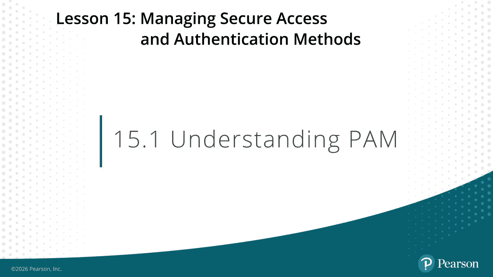
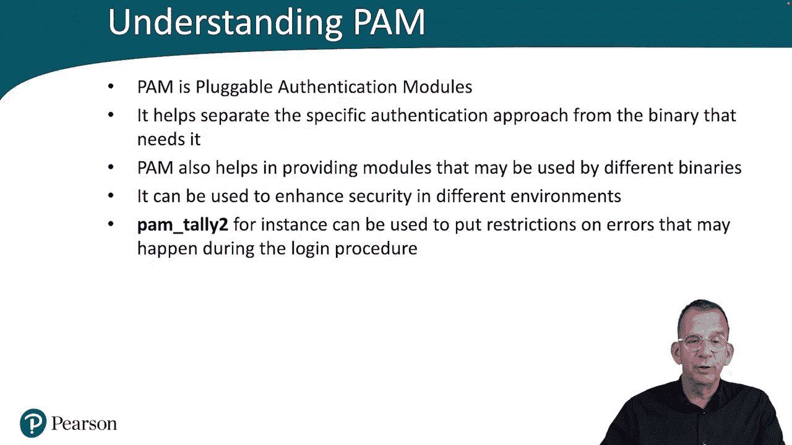
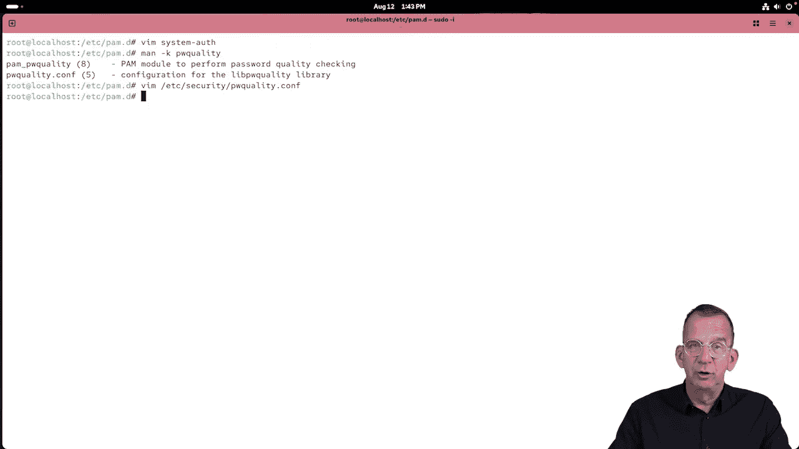

# Oreilly - CompTIA Linux+ V8：04：理解 PAM 🔐

在本节课中，我们将一起学习什么是 PAM，以及它在 Linux 系统认证流程中是如何工作的。我们会先介绍 PAM 的基本概念，再了解它的四个认证阶段，接着看看常见的 PAM 模块有哪些，最后说明 PAM 的配置文件通常放在哪里。不管你是刚接触 Linux 的新手，还是想复习认证知识的学习者，这节课都会用大白话把 PAM 讲清楚，让你明白它是怎么让登录认证变得灵活的。

---

什么是 PAM

PAM 的全称是 Pluggable Authentication Modules，中文意思是可插拔认证模块。简单地说，PAM 就是一种让 Linux 认证变成“即插即用”的机制。它的核心思想可以用下面这个公式来描述：

PAM = 认证模块 + 配置文件 + 应用程序接口

当你登录 Linux 系统时，系统不需要把认证逻辑直接写死在每个程序里，而是通过 PAM 把认证过程拆分成一个个可以替换的模块。这样一来，如果你想增加指纹识别、人脸识别或者其他新的认证方式，只需要加入对应的 PAM 模块，而不需要修改登录程序本身的代码。

---

PAM 的作用和优势

PAM 的主要作用，是把具体的认证方法和真正需要用到认证的程序分开来。假设你是一个设备厂商，想要在自己的设备上加入指纹读取器。如果没有 PAM，你可能得修改登录程序的源代码，然后重新编译整个二进制文件。有了 PAM 之后，你只需要提供一个特定的库文件，把它集成到认证流程中，就可以扩展认证的可能性。

PAM 还有一个好处，就是同一个模块可以被很多不同的程序复用。比如一个密码检查模块，既可以被 ssh 使用，也可以被图形登录界面使用。这样不仅节省了开发工作，还能在不同的环境下统一增强安全性。这里还有一个具体的模块叫 pam_tally2，它可以在系统启动过程中，对登录失败次数过多的情况做出限制，防止暴力破解。

---

查看 PAM 在登录中的应用

为了让你更直观地理解 PAM 到底在干什么，我们可以来看一看登录程序是怎么使用 PAM 的。这里的目的不是要把你培养成 PAM 专家，只需要知道它是如何影响认证流程就足够了。

我们可以使用 ldd 命令来查看登录二进制文件依赖的库：

ldd /bin/login

运行这条命令之后，你会发现登录程序使用了 libpam 和 libpam_misc 这两个库。这意味着登录程序在运行时，会调用 PAM 来处理认证相关的任务，而不是自己独立完成所有的身份验证工作。

---

PAM 的四个认证阶段

PAM 的配置文件放在 /etc/pam.d/ 目录下。在这个目录里，你可以找到 login 这样的配置文件。打开 login 配置文件，你会发现 PAM 把认证过程分成了四个不同的阶段。

以下是这四个阶段的具体含义：

- auth：用户初次接触系统，进行身份确认的阶段。
- account：检查账户设置，比如账号是否过期、是否允许登录。
- password：验证密码是否符合要求，比如长度、复杂度等。
- session：打开会话，并为用户提供访问特定资源的权限。

这四个阶段就像是登录时的几道关卡，用户需要逐一通过，才能最终进入系统。

---

常见的 PAM 模块示例

在 login 的配置文件中，不同的阶段会调用不同的模块。下面是几个比较常见的例子：

- session required pam_selinux.so：这个模块在 RHEL 系统中很常见，用于 SELinux 的会话管理。但在默认不带 SELinux 的 Ubuntu 系统里，你可能找不到这一行。
- account required pam_nologin.so：如果你在文件系统根目录下创建一个名为 nologin 的文件，除了 root 用户之外，其他人都无法登录。
- include system-auth：这表示引用公共的认证配置，让多个程序复用同一套认证规则，避免重复编写。

除了上面这些模块，还有一些在认证过程中也很常见。以下是几个典型的模块及其作用：

- pam_env.so：在 auth 阶段读取环境变量。
- pam_faildelay.so：设置登录失败后的延时，限制尝试频率，防止频繁猜密码。
- pam_unix.so：基于 /etc/passwd 文件进行传统的 Unix 认证。
- pam_pwquality.so：集成在 password 阶段，确保你的密码满足适当的复杂度要求。

你还会注意到，大多数阶段在最后都会有一个 pam_deny 模块。它的意思是，如果前面的必要条件或充分条件都没有通过，就会走到 pam_deny，最终拒绝用户登录系统。

---

PAM 的配置文件位置

PAM 模块不仅在 /etc/pam.d/ 中配置，很多安全相关的模块还会在 /etc/security/ 目录下有对应的配置文件。你可以使用下面的命令来查找相关的帮助页面：

man -k pw quality

通过这条命令，你会看到 pam_pwquality 的相关说明。通常，密码质量的配置文件就在 /etc/security/pwquality.conf 里。你不需要把 PAM 的所有细节都背下来，但要清楚 PAM 模块通常是通过 /etc/security/ 下的文件来配置的，这样在需要调整密码策略时你知道去哪里找。

---

本节课中，我们一起学习了什么是 PAM，以及它如何让 Linux 的认证变得模块化和可扩展。我们了解了 PAM 的四个认证阶段，分别是 auth、account、password 和 session，还看到了 pam_unix.so、pam_pwquality.so 和 pam_deny 等常见模块的作用。最后，我们也知道了 PAM 的配置文件主要分布在 /etc/pam.d/ 和 /etc/security/ 目录下。希望这节课能帮你建立对 PAM 的直观认识，为后续学习 Linux 认证打下基础。

