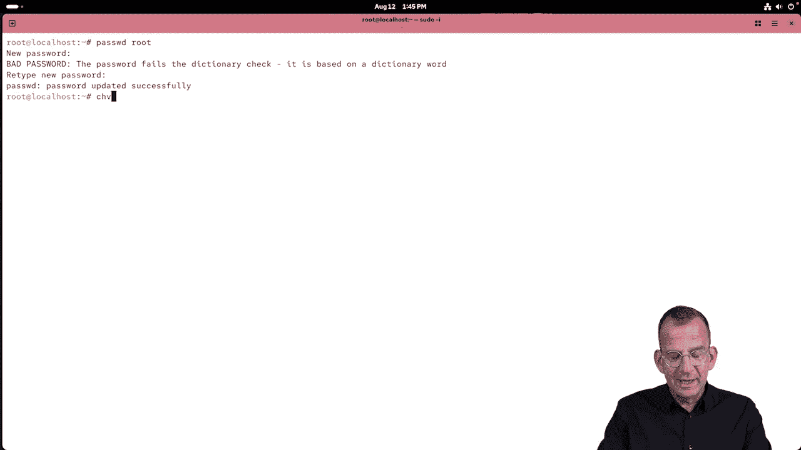
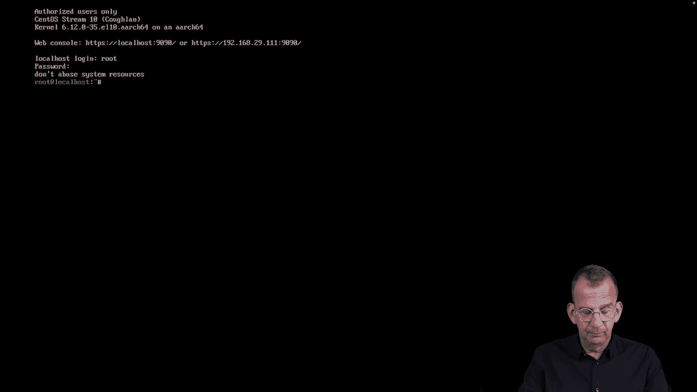
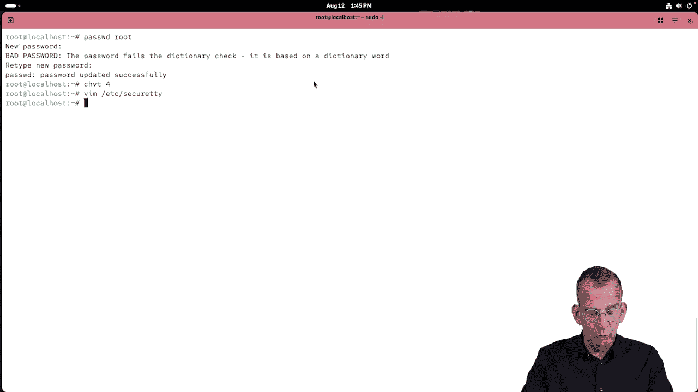
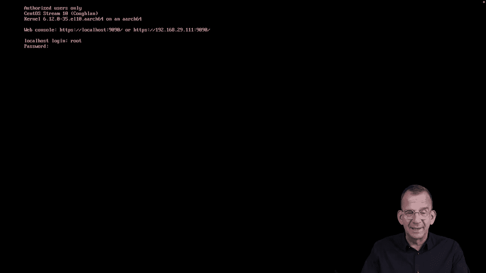
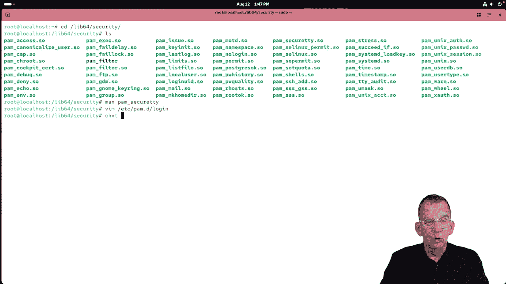
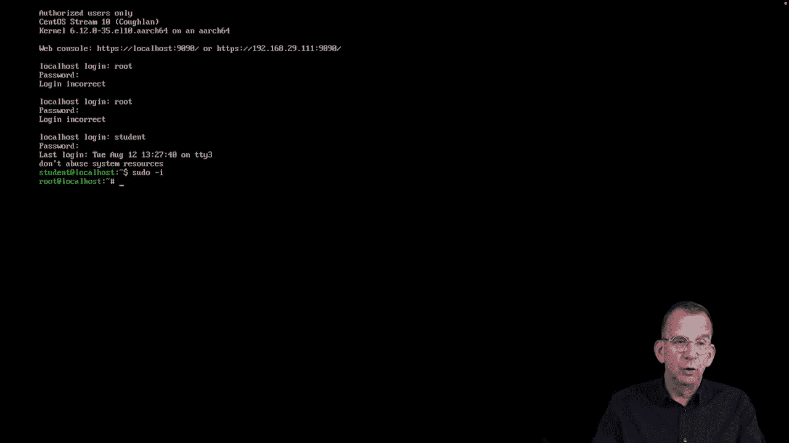
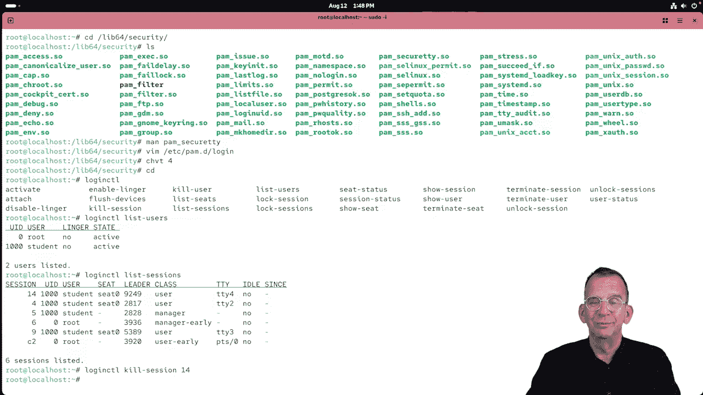

# CompTIA Linux+：04：配置 PAM 🔐

## 概述

在本节课中，我们将一起学习如何在 Linux 系统中配置 PAM，也就是可插拔认证模块。通过本节课，你将了解如何限制 root 用户从哪些终端登录，如何找到 PAM 模块文件，以及如何修改登录认证流程，最后还会学习如何使用 loginctl 来管理当前的登录会话。无论你是刚接触 Linux 的新手，还是正在准备 CompTIA Linux+ 考试，这些内容都能帮助你更好地理解系统安全的基础知识。

---

### 一、什么是 PAM 以及为什么要限制 root 登录

在 Linux 系统中，PAM 是一套灵活的认证机制，它允许管理员自定义不同服务（比如登录、切换用户、sudo 等）的身份验证方式。简单来说，PAM 就像是系统安全的“插件接口”，你可以根据需要加入或移除不同的认证规则。



在本节课的示例中，我们需要确保 root 用户拥有一个明确的密码，并且只能从指定的虚拟终端登录。为了演示这一点，我们先切换到 root 用户并设置它的密码。这里的“route”其实是“root”的笔误，下面统一使用 root。



以下是具体的操作步骤：

```bash
su root
passwd root
```

执行完上面的命令之后，root 用户就有了自己的登录密码。接下来，我们切换到虚拟终端 4，尝试使用 root 用户及其密码登录系统，看看默认情况下是否可以成功。

```bash
# 切换到虚拟终端 4
# 使用 root 用户及其密码登录
```

如果一切正常，你应该能够顺利登录进去。这说明在没有额外限制之前，root 默认可以从多个虚拟终端进行登录。

---

### 二、查看 /etc/securetty 并理解安全终端

上一节我们介绍了如何设置 root 密码并在虚拟终端 4 上登录，本节中我们来看看如何限制 root 只能从特定终端登录。

回到虚拟终端 2 之后，我们要查看一个重要的配置文件，路径是 `/etc/securetty`。这个文件的作用是列出哪些 TTY 设备允许 root 用户安全登录。如果某个终端不在这个列表里，root 就无法从那里直接登录。



为了演示，我们先把 `tty3` 添加到这个文件中：



```bash
echo "tty3" >> /etc/securetty
```

按照预期，当我们回到虚拟终端 4 尝试以 root 用户登录时，应该会被拒绝。但实际情况可能相反，root 依然可以登录。为什么会这样呢？这是因为 PAM 中的 `pam_securetty` 模块正在起作用，它会检查当前终端是否在 `/etc/securetty` 列表中，并据此决定是否允许 root 登录。

---

### 三、定位 PAM 模块文件

上一节我们介绍了 `/etc/securetty` 的作用，本节中我们来看看 PAM 模块本身存放在哪里。

PAM 模块通常以共享库文件的形式存在，在 64 位 Linux 系统中，你可以在 `/lib64/security/` 目录下找到它们。我们要找的模块就是 `pam_securetty.so`。

为了确认这个模块支持哪些认证类型，可以查看它的帮助页面：

```bash
man securetty
```

从手册页面中可以看出，该模块只提供 `auth`（认证）类型。这意味着我们需要把它加入到登录服务的认证流程中，而不是账户管理或密码管理流程。搞清楚这一点之后，我们就知道接下来该修改哪个配置文件了。

---

### 四、修改登录 PAM 配置文件

上一节我们介绍了 PAM 模块的位置和类型，本节中我们来看看如何把 `pam_securetty.so` 加入到登录认证中。

既然我们讨论的是登录过程，就需要修改 `/etc/pam.d/login` 这个配置文件。在其中加入如下一行：

```bash
auth required pam_securetty.so
```

从现在起，`pam_securetty.so` 就会被包含在登录的认证流程里。你不需要再去读其他复杂的文档，系统会自动找到正确的 login 二进制文件，进而读取 PAM 配置，并动态加载所有需要的共享库。

---

### 五、验证 root 登录被禁止

上一节我们介绍了如何修改 `/etc/pam.d/login`，本节中我们来看看修改后的实际效果。

回到虚拟终端 4，再次尝试使用 root 用户登录。你会发现，这次登录不再成功。为了排除输入错误的可能性，我们可以再仔细检查一遍，确认 root 用户确实已经无法从这个终端登录。



此时，如果你尝试使用普通用户（比如 student）登录，然后执行 `su -` 或 `sudo -i` 切换到 root，你会发现这些操作仍然可以成功。这是因为我们刚才的修改只作用于 PAM 的 login 服务，而没有作用于 `su` 服务。每个服务都有自己独立的 PAM 配置，所以改了 login 并不会自动影响 su。

---

### 六、使用 loginctl 管理登录会话

上一节我们介绍了如何验证 root 登录限制，本节中我们来看看如何使用 loginctl 来查看和结束用户会话。



`loginctl` 是 systemd 提供的登录会话管理工具。你可以用它列出当前系统上的所有用户，或者查看详细的会话信息。

以下是常用的两个命令：

```bash
loginctl list-users
loginctl list-sessions
```

`list-users` 的输出可能不够具体，因此更推荐使用 `list-sessions`，它能清楚地显示哪个用户在哪个终端上登录。如果你发现某个会话不再需要，可以直接结束它，而不必回到物理控制台：

```bash
loginctl kill-session 14
```

执行这个命令后，对应的用户就会被强制登出，系统会立即回收该会话占用的资源。

---

## 总结



本节课中我们一起学习了 PAM 的基本概念，了解了 `/etc/securetty` 如何控制 root 用户的登录终端，掌握了如何在 `/lib64/security/` 中定位 `pam_securetty.so` 模块，学会了在 `/etc/pam.d/login` 中添加 `auth required pam_securetty.so` 来限制 root 登录，并验证了该配置生效后 root 无法从虚拟终端 4 登录。最后，我们还介绍了如何使用 `loginctl list-sessions` 查看登录会话，以及如何用 `loginctl kill-session` 结束指定的用户会话。希望这些内容能帮助你更好地掌握 Linux 系统的认证与会话管理。

