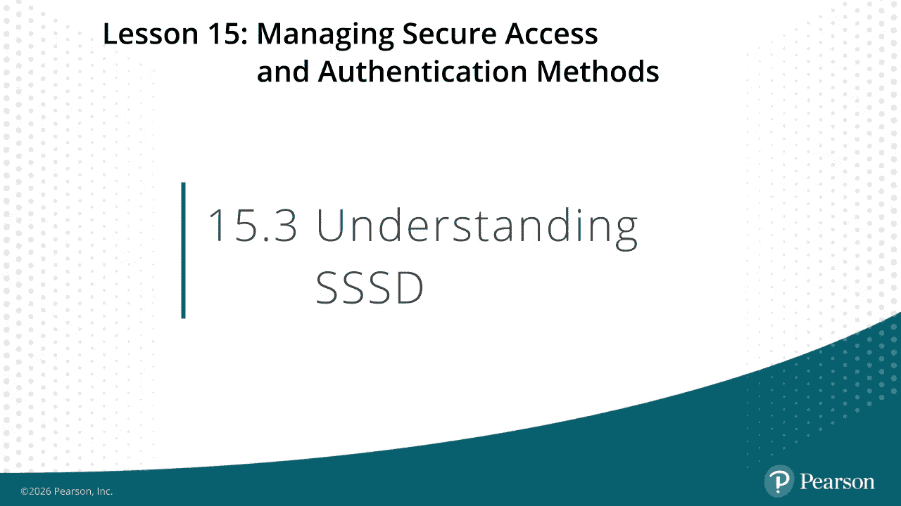
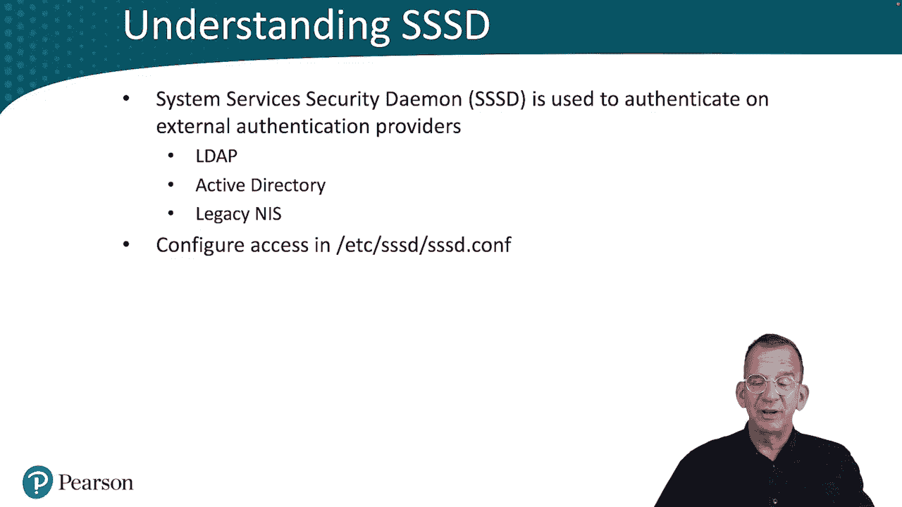
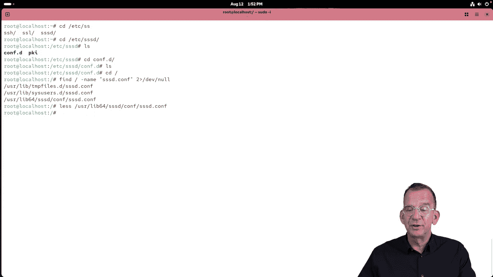

# CompTIA Linux+ V8：153：Understanding SSSD 🔐


在本节课中，我们将一起学习什么是 SSSD，它的配置文件在哪里，以及它是如何处理身份验证的。内容会尽量用大白话解释，即使你是初学者也能看懂。我们会先看看 SSSD 的基本定义，再看看配置文件的位置，最后总结一下需要记住的重点。




## 什么是 SSSD

首先我们来看看 SSSD 到底是什么。SSSD 的全称是 System Security Services Daemon。简单来说，它是一个用于对外部身份验证提供程序进行身份验证的系统服务。

核心概念可以用下面这个公式来描述：

```text
SSSD = System Security Services Daemon
```

SSSD 支持将 Linux 身份验证重定向到多种外部来源，常见的有以下几种：

- LDAP 服务器
- Active Directory 服务器
- 旧版 NIS（非常古老，大概率不会再出现）

如果你想把系统的身份验证交给这些外部服务器处理，就需要配置 SSSD。




## SSSD 的配置文件位置

上一节我们介绍了 SSSD 是什么以及它的基本用途，本节中我们来看看它的配置文件放在哪里。

你可以在 /etc/sssd/sssd.conf 中配置 SSSD 的访问设置。我们进入 /etc/sssd 目录看一下。如今你会发现那里只有 conf.d 目录，里面只有放置文件，没有主配置文件。这种变化在 Linux 中一直在发生，这是很正常的情况。

幸运的是，我们可以使用以下命令来查找相关文件，并且不希望看到任何错误信息：

```bash
find -name sssd.conf
```

执行后，你只想看到查询结果。看来通常的路径是 /usr/lib64/sssd/conf.d/。我们可以用 less 查看这个文件，因为它位于 /usr/lib64/ 下，那通常不是你会修改的位置。不过我还是想快速看一看，里面到底有什么内容。


## 查看配置内容

下面是我们在配置文件中能看到的具体内容。

这里展示了 SSSD 是如何配置的。services 字段只设置了 NSS 和 PAM，domain 字段设置为 shadow。这意味着它目前负责的是本地身份验证。

配置示例如下：

```ini
[sssd]
services = nss, pam
domains = shadow
```

如果你打算将系统连接到 Active Directory，并且使用 realmd 来设置你的系统，那么你会在 /etc/sssd/ 下找到自定义的 SSSD 配置文件。不过现在我们没有这个文件，这也很合理，因为我们目前只处理内部身份验证，不涉及外部目录服务。


## 需要记住的要点

下面是关于 SSSD 需要记住的几个要点。

不要对 SSSD 期待太多，但就像 Linux 中的许多东西一样，你需要知道它的存在，并且了解它在做什么。哪怕你现在不需要配置它，也要知道这个服务在系统里运行着，并在必要时提供身份验证支持。


## 本节总结



本节课中我们一起学习了 SSSD 的基本概念、配置文件的位置，以及它如何处理本地和外部身份验证。希望这些内容能帮助你理解 Linux 身份验证机制的一部分。
