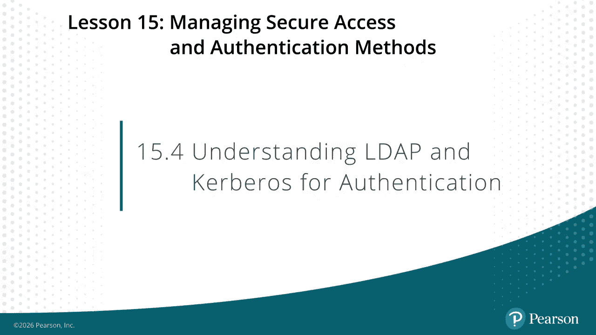
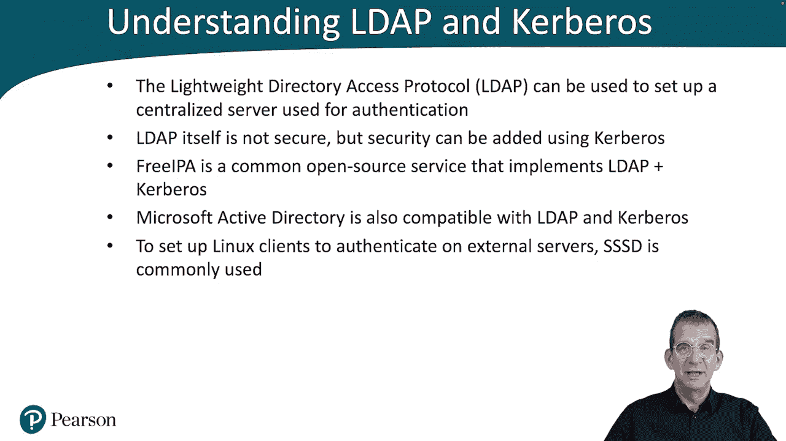

🔐 Linux认证与LDAP Kerberos教程：04：理解LDAP和Kerberos认证

🔐 本节课概述

在本节课中，我们将一起学习 LDAP 和 Kerberos 这两种用于身份认证的技术，并用大白话把它们的作用讲清楚。LDAP 的全称是轻量级目录访问协议，它的主要职责是搭建一个集中式的认证服务器，让多个电脑或服务器共用同一套账号和密码，而不是在每台机器上分别创建用户。Kerberos 是另一种网络认证协议，它不直接传输密码，而是通过票据机制来证明用户身份，从而提升安全性。我们还会介绍 FreeIPA 这个开源工具，它把 LDAP 和 Kerberos 整合在一个服务器里，效果非常类似于微软的 Active Directory，适合不想引入 Active Directory 却又需要集中式认证的场景。最后，我们会简要看看如何在 Linux 客户端上配置外部认证，其中 SSSD 服务会起到关键的桥梁作用。无论你是刚接触 Linux 认证，还是想搭建统一的账号管理系统，这节课都会尽量用简单易懂的方式把原理说透。

📌 LDAP 与 Kerberos 的基本概念

上一节我们主要聊的是本地系统的基础认证，本节中我们来看看目录服务和票据认证是怎么协同工作的。

LDAP 不仅仅是一个通信协议，它本身也可以充当认证服务器，功能上很像 Active Directory。不过，单独使用 LDAP 时，安全性并不高，账号和密码在网络中传输容易被窃听。为了弥补这个不足，管理员可以部署证书服务器，为 LDAP 通信添加加密层，从而保护登录信息不被截获。

Kerberos 则提供另一种认证思路，它不直接在网络上发送密码，而是先向认证服务器申请票据，凭票据访问服务，这样即使网络被监听，密码也不会直接泄露。

以下是两者的核心关系和作用分工：

- LDAP：负责存储用户账号、组信息以及目录数据，提供集中式查询
- Kerberos：负责生成和验证安全票据，确保身份认证过程不直接暴露密码
- 组合使用：LDAP 存储账号，Kerberos 负责安全验证，两者互补，共同构成集中式认证体系

从公式上可以简单理解为：

`LDAP（账号存储） + Kerberos（票据验证） = 安全的集中式身份认证`

🛡️ LDAP 的安全性与 FreeIPA 解决方案

刚才我们介绍了 LDAP 和 Kerberos 的基本作用，本节中我们来看看如何在 Linux 上快速部署它们，以及为什么 FreeIPA 是一个不错的选择。

单独使用 LDAP 时，缺乏足够的安全保护，容易受到网络攻击或信息泄露。管理员可以配合证书服务器，为 LDAP 通信启用加密，这样登录凭证在传输过程中就更难被第三方窃听。

如果你不想手动分别安装和配置 LDAP 与 Kerberos，FreeIPA 是一个非常方便的开源服务器。它同时实现了 LDAP 和 Kerberos 两种服务，安装和使用都比较简单。部署完成后，你会得到一个非常类似于 Microsoft Active Directory 的系统，而且它原生支持 LDAP 和 Kerberos 协议，可以与现有的基础设施良好兼容。

以下是 FreeIPA 的主要优点：

- 开源免费，无需购买昂贵的商业授权
- 同时集成 LDAP 与 Kerberos，无需拆分部署多个组件
- 与微软 Active Directory 功能相近，迁移和学习成本较低
- 在 Linux 系统上安装和维护较为直观，适合中小型环境

🖥️ Linux 客户端外部认证配置

前面我们讲完了服务器端的 LDAP、Kerberos 与 FreeIPA，本节中我们来看看客户端该怎么连接这些外部认证服务。

如果你希望 Linux 客户端能够使用外部 LDAP 或 Kerberos 服务器进行登录认证，就需要在客户端上安装相应的客户端组件，并指定认证服务器的地址。在这个过程中，SSSD 服务是最常用的选择，你在之前的课程中已经接触过它。SSSD 可以把本地认证请求转发到远程 LDAP 或 Kerberos 服务器，让用户用同一套账号登录不同的 Linux 机器，实现真正的集中式账号管理。

以下是配置客户端认证的大致步骤：

- 安装 SSSD 服务及相关客户端软件包
- 编辑 SSSD 配置文件，填写 LDAP 或 Kerberos 服务器地址
- 启动并启用 SSSD 服务，使其随系统自动启动
- 验证本地用户能否通过外部账号成功登录

📝 本节课总结

本节课中我们一起学习了 LDAP 和 Kerberos 用于身份认证的基本原理。我们了解到 LDAP 可以搭建集中式认证服务器，但单独使用时安全性较低，需要配合证书服务器加强防护。FreeIPA 作为开源解决方案，同时实现了 LDAP 和 Kerberos，效果类似于 Active Directory，适合在 Linux 环境中快速部署。最后我们简要介绍了如何在 Linux 客户端上配置外部认证，其中 SSSD 服务是连接客户端与外部认证服务的关键组件。希望这节课能帮你建立起对集中式认证的直观认识，为后续的实际部署打下基础。
