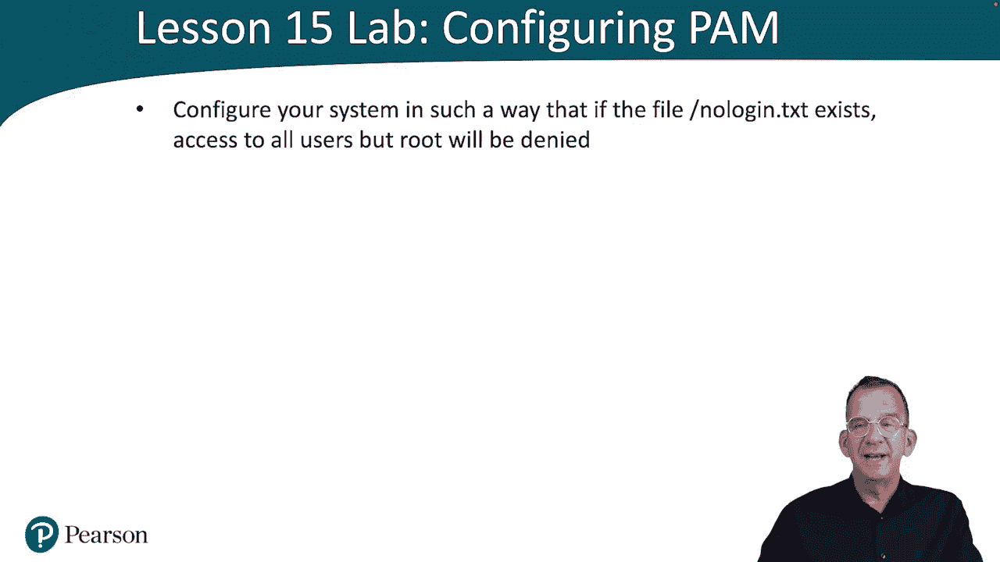

# 🔐 CompTIA Linux+ V8：Lesson 15：配置 PAM 实验

在本节课中，我们将一起学习如何在 Linux 系统中配置 PAM，也就是可插拔认证模块。具体来说，我们会做一个动手实验，学习当某个特定文件存在时，如何限制普通用户登录，同时保留 root 用户的访问权限。这对于系统维护和紧急情况下的访问控制非常有用。

## 什么是 PAM

PAM 的全称是 Pluggable Authentication Modules，中文叫可插拔认证模块。你可以把它理解成 Linux 系统里的一个“认证插件管理器”。当用户尝试登录系统时，PAM 会根据预先设定的规则，决定这个用户能不能进来，以及需要验证什么信息。

在日常使用中，大多数 Linux 发行版都内置了 PAM，但默认配置往往比较宽松。作为系统管理员，我们有时需要收紧权限，比如在系统维护期间禁止普通用户登录。这时候 PAM 就能派上用场了，它让我们可以在不修改底层程序的前提下，灵活地改变登录行为。

## 本节实验的目标

接下来我们来看看本节实验想要达成什么效果。

以下是本节实验的具体目标：

- 在系统中创建或检查 /etc/nologin 文件。
- 当这个文件存在时，阻止除了 root 以外的所有用户登录。
- 确保 root 用户仍然可以正常登录系统。

简单来说，如果这个文件存在，普通用户想登录也不行，只有 root 账号能例外。

## 核心配置原理

这里有一个核心概念，我们用伪代码来描述：

```bash
if [ -f /etc/nologin ]; then
    拒绝所有非 root 用户登录
else
    允许正常登录
fi
```

实际操作中，PAM 会自动检查这个文件的存在情况。如果文件存在，PAM 就会在认证阶段直接拦截普通用户的登录请求。root 用户因为拥有最高权限，通常会被 PAM 设置为例外，不受这个限制。也就是说，文件存在与否，就是开关，root 是唯一的钥匙持有者。

## 如何执行配置

下面我们来看具体的操作步骤。

首先，你需要以 root 身份登录系统，因为只有 root 才有权限在 /etc 目录下创建文件。

以下是执行步骤：

1. 打开终端，确认当前使用的是 root 用户。
2. 使用 touch 命令创建 /etc/nologin 文件：`touch /etc/nologin`
3. 尝试用普通用户登录，观察是否被拒绝。
4. 尝试用 root 用户登录，确认仍然可以正常进入系统。
5. 如果不再需要限制，删除该文件即可恢复正常：`rm /etc/nologin`

## 验证是否生效



配置完成后，我们需要确认规则是否真的起作用了。

你可以尝试以下验证方法：

- 用一个普通用户账号尝试 SSH 登录或本地登录，系统应该提示账号不可用或登录失败。
- 用 root 账号尝试同样的登录方式，应该能够成功进入系统。
- 删除 /etc/nologin 文件后，普通用户应该又能正常登录了。


通过这些测试，你就能确定 PAM 已经按照预期工作了，限制规则也没有误伤到 root 用户。

## 总结

本节课中我们一起学习了 PAM 的基本概念，掌握了如何利用 /etc/nologin 文件限制普通用户登录，同时保留 root 用户的访问权限。这不仅是一个实用的系统管理技巧，也能帮助你更好地理解 Linux 认证机制的运作方式。
