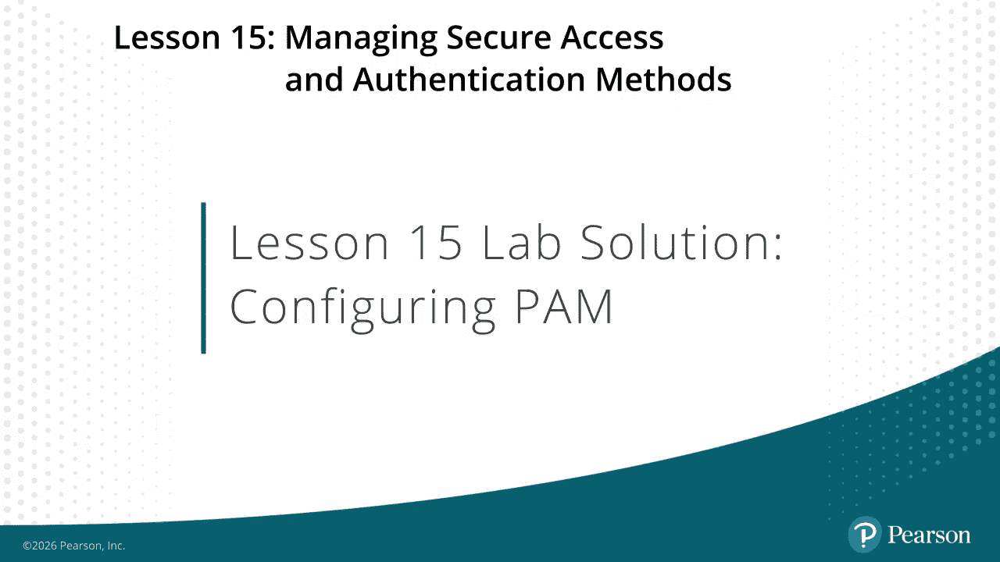
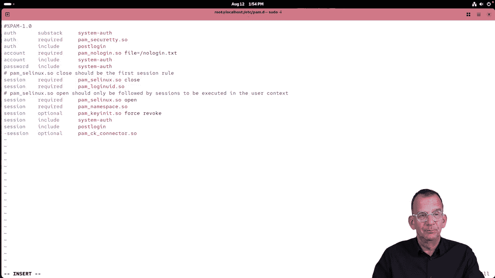

# CompTIA Linux+ V8：第15课：配置 PAM 实验解答 🔐

在本节课中，我们将一起学习如何在 Linux 系统中配置可插拔认证模块，也就是 PAM，并完成 Lesson 15 的实验解答。PAM 是 Linux 系统里负责处理用户登录、身份验证和权限检查的重要机制，几乎所有的登录服务都会依赖它来决定用户能不能进入系统。通过本节内容，你会明白如何查看登录配置文件、理解账号管理模块的作用，以及如何修正实验中文件路径不正确的问题。不管你是刚接触 Linux 的新手，还是已经有一点基础的学习者，这节课都会用大白话把每一步讲清楚，让你轻松掌握 PAM 的配置方法，为后续的学习打下坚实基础。


## 第一步：查看 PAM 的登录配置文件


要让 PAM 正常工作，我们需要先去看看它的配置文件放在哪里。在 Linux 系统中，PAM 的相关配置通常存放在 /etc/pam.d 这个目录下，而我们这次实验要关注的就是登录服务的配置文件。这个目录里的每一个文件都对应一种登录服务，比如 login 文件专门处理终端登录请求，sshd 文件处理远程 SSH 登录，以此类推。找到正确的文件是配置 PAM 的第一步，也是最重要的一步，因为如果找错了地方，后面的修改就白费了。



以下是具体操作：

- 打开终端，使用 cd /etc/pam.d 命令进入 PAM 配置目录。
- 使用 ls 命令列出目录下的所有文件，确认是否存在 login 文件。
- 使用 cat login 或 less login 命令查看 login 文件的内容，重点关注 account 这一行。

在这一步中，我们会看到 login 文件里已经配置了 pam_no_login.so 模块，并且 account 字段被标记为 required。这意味着系统在判断用户能否登录时，必须满足 pam_no_login.so 模块定义的条件。简单来说，如果这个模块检查失败，用户就无法成功登录，哪怕密码输入正确也一样会被拒绝。


## 第二步：检查 pam_no_login.so 模块的作用

上一节我们介绍了如何查看 /etc/pam.d/login 文件，发现其中已经启用了 pam_no_login.so 模块，并且设置为 account required。本节中我们来看看这个模块到底在做什么，以及它要求满足什么条件。理解模块的作用有助于我们判断配置是否正确，也能在排查登录问题时更快地定位原因。

以下是 pam_no_login.so 模块的核心作用：

- 检查系统中是否存在特定的禁用登录文件。
- 如果该文件存在，拒绝所有非 root 用户的登录请求。
- 常用于系统维护期间临时禁止普通用户登录，让管理员可以安心进行系统更新或修复。

从实验现象来看，account already required 说明系统已经强制要求通过 pam_no_login.so 的检查。换句话说，用户想要登录，就得先通过这个模块设置的门槛，否则登录会被直接拒绝，这正是实验要验证的核心逻辑。


## 第三步：查阅 pam_nologin 的手册页面

刚才我们确认了 login 配置中已经包含 pam_no_login.so，但还不清楚它具体会去读取哪个文件，以及默认路径是不是实验需要的路径。本节中我们来查看这个模块的官方说明，找出默认的文件路径是什么，以及如何通过参数修改它。查阅手册是学习 Linux 工具的好习惯，因为很多模块的细节参数都写在文档里，而不是显而易见的。

以下是查阅手册页的步骤：

- 在终端运行 man pam_nologin 命令，打开模块的帮助文档。
- 在文档中查找关于文件路径的说明，注意默认情况下模块会读取 /etc/nologin。
- 确认如果需要使用其他文件，可以通过 file 参数进行指定，从而覆盖默认路径。

手册文档里明确写着，pam_nologin 默认读取的文件是 /etc/nologin。但我们的实验环境可能需要用到 /etc/nologin.txt，所以默认路径并不符合实验要求，这就意味着我们需要手动调整配置，把模块指向正确的文件，否则实验无法通过。


## 第四步：修改配置文件中的文件路径

在上一节中我们了解到 pam_nologin 默认读取 /etc/nologin，而实验需要的是 /etc/nologin.txt。本节中我们来实际修改配置文件，把模块的 file 参数改成正确的路径。修改配置文件时要特别小心，因为一个拼写错误或者多余的空格都可能导致 PAM 无法正确加载模块，进而影响用户登录。

以下是修改的具体做法：

- 回到 /etc/pam.d/login 文件，找到包含 pam_no_login.so 的那一行。
- 在该行末尾添加或者修改 file 参数，设置为 /etc/nologin.txt。
- 保存文件并退出编辑器，确保更改已经写入磁盘。

具体的配置行可以用下面的代码来表示：

```text
account required pam_no_login.so file=/etc/nologin.txt
```

这一行代码的意思是，账号管理阶段必须调用 pam_no_login.so 模块，并且该模块应该读取 /etc/nologin.txt 文件来决定是否允许登录。这样修改之后，PAM 就会去检查这个自定义路径下的文件，而不是默认的 /etc/nologin，从而满足实验的要求，让登录控制逻辑按照预期运行。


## 实验完成与总结



经过上面的步骤，我们已经完成了 Lesson 15 配置 PAM 的实验要求。现在回头看看整个过程，你应该能清楚地理解每一步是在做什么，以及为什么要这样修改配置。PAM 的配置看起来复杂，但只要抓住核心模块和参数，其实逻辑非常清晰。

本节课中我们一起学习了以下内容：

- 如何查看 /etc/pam.d 下的登录配置文件，并定位 login 服务的配置。
- pam_no_login.so 模块在 account 阶段的作用及其 required 属性的含义。
- 如何通过 man pam_nologin 查看模块的默认行为和参数说明，找到默认读取的文件路径。
- 如何把 pam_no_login.so 的 file 参数改为 /etc/nologin.txt，完成实验配置并验证修改。

通过这节课的学习，你已经掌握了 PAM 配置的基本思路，也知道了当默认路径不符合实验要求时该如何进行调整。希望这些内容对你的 CompTIA Linux+ 备考有所帮助，祝你学习顺利。
