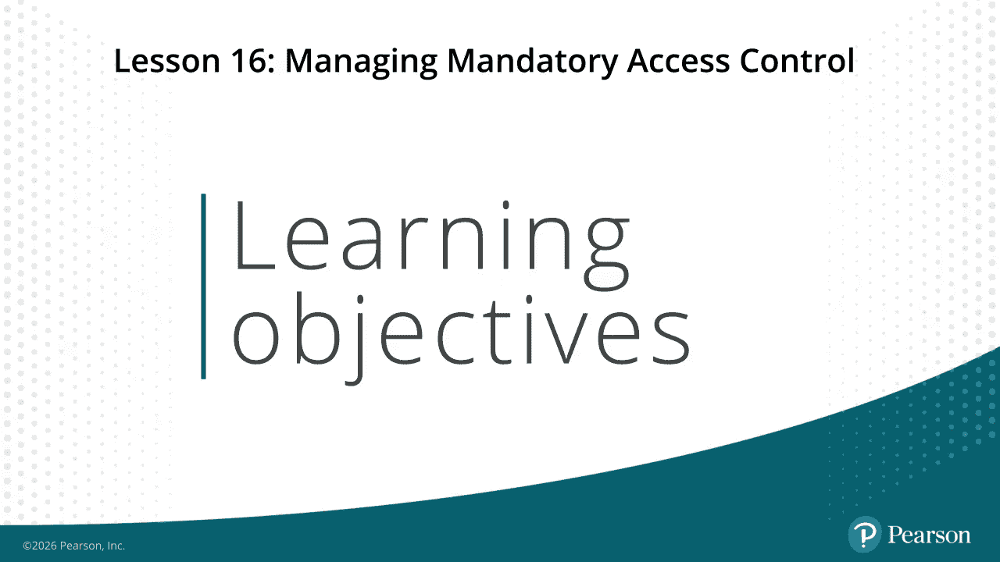
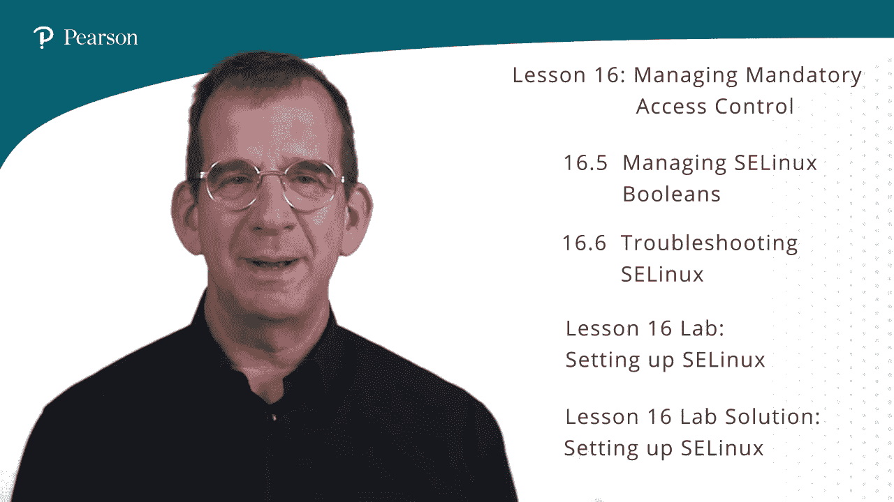

# CompTIA Linux+ V8：04：强制访问控制学习目标 🔒

## 课程概述



在本节课中我们将要学习强制访问控制的相关内容。我们会从强制访问控制是什么、为什么有用开始讲解，然后重点介绍 SE Linux 和 AppArmor 这两个实现强制访问控制的主要系统。了解它们的区别之后，我们会深入学习 SE Linux 的模式、标签和布尔值，最后还会学习如何排查 SE Linux 的问题。和其他课程一样，本节课也提供实验和实验解答，供你动手练习。

## 什么是强制访问控制

在讲具体的工具之前，我们先来了解强制访问控制这个概念。强制访问控制，也就是 MAC，是一种比较严格的安全机制。系统会根据预先设定的安全策略来决定哪个用户或进程可以访问哪些文件或资源，普通用户甚至系统管理员在默认情况下也不能随意绕过这些规则。这样可以有效防止恶意软件或误操作导致系统安全受损。

核心概念可以用下面的公式来描述：

```text
访问决策 = 安全策略 + 主体安全标签 + 客体安全标签
```

这个公式的意思是，系统在决定是否允许访问时，会综合查看请求访问的主体、被访问的客体以及当前的安全策略。

## SE Linux 和 AppArmor 的区别

了解完强制访问控制的基本概念之后，本节中我们来看看 SE Linux 和 AppArmor 的区别。这两个系统都是目前比较常用的强制访问控制实现，但它们的设计思路和配置方式有所不同。搞清楚它们的区别后，我们会把学习重点放在 SE Linux 上。

以下是两个系统的主要特点对比：

- SE Linux：由美国国家安全局开发，基于类型强制访问控制，策略比较复杂，但控制粒度非常细，适合对安全要求高的环境。
- AppArmor：基于文件路径的强制访问控制，配置相对简单，上手更快，适合快速部署的场景。

## SE Linux 的模式、标签和布尔值

在对比完 SE Linux 和 AppArmor 之后，本节中我们来看看 SE Linux 的具体工作方式。SE Linux 主要通过三个部分来控制系统访问：模式、标签和布尔值。理解这三个部分，就是理解 SE Linux 的关键。

以下是这三个核心概念的简单说明：

- 模式：SE Linux 的运行状态，常见的有强制模式、宽容模式和禁用模式。强制模式会阻止违规访问，宽容模式只记录不阻止，禁用模式则完全关闭 SE Linux。
- 标签：系统中的每个文件、进程和网络端口都有一个安全标签，SE Linux 会根据这些标签来决定是否允许访问。
- 布尔值：SE Linux 提供的一些开关选项，可以用来快速开启或关闭某些特定的策略行为，而不需要修改复杂的策略文件。

核心命令可以用下面的代码块表示：

```bash
getenforce          # 查看当前 SE Linux 运行模式
setenforce 1        # 切换到强制模式
ls -Z               # 查看文件的安全标签
getsebool -a        # 查看所有布尔值的当前状态
setsebool -P httpd_can_network_connect on  # 开启某个布尔值并使其持久生效
```

## 排查 SE Linux 问题

在上一节我们介绍了 SE Linux 的模式、标签和布尔值，本节中我们来看看怎么排查 SE Linux 相关的问题。当某个应用程序无法正常运行时，可能是 SE Linux 阻止了它的访问行为，这时候我们就需要排查一下，确认是不是 SE Linux 造成的。

以下是常见的排查步骤：

- 查看系统日志，寻找被 SE Linux 拒绝的访问记录。
- 使用 `ausearch` 或 `sealert` 工具来分析拒绝日志，找出具体原因。
- 临时将 SE Linux 切换到宽容模式，看问题是否消失，从而确认是否是 SE Linux 导致的。
- 根据日志信息调整文件标签或布尔值，或者更新安全策略来解决问题。

排查问题时可以参考下面的代码：

```bash
ausearch -m avc -ts recent   # 查看最近的 SE Linux 拒绝记录
sealert -a /var/log/audit/audit.log  # 分析审计日志并给出建议
setenforce 0                 # 临时切换到宽容模式进行测试
chcon -t httpd_sys_content_t /var/www/html  # 修改指定文件的安全标签
```

## 实验与练习

和其他的课程一样，本节课也包含一个实验和实验解答，供你练习技能。建议你在实际的 Linux 系统中操作，加深对强制访问控制和 SE Linux 的理解。



## 课程总结

本节课中我们一起学习了强制访问控制的基本概念，了解了 SE Linux 和 AppArmor 这两个主要系统的区别，学习了 SE Linux 的模式、标签和布尔值，还掌握了排查 SE Linux 问题的基本方法。希望这些内容能帮助你更好地理解 Linux 系统的安全控制机制。

