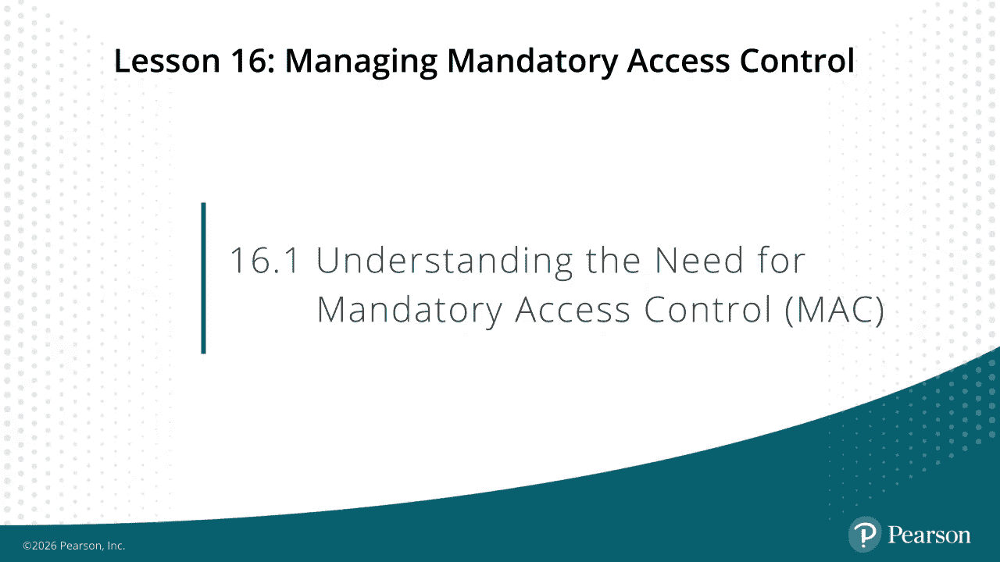
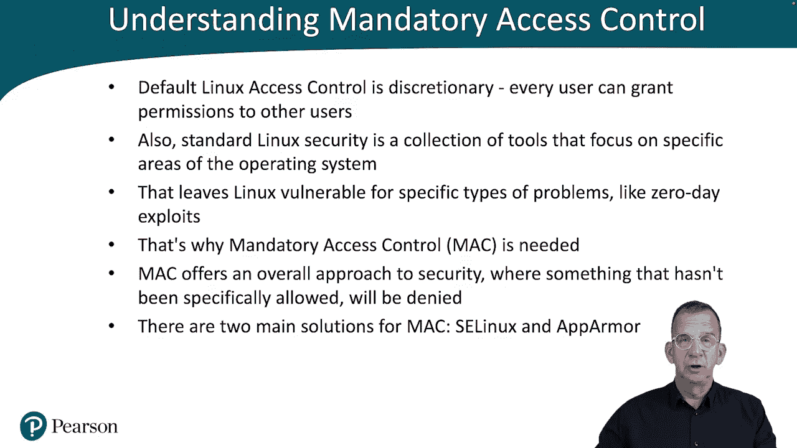

# CompTIA Linux+：03：理解强制访问控制（MAC）的必要性 🔒


在本节课中我们将要学习强制访问控制，也就是Mandatory Access Control，简称MAC。很多刚接触Linux安全的初学者，通常只接触过文件权限和用户权限，但其实这些只是安全体系的一小部分。在这一节里，我们会用大白话把MAC的来龙去脉讲清楚，解释为什么传统的Linux权限在某些情况下不够安全，以及MAC是如何通过更严格的规则来保护系统的。内容会稍微详细一点，为了让你能够彻底理解，所以每个概念都会展开来说，尽量不留盲区。


## 默认的Linux访问控制是什么 📂


先来聊聊Linux系统出厂时默认的访问控制方式。在Linux里，默认采用的是自主访问控制，英文叫Discretionary Access Control，简称DAC。简单来说，就是每个用户对自己拥有的文件和目录拥有决定权，可以随意把读、写、执行的权限给其他用户，或者收回这些权限。这里没有一个统一的中心来管控所有用户的权限，大家各自为政，只要你是文件的所有者，基本上就可以随便改权限。



以下是默认Linux权限模型的核心特点：

- 每个用户都可以把自己的文件权限授予给其他用户，没有人能从整体上禁止这种行为。
- 系统不存在集中式的权限审批机制，所有的授权决定都分散在单个用户手里。
- 权限粒度通常只精确到文件或目录层面，无法对系统内核或关键进程进行更细粒度的约束。

普通用户可以这样理解默认权限：如果我是某个文件的创建者，我想让同事查看，我就可以直接给他读权限；如果我不想让别人改，我就不给写权限。这种方式听起来很灵活，但也埋下了安全隐患，因为缺乏一个总开关来约束大家的行为。


## 为什么标准Linux安全不够用 ⚠️

上一节我们介绍了默认的自主访问控制，本节中我们来看看这种方式为什么在现代安全环境下显得不够。标准的Linux安全本质上是一堆分散的工具集合，每个工具只关注操作系统里的某个特定区域，比如文件权限、用户账号、网络防火墙等等。这些工具多年来是逐步累加上去的，而不是一开始就按照一个统一的安全蓝图设计的。

之所以会变成这样，主要是因为Linux背后背负着非常古老的Unix遗产。早期的Unix系统诞生的时候，网络安全和恶意软件还不是今天这个局面，设计者更多考虑的是方便协作，而不是防范严密的攻击。因为这种历史包袱和分散的设计思路，Linux在面对某些特定威胁时会显得脆弱，典型的例子就是零日漏洞利用，也就是零日攻击。攻击者可以利用系统还没有修补的漏洞，在管理员来得及反应之前完成入侵。

下面是标准Linux安全的主要局限：

- 缺乏统一的安全策略，各个安全工具之间协调性差。
- 很难阻止未知的零日漏洞攻击，因为默认模式倾向于允许未明确禁止的操作。
- 普通用户拥有过多自主权，可能无意或故意地将敏感权限授给不可信的人。

简单来说，传统Linux安全像是一套零散的门锁，每个房间装一把，但没有一把总钥匙来管控整栋大楼的出入，遇到专业的小偷就容易被钻空子。


## 强制访问控制（MAC）是什么 🛡️

既然知道了默认权限的不足，那强制访问控制又是怎么解决这些问题的呢？MAC提供了一种整体性的安全方法，它的核心思想和传统的DAC完全不同。在MAC模型下，系统会维护一套中心化的安全策略，只有明确允许的操作才能被执行，所有没有被明确允许的行为都会被自动拒绝，而且普通用户没有任何办法去修改或绕过这些规则。

我们可以用一个简单的公式来描述MAC的决策逻辑：

```
访问决策 = 如果（请求的操作在安全策略的允许列表中）则 允许访问，否则 拒绝访问
```

这意味着，即使你是文件的所有者，也不能随便把权限给别人，因为最终决定权在系统策略而不是在用户手里。这种“默认拒绝”的机制，能够有效堵住很多攻击者利用配置错误或未知漏洞的路径。

以下是MAC与传统权限的核心区别：

- 控制权集中在系统安全策略，而不是分散在各个用户手中。
- 未经明确允许的所有操作默认会被拒绝，用户无法自行更改这一行为。
- 安全策略通常由系统管理员统一制定，并作用于整个操作系统，而不是单个文件。

通俗地说，MAC就像是一个严厉的保安，只有名单上的人才能进，不在名单上的一律不放行，而且普通人没法说服保安放自己进去。


## MAC的主要实现方案 🖥️

了解完MAC的原理之后，我们来看看在Linux世界里，通常有哪些工具可以把这个理念落地。目前业界比较主流的强制访问控制解决方案主要有两个，一个是SELinux，另一个是AppArmor（原文中提到的E Aror指的就是AppArmor）。这两个项目都试图在操作系统内核层面强制执行安全策略，防止进程越权访问资源。

以下是两种主要MAC方案的简要介绍：

- SELinux：由美国国家安全局参与开发，功能非常强大，策略细致，但配置相对复杂，学习曲线较陡。
- AppArmor：路径基于的安全模块，配置相对简单，容易上手，适合快速部署。

如果你正在准备CompTIA Linux+认证考试，那么你需要重点了解的是SELinux。考试大纲中对SELinux的要求比较明确，所以后面的章节我们会围绕SELinux展开更深入的讲解，包括它的运行模式、策略管理以及常见故障排查。




本节课中我们一起学习了强制访问控制的必要性。我们回顾了默认Linux自主访问控制的工作方式，分析了标准Linux安全在面对零日漏洞等现代威胁时的局限性，理解了MAC“未明确允许即拒绝”的核心原则，并初步认识了SELinux和AppArmor两种主流实现方案。希望通过这一节，你能对Linux系统安全有更完整的认识，为后续深入学习SELinux打下基础。
