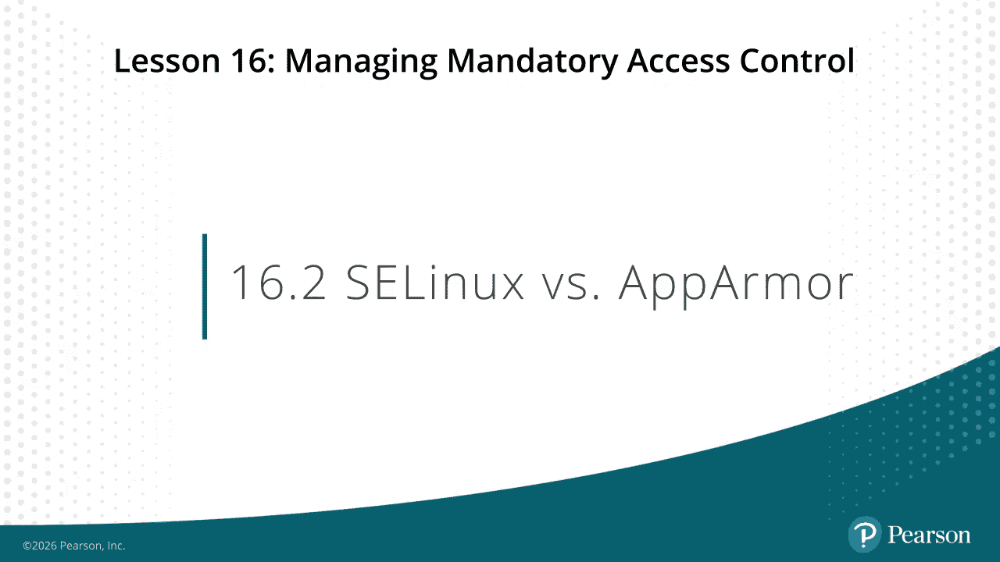
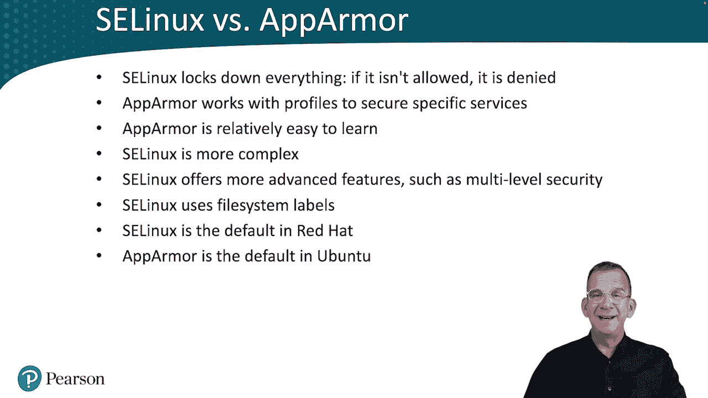

CompTIA Linux+ V8：393.162：SELinux 与 AppArmor 的区别与联系 🛡️

在本节课中我们将要学习 Linux 系统中两个重要的安全模块：SELinux 和 AppArmor。我们会先分别介绍它们的设计思想，再对比它们的复杂度和功能，最后看看不同的 Linux 发行版分别默认使用哪一个，以及现在的行业选择是什么。通过这节课，你将明白这两个工具的基本区别，以及在实际工作中该如何理解它们。


首先，我们来看看 SELinux 是怎么设计的。



SELinux 的开发目标非常明确，就是要锁定系统中的所有内容。它采用的是默认拒绝策略，也就是说，任何没有被明确允许的操作，系统都会直接拒绝。这种设计理念可以简单理解为，系统一开始处于完全封闭的状态，只有管理员显式打开的权限才会生效，其余全部禁止。

以下是 SELinux 的核心设计原则：

- 一切默认禁止，未明确允许的一律拒绝。
- 安全策略由系统管理员集中制定和管理。
- 适合需要高安全等级的环境。

SELinux 的核心机制可以用下面这个简单的逻辑来表示：

```
如果 操作未被允许 则 系统拒绝执行
```

或者用更技术化的说法，SELinux 的精髓在于文件系统标签，每个文件和进程都带有安全标签，系统根据这些标签来决定是否允许访问。

上一节我们介绍了 SELinux，本节中我们来看看 AppArmor 是如何工作的。

AppArmor 与 SELinux 有明显不同，它不是试图锁定整个系统，而是专门用来保护具体的服务。换句话说，AppArmor 采取的是针对性防护，而不是全局封锁。管理员可以为某个特定服务编写配置文件，规定该服务可以访问哪些文件、可以执行哪些操作，超出范围的行为会被阻止。

以下是 AppArmor 的主要特点：

- 专门保护特定服务，而不是整体锁定系统。
- 配置相对简单，上手门槛较低。
- 适合希望快速给关键服务加固的场景。

AppArmor 的开发初衷，就是作为 SELinux 的一种替代方案。因为 SELinux 虽然强大，但学习和配置都比较复杂，所以 AppArmor 试图提供一个更容易上手的选择。

刚才分别介绍了 SELinux 和 AppArmor，本节我们来对比一下它们的复杂度和功能。

SELinux 在设计上更为复杂，但也提供了更多高级功能。例如，它支持多级安全机制，可以按照不同的安全等级对数据和访问进行细致控制。而 AppArmor 虽然更容易学习，但在功能深度上不如 SELinux 那么丰富。

两者之间的对比关系可以简化为下面这个表达式：

```
SELinux 复杂度 > AppArmor 复杂度
SELinux 高级功能 > AppArmor 高级功能
AppArmor 学习难度 < SELinux 学习难度
```

了解了基本区别后，我们来看看不同的 Linux 发行版分别默认使用哪一个。

在主流 Linux 发行版中，SELinux 是 Red Hat 及其相关发行版的默认安全模块。也就是说，如果你安装的是 Red Hat Enterprise Linux 或其衍生版本，系统出厂时通常就开启了 SELinux。而 AppArmor 则是 Ubuntu 的默认选择，Ubuntu 用户安装系统后，AppArmor 会自动在后台运行。

以下是常见发行版的默认安全模块：

- Red Hat 及相关发行版：SELinux
- Ubuntu：AppArmor

多年来关于二选一的讨论已经有了结论，本节我们来看看当前的行业现状。

目前，SELinux 已经被 Red Hat 广泛实施，并且在世界各地的许多政府组织中成为强制要求。这意味着，如果你在政府或大型企业的 Linux 环境中工作，很可能会被要求使用 SELinux，而不是 AppArmor。之前关于"该用 SELinux 还是 AppArmor"的争论，在今天基本上已经由 SELinux 获胜。

以下是当前的行业应用情况：



- Red Hat 实施 SELinux 作为标准安全模块。
- 许多政府组织将 SELinux 列为合规性要求。
- SELinux 已成为企业级和政府级 Linux 部署的主流选择。

本节课中我们一起学习了 SELinux 和 AppArmor 的区别与联系。我们了解到 SELinux 主打全局锁定和默认拒绝，适合高安全等级环境；AppArmor 主打特定服务防护，更容易上手。我们还知道 Red Hat 及相关发行版默认使用 SELinux，Ubuntu 默认使用 AppArmor，而现在的行业趋势是 SELinux 被更多政府组织和大型机构采纳。希望这节课能帮你建立起对 Linux 安全模块的基本认识。
