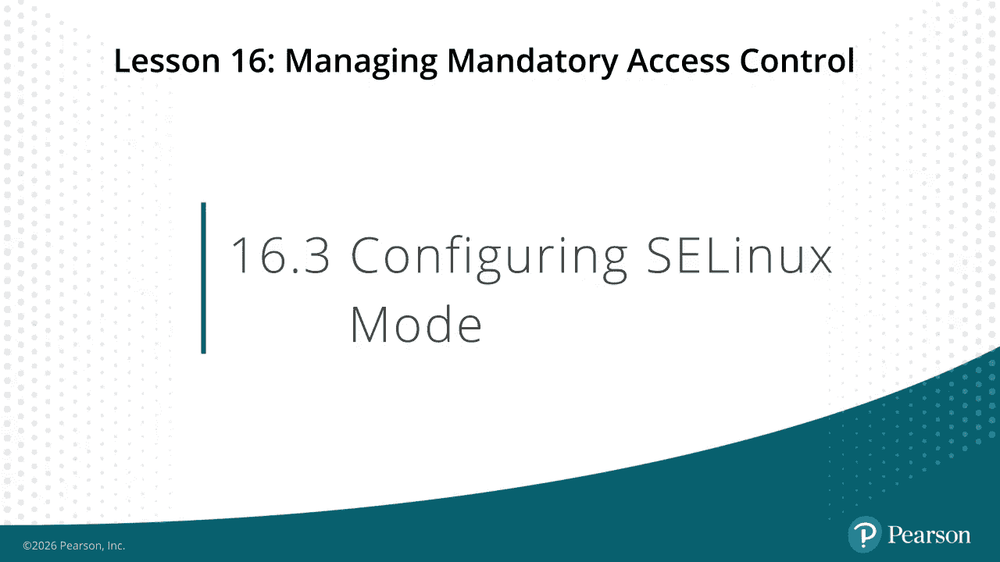
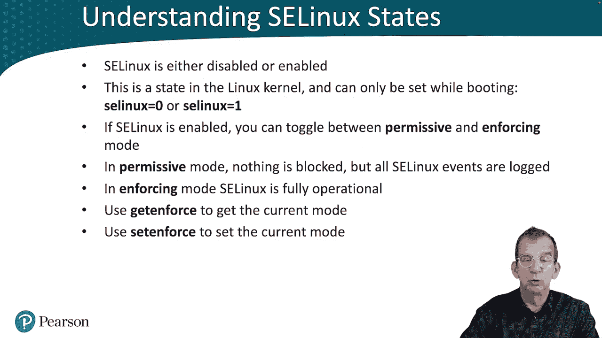
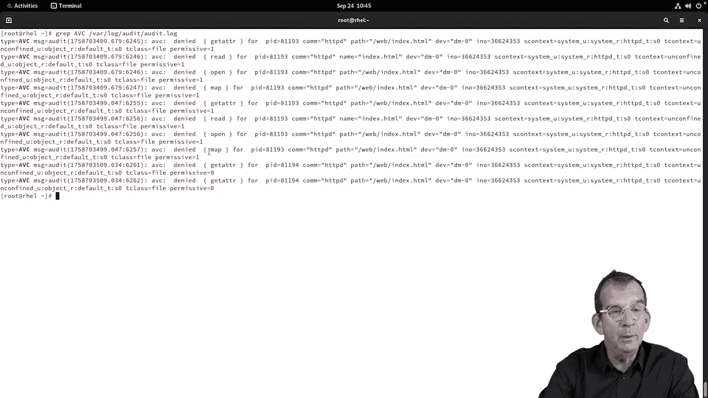
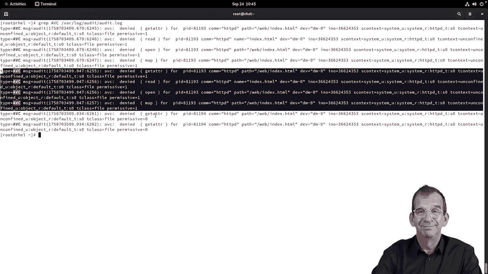

🐧 CompTIA Linux+ V8：163：配置 SELinux 模式

在本节课中，我们将一起学习 SELinux 模式的配置方法。SELinux 是 Linux 系统中一个重要的安全机制，它可以控制进程和文件之间的访问权限。很多初学者在刚接触 SELinux 时，容易被它的各种模式搞混，比如什么是禁用状态，什么是宽容模式，什么是强制模式。本节课我们会用大白话把这些概念讲清楚，并且通过真实的命令演示，让你知道怎么在系统上查看和修改 SELinux 的当前模式。之后我们还会搭建一个简单的 Web 服务器场景，看看 SELinux 在不同模式下的表现，最后介绍怎么通过日志来排查问题。准备好的话，我们现在就开始。

### SELinux 的启用与禁用状态

上一节我们简单了解了 SELinux 是什么，本节中我们先来看看 SELinux 的基本运行状态。SELinux 在内核层面有两种主要状态，要么是禁用，要么是启用。这个状态是在系统启动时确定的，不能在系统运行后随意切换。如果你想改变 SELinux 的启用或禁用状态，需要修改引导加载程序的启动参数，并在重启系统后生效。具体的参数设置如下：

SELinux = 0：表示禁用 SELinux  
SELinux = 1：表示启用 SELinux  

一旦系统进入启用状态，SELinux 才会开始工作，进而区分宽容模式和强制模式。如果你不确定自己的系统当前处于什么状态，可以在系统启动完成后，通过相关命令来查询。

### 宽容模式与强制模式

当 SELinux 处于启用状态之后，我们可以在两种工作模式之间切换，分别是宽容模式和强制模式。以下是两种模式的核心区别：

- 宽容模式（permissive）：不会阻止任何操作，但会把所有 SELinux 相关事件记录到日志中。这个模式非常适合故障排除，因为你可以清楚地看到系统中发生了什么，而不会因为安全策略而被阻断。
- 强制模式（enforcing）：SELinux 完全启用，会根据安全策略阻止不被允许的操作，并且只会记录第一个被阻止的动作。

你可以使用下面的命令来查看和设置当前模式：

getenforce：用于获取当前 SELinux 模式  
setenforce：用于设置当前 SELinux 模式，例如 setenforce 0 切换到宽容模式，setenforce 1 切换到强制模式  

注意，setenforce 修改的模式只在当前系统运行期间有效，重启后会恢复到配置文件中设置的默认状态。

### 查看当前 SELinux 模式

让我来演示一下如何查看当前模式。好了，我们来看看当前系统的实际状态。在终端中执行 getenforce 命令，你会看到输出结果显示为 enforcing，这意味着 SELinux 当前处于强制模式。如果你执行 setenforce 0 命令，然后再次运行 getenforce，输出就会变成 permissive，说明已经成功切换到宽容模式。

### 配置 Web 服务器文档根目录

你可能会问，切换 SELinux 模式有什么实际意义呢？这很重要，因为当你配置 Web 服务器时，SELinux 可能会阻止某些访问。假设我们要修改 Apache Web 服务器的文档根目录。以下是具体操作步骤：

打开 Apache 配置文件，路径通常是 /etc/httpd/httpd.conf  
找到文档根目录设置，默认值通常是 /var/www/html  
把文档根目录修改为 /web 目录  
创建 /web 目录，并使用 Vim 编辑器在其中创建 index.html 文件，写入 Hello World 之类的测试内容  
执行 systemctl restart httpd 命令重启 Web 服务  
使用 curl 命令访问本地主机，如果一切正常，页面会显示 hello world  

### 不同模式下的访问测试

当 SELinux 处于宽容模式时，你可以正常访问 Web 页面，并且即使有权限问题，也不会被直接阻断。但是，如果你切换回强制模式，再次使用 curl 访问本地主机，你可能会看到大量错误消息。这就是宽容模式允许你先完成配置和测试的方式，而不会被安全策略打断。这时查看日志就变得非常有用，你可以查看 /var/log/audit/audit.log 文件，找出 SELinux 记录的拦截事件，从而了解问题出在哪里。

### 日志分析与故障排除

在宽容模式下，我们可以看到完整的事件流，这对排查问题非常有帮助。因为所有的操作都会被记录，即使有些操作最终被允许，日志里也会保留相关信息。而在强制模式下，你通常只能看到第一个被立即阻止的操作，因为这就是 SELinux 在强制模式下应该做的事情：及时拦截不符合安全策略的行为，防止潜在的安全风险。因此，在生产环境中建议保持强制模式，而在调试或配置新服务时，可以暂时切换到宽容模式，通过日志分析找到问题，再切回强制模式。

### 本节总结

本节课中，我们一起学习了 SELinux 的基本状态、宽容模式和强制模式的区别，掌握了使用 getenforce 和 setenforce 查看与切换模式的方法。我们还通过配置 Web 服务器文档根目录的实战演示，了解了 SELinux 在不同模式下对访问控制的影响，并学会了通过 /var/log/audit/audit.log 日志来排查 SELinux 拦截问题。希望这节课能帮助你更好地理解和使用 SELinux，在保障系统安全的同时，也能高效地进行故障排查。
