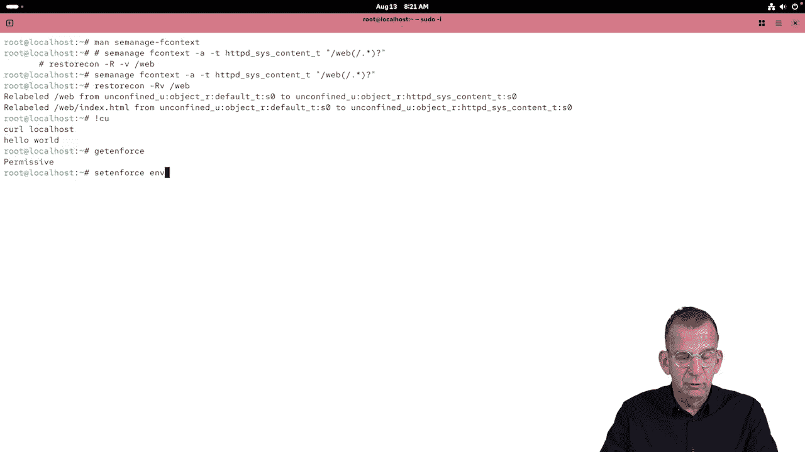
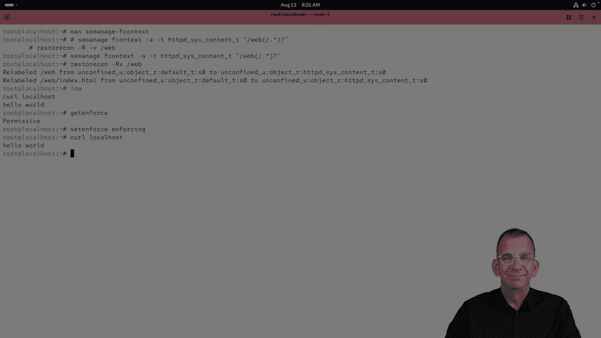

CompTIA Linux+ V8：第395节：使用SELinux标签 🛡️

在本节课中，我们将一起学习SELinux标签的核心知识。你将了解什么是安全上下文标签，这些标签由哪几个部分组成，以及最关键的类型字段是如何决定访问权限的。接着我们会演示如何使用命令行工具来管理和设置标签，并通过一个真实的Web服务器文档根目录故障排查案例，掌握在强制模式下让服务正常运行的完整步骤。

在开始具体操作之前，我们先来了解SELinux标签的基本定义和作用。

SE Linux标签是SELinux安全机制的核心。系统中的所有项目都会使用上下文标签进行标记。这些标签会被应用到文件、目录、网络端口，甚至用户身上。很多命令提供了-oZ选项，允许你打印出标签信息，从而方便查看当前对象的安全状态。

核心概念可以用下面的公式来描述：

上下文标签 = 用户部分 + 角色部分 + 类型部分 + 安全级别部分

刚才我们介绍了标签的基本作用，本节中我们来看看一个标签具体由哪些部分组成，以及哪一部分是最重要的。

一个完整的上下文标签通常包含四个部分。第一部分是用户部分，第二部分是角色部分，这两部分只在非常特殊的场景下才会用到。第三部分是类型部分，也就是httpd_sys_content_t这类字段，这是唯一真正重要的部分。第四部分是安全级别部分，涉及多类别和多层安全，在Linux+考试范围内不会详细讨论。

代码示例如下：

system_u:object_r:httpd_sys_content_t:s0

类型字段httpd_sys_content_t用来标识目录的访问权限，使得携带httpd_t上下文的进程可以读取该目录下的内容。

理解了类型字段的作用后，我们继续看一个具体的例子，看看CGI脚本目录是如何使用特殊标签的。

在CGI bin目录中，你可以看到上下文类型是httpd_sys_script_t。之所以这样设置，是因为CGI bin目录里存放的是脚本文件，这些文件需要执行权限。为了允许脚本正常执行，系统会使用特定的上下文标签httpd_sys_script_t。

知道了标签的作用和类型之后，我们需要学习如何在系统中实际管理这些标签。

如果你想管理文件的上下文标签，应该使用semanage fcontext命令。使用这个命令为文件设置标签后，会将上下文写入安全策略中。不过仅仅写入策略还不够，还需要将策略中的标签应用到实际文件上，这时要使用restorecon命令。策略代表的是我们期望的默认状态，而restorecon负责把这个状态落实到文件的inode上。

以下是两个常用命令及其作用：

- semanage fcontext：将上下文标签写入安全策略
- restorecon：将策略中的标签应用到文件和目录

如果SELinux系统之前处于禁用状态，现在重新启用，系统会自动触发自动标签操作，这就是我们在之前演示中看到的情况。

除了文件和目录，网络端口也可以设置上下文标签，接下来我们看看如何操作，以及在什么情况下需要手动查找标签。

你可以使用semanage port命令为端口设置上下文。在使用默认设置时，上下文标签通常不需要更改。以Apache为例，如果你把index.html放在默认的文档根目录下，就不需要做任何额外操作。如果使用了非默认设置，就需要找到合适的标签。

以下是查找标签的通用方法：

- 查看默认设置，使用ls -Z命令查看目录中的默认上下文标签
- 安装SELinux策略文档包，查看man selinux手册页，获取大量相关信息
- 查看SELinux生成的警报消息，这在后续故障排除章节中会详细演示

理论介绍结束后，我们进入实操环节，看看如何为Web服务器的文档根目录设置正确的上下文标签。

在实验中，Web服务器的文档根目录无法正常工作。使用aus命令查看/var/log/audit/audit.log日志，只取最后一行，因为错误消息始终相同。日志告诉我们源上下文是httpd_t，目标上下文是default_t。SELinux不允许httpd_t访问default_t，因为SELinux的目标是防止未授权访问，只允许受控访问。default_t属于未控制的默认类型，代表任何内容。

我们看到/web目录当前拥有default_t标签，而它作为文档根目录，应该设置为httpd_sys_content_t。

执行以下命令来设置标签：

semanage fcontext -a -t httpd_sys_content_t "/web(/.*)?"
restorecon -Rv /web

这里的正则表达式表示要将标签应用到/web目录下的所有内容。第二部分的restorecon命令会把新上下文从策略应用到目录。

执行完成后，再次使用ls -Z命令检查。即使当前处于强制模式，服务也能正常工作。

如果此时系统仍处于宽容模式，需要切换到强制模式。使用setenforce 1命令即可完成切换，之后服务仍然可以正常访问。

实验演示到此结束，我们来回顾一下本节课的主要内容。

本节课中我们一起学习了SELinux标签的基本概念，了解了上下文标签的四个组成部分，重点掌握了类型字段对访问权限的决定作用。我们还学习了如何使用semanage fcontext和restorecon命令来管理和应用标签，并通过修复Web服务器文档根目录的实例，掌握了在强制模式下排查和解决SELinux访问问题的完整流程。

