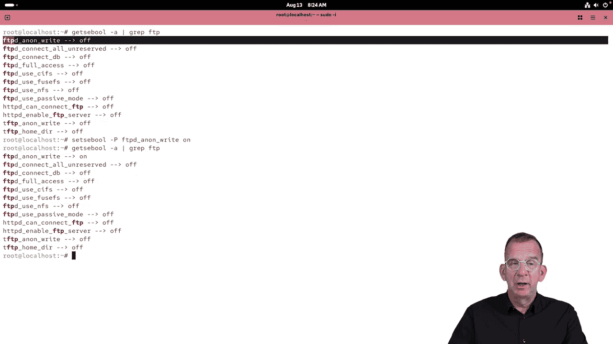

# CompTIA Linux+ V8：第4章：管理SELinux布尔值 🛡️

在本节课中，我们将一起学习SELinux布尔值的相关知识。你将了解什么是布尔值，它与上下文标签有什么区别，以及如何在系统中查看和修改布尔值。我们还会通过一个FTP匿名访问的实际案例，演示如何开启特定服务的权限。学完本节内容后，你将能够独立处理与SELinux布尔值相关的常见安全配置问题。

除了上下文标签之外，SELinux中还有一个你需要知道的重要设置，那就是布尔值。你可以把布尔值理解为一个只有开启和关闭两种状态的开关。这个开关的作用，是让你能够快速地针对某些特定场景，应用相应的安全策略。虽然这听起来可能比较简单，但一旦你掌握了它的使用方法，日常的系统管理工作就会变得更加轻松，不需要为每一种情况都去编写复杂的规则。

系统中布尔值的数量是有限的，这是因为它们专门用来解决一些常见的安全场景。开发人员已经预先定义好了这些开关，每个开关都对应管理员在实际工作中经常会遇到的安全需求。你不需要从零开始创建新的安全规则，只需要从这些现成的开关中挑选适合的一个，就能快速完成配置。这样的设计目的，就是为了降低SELinux的使用门槛，让普通用户也能在不深入底层原理的情况下，处理大部分常见的安全策略问题。

布尔值和上下文标签是并行工作的，两者互不替代，而是互相补充。有时候你的文件上下文标签配置完全正确，但服务依然无法正常运行，这时往往就是因为对应的布尔值被关闭了。你可以把上下文标签看作是门上的锁，而布尔值则是门旁边的总闸开关。只有当锁和开关都处于正确状态时，服务才能真正访问它需要的资源。因此，在排查SELinux相关问题时，你不能只检查标签，也必须同步检查布尔值的当前状态。

以下是管理SELinux布尔值时最常用的两个命令，它们分别用于查看所有开关状态和做持久化修改：

* `getsebool -a`：列出系统中所有布尔值及其当前开关状态。
* `setsebool -P <布尔值名称> on|off`：修改指定布尔值的状态，其中 `-P` 参数表示将更改永久生效，重启后不会失效。

现在我们来看一个实际操作示例，帮助你更直观地理解布尔值的作用。我们先使用查看命令，把系统中所有的布尔值都列出来，然后挑选一个与FTP服务相关的开关进行演示。

以下是演示步骤的详细说明：

1. 执行 `getsebool -a` 命令，在输出结果中找到与FTP相关的布尔值。
2. 你会看到名为 `ftpd_anon` 的布尔值，它当前的状态是关闭。
3. 这个开关控制的是FTP服务的匿名访问权限。当它处于关闭状态时，无论你在FTP服务器配置文件里如何设置，都无法允许匿名用户登录。
4. 要开启这个权限，使用 `setsebool -P ftpd_anon on` 命令。
5. 切记必须加上 `-P` 参数，否则更改只在当前会话有效，重启后就会恢复原状。
6. 开启布尔值之后，你还需要分别在FTP服务器的配置文件中开启匿名访问选项。布尔值只是从SELinux层面打开了大门，具体的服务行为仍然由FTP服务器本身决定。

从SELinux的角度来看，一旦 `ftpd_anon` 被设置为开启状态，系统就会允许FTP匿名访问的请求通过安全检查。不过这并不代表工作已经全部完成，你仍然需要确认FTP服务软件本身已经正确配置了匿名权限。两者缺一不可，只有SELinux开关和服务配置都正确，匿名FTP才能真正正常工作。

在本节课中，我们一起学习了SELinux布尔值的基本概念，了解了它与上下文标签的区别和联系，掌握了 `getsebool -a` 和 `setsebool -P` 这两个核心命令的用法，并通过FTP匿名访问的案例，演示了如何在实际中开启和持久化修改布尔值。希望这些内容能帮助你更好地管理系统安全，解决日常工作中遇到的SELinux访问控制问题。

