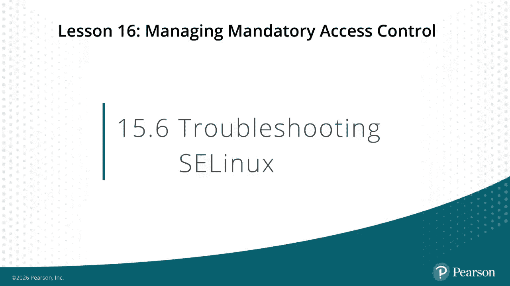
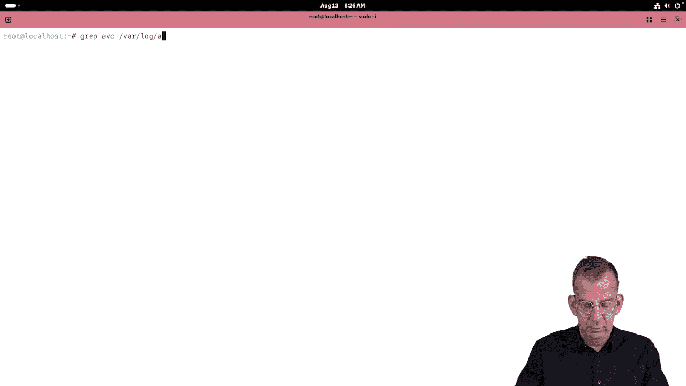
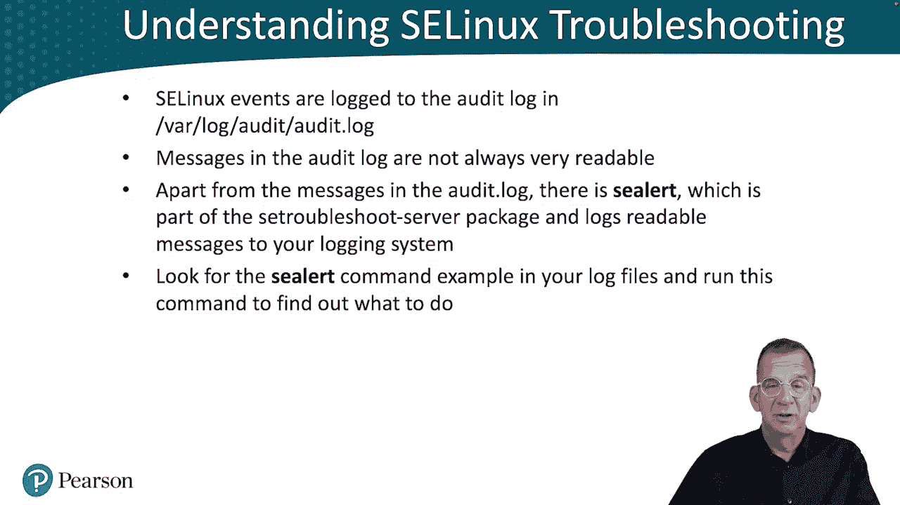
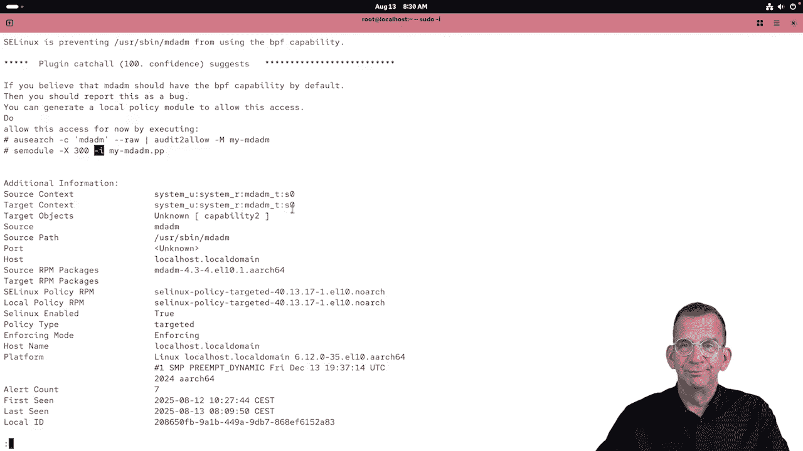

# CompTIA Linux+：397：SELinux 故障排除 🛠️

在本节课中，我们将要学习当 Linux 系统因为 SELinux 而无法正常工作时，该如何进行故障排查。我们会先从查看审计日志中的 AVC 事件开始，再分析几个实际案例，接着学习如何使用 sealert 工具来辅助判断问题，最后了解当自动建议不够用时，该如何处理。内容会尽量用大白话讲解，即使你是初学者也能看懂。


## 1. 为什么要学习 SELinux 故障排查 🐧

有时候 Linux 系统会出现故障，导致某些服务无法正常运行。这时你需要知道如何排查问题，而不是盲目尝试各种方法。故障排查的第一步，就是确认问题到底出在哪里，特别是当你怀疑是 SELinux 阻止了某个操作时，必须有条不紊地检查日志和上下文，才能找到真正的原因。


## 2. 查看审计日志中的 SELinux 事件 📄



当你怀疑是 SELinux 作怪时，首先要做的就是查看审计日志。SELinux 的所有事件都会用 AVC 标记写入日志，所以你可以用下面的命令来查看：

```bash
grep AVC /var/log/audit/audit.log
```

旧版本的日志里，消息不一定非常容易读懂，但你需要知道自己在检查什么。只要找到带有 AVC 的记录，就能大致知道哪个进程被拦截了，以及被拦截的原因是什么。


有了日志之后，我们来看两个真实的例子，感受一下这些消息到底在说什么。


## 3. 分析审计日志中的实际案例 🔎

下面是几个典型的审计日志条目，帮助你理解 AVC 消息的含义。

第一个例子涉及 BPF 系统调用。日志显示，进程 MDAM 使用的源上下文是 MDAM_t，目标上下文也是 MDAM_t。按照常理，源和目标上下文相同通常应该允许操作，但这里偏偏提示 MDAM 不被允许发出 BPF 系统调用，这就很奇怪了。我们可以用下面的公式来表示这种异常情况：

$$
\text{源上下文} == \text{目标上下文} \nRightarrow \text{操作被允许}
$$

第二个例子是 Apache 网页服务器。日志里出现了 "AVC denied read"，说明 HTTPD 进程尝试读取某个文件。具体来看，PID 是 1253，命令是 HTTPD，它访问的是 index.html。源上下文是 httpd_t，目标上下文是 default_t。看到这样的信息，你应该知道下一步该怎么处理。


审计日志的消息其实挺直白的，因此它应该始终是你进行 SELinux 故障排查的起点。


## 4. 使用 sealert 工具辅助排查 🛠️

除了直接阅读审计日志，你还可以使用 sealert 工具。sealert 是 setroubleshoot-server 包的一部分，它会把人类可读的消息记录到你的日志系统中。你可以在日志文件里查找 sealert，然后根据它给出的建议命令来决定下一步怎么做。有些情况下它提供的信息非常有用，有些情况下则完全没用。

使用下面的命令来查找 sealert 相关的日志：



```bash
journalctl | grep sealert
```

运行之后，你会看到 sealert 生成了几条消息。你需要学习如何解读这些命令。我们先拿网页索引文件 index.html 的案例来看，然后出于好奇，也看看 MDADM 的情况。输出内容比较多，建议通过 less 分页查看。

sealert 可能会给出几种建议。比如它可能提到一个名为 "catch_all Boolean" 的选项，置信度大约 57.6%，并声称这是解决方案，但实际上往往并不是。另一种建议可能是使用下面的命令来设置文件类型：

```bash
semanage fcontext -a -t file_type
```

不过紧接着它会给你一个很长的文件类型列表让你选择，这也不太实用。尽管如此，sealert 有时候确实会给出一个有意义的命令，你可以试一下，但我的建议是：始终要结合你自己对问题的理解来判断 sealert 的建议。


作为补充，我们再看看 MDADM 这个例子。


## 5. 处理 MDADM 的特殊情况 🐞

MDADM 显然在某些系统配置中没有被正确设置。sealert 告诉我们，这应该被当作一个 bug 来报告，我同意这个看法。但 sealert 也给出了一个修复方案，这个方案会超出我们当前讨论的范围。

这个修复方案的做法是，生成一个 SELinux 策略模块，在其中允许之前对 MDADM 拒绝的所有操作。策略模块生成之后，使用下面的命令将其插入内核：

```bash
semodule -i 策略模块文件
```

插入新策略模块后，相关的拒绝消息就会消失。


## 6. 本节课的核心要点 📌

下面是本节课的核心要点：

- 优先根据自己的理解，查看 `/var/log/audit/audit.log` 中的 AVC 记录。
- 将 sealert 作为辅助手段，尝试缩小问题范围。
- sealert 有时很有用，有时完全没用，不能完全依赖它。
- 当你确定需要时，可以用 `semodule -i` 插入自定义 SELinux 策略模块。




本节课中，我们一起学习了如何排查 SELinux 导致的问题。我们先从查看审计日志中的 AVC 事件开始，再分析了 BPF 和 Apache 的实际案例，接着学习了使用 sealert 工具及其局限性，最后了解了如何通过策略模块来处理 MDADM 这类特殊情况。希望这些内容能帮助你在遇到 SELinux 相关故障时，更有条理地进行排查和解决。

