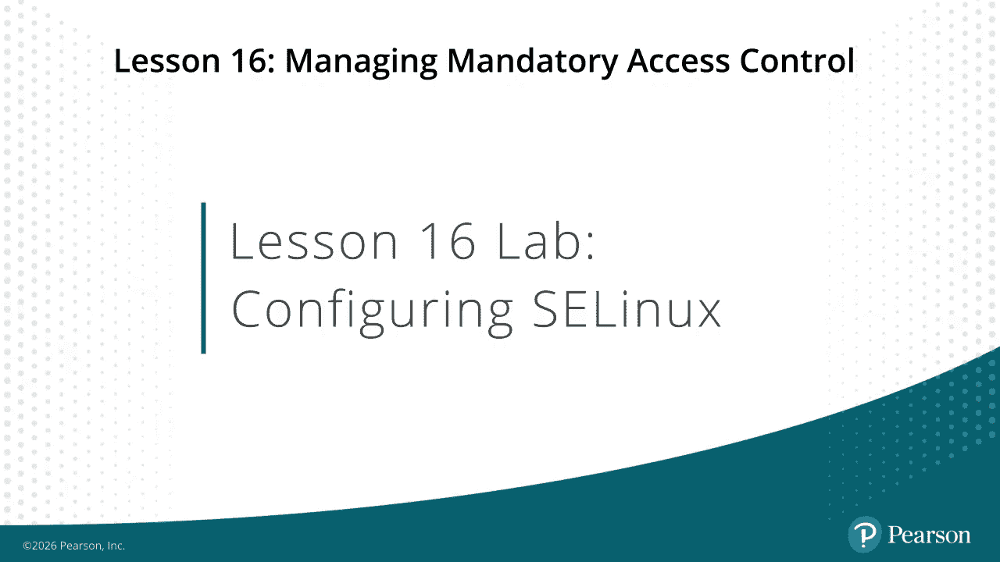
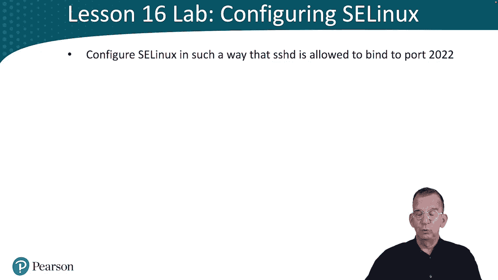

# CompTIA Linux+ V8：第16课：配置 SELinux 实验 🔒

在本节课中，我们将一起学习如何在 Linux 系统上配置 SELinux。这节课位于整个章节的结束部分，所以我们将通过一个实验来巩固所学知识。实验的具体任务是配置 SELinux，让 SSHD 服务被允许绑定到端口 2022。这对于理解系统安全和端口访问控制非常重要，也是日常运维中常见的需求。

## 实验目标

以下是本节实验需要完成的具体目标：
- 认识 SELinux 对服务端口访问的限制作用
- 学习如何修改 SELinux 策略，开放特定端口
- 确保 SSHD 能够正常监听端口 2022


SELinux 的访问控制核心可以用公式描述：
```
SELinux 决策 = 主体身份 + 客体类型 + 动作许可
```

## 实验步骤



上一节我们介绍了 SELinux 的基础原理，本节中我们来看看如何进行实际配置。

以下是详细的操作步骤：
1. 检查当前 SELinux 运行模式，确认系统处于强制模式
2. 查看 SSHD 当前允许绑定的端口范围
3. 将端口 2022 添加到 SSHD 允许绑定的端口列表中
4. 重启 SSHD 服务，使配置生效
5. 使用测试命令确认 SSHD 已成功绑定到端口 2022

## 核心命令

在实际操作中，我们会用到以下关键命令：

```
getenforce
semanage port -a -t ssh_port_t -p tcp 2022
systemctl restart sshd
ss -tlnp | grep 2022
```

这些命令的作用分别是查看 SELinux 当前状态、向策略中添加端口 2022、重启 SSH 服务以及检查端口是否被监听。通过这一系列操作，我们可以让 SSHD 在 SELinux 强制模式下也能使用非默认端口。

## 配置原理

SELinux 默认采用强制访问控制，意味着即使是根用户，如果没有策略允许，服务也无法绑定到某个端口。SSHD 默认只被允许使用标准 SSH 端口，所以要改用 2022，必须手动更新 SELinux 端口类型数据库。

配置逻辑可以简化为：
```
如果 SELinux 模式 = Enforcing 且 端口不在允许列表中，则 拒绝绑定
```



## 课程总结

本节课中我们一起学习了如何配置 SELinux，使 SSHD 获得绑定端口 2022 的权限。我们掌握了查看 SELinux 状态、修改端口策略以及验证服务监听的方法。希望这个实验能帮助你更好地理解 Linux 系统中的安全策略管理。

