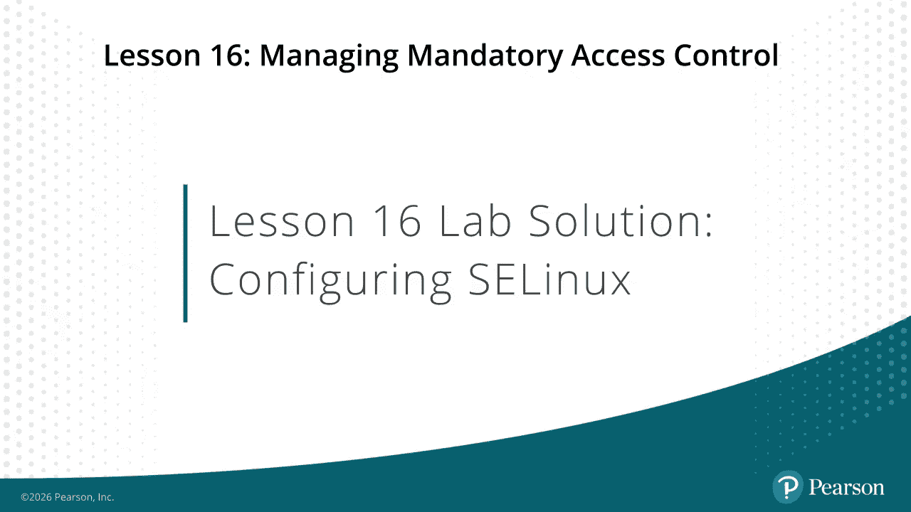
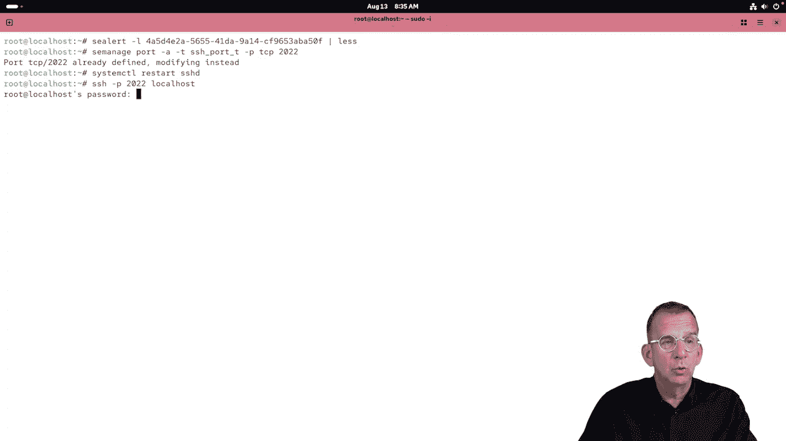

CompTIA Linux+ V8：第16章：配置SELinux实验解决方案 🐧


在本节课中，我们将学习当SSH服务因为SELinux策略限制而无法绑定非默认端口时该如何排查与修复。我们会从编辑SSH配置文件开始，重启服务并观察报错，接着查看系统日志和审计日志来理解SELinux到底拒绝了什么，最后使用semanage命令开放端口，验证服务能够正常启动。整个过程适合初学者，我们会用大白话把每一步背后的原理讲清楚。



### 第一步：编辑SSH配置文件 📝

在正式开始排障之前，我们先来看看需要修改的文件。SSH服务的配置文件位于/etc/ssh/sshd_config，里面定义了服务监听的端口号，默认情况下通常是22。我们想把它改成2022，只是为了演示如何处理非标准端口的SELinux权限问题。

以下是打开配置文件的命令：

```bash
vim /etc/ssh/sshd_config
```

在vim里向下查找，找到以Port开头的那一行。如果你仔细看这行上面两行，其实已经有提示告诉你接下来该怎么做，那就是使用semanage port来处理SELinux端口策略。不过为了让你看到如果不处理SELinux会发生什么，我们先不急着改策略，直接尝试重启服务。

### 第二步：重启服务并查看报错 🔍

修改完配置文件之后，下一步自然是让新配置生效。我们执行systemctl restart sshd来重启SSH守护进程，这时候系统会报错并提示操作失败。如果你只用systemctl status sshd查看状态，可能发现信息不够详细，不足以定位问题。这时候更有效的方法是使用journalctl -u sshd来查看该服务的系统日志。

以下是相关命令：

```bash
systemctl restart sshd
systemctl status sshd
journalctl -u sshd
```

在日志输出中，你会看到非常明确的错误信息：bind to port 2022: Permission denied。简单来说，系统告诉你SSH进程没有权限绑定到2022号端口，这就是我们需要解决的核心问题。

### 第三步：理解SELinux拒绝的原因 🛡️

既然知道端口被拒绝了，我们就需要搞清楚是谁拒绝的，以及为什么拒绝。SELinux的审计日志记录了所有被策略阻止的操作，我们可以查看/var/log/audit/audit.log来找到详细线索。在日志里，你会看到类似下面这样的拒绝记录：

```text
avc: denied { name_bind } for comm=sshd scontext=sshd_t tcontext=unreserved_port_t
```

这句话的大白话意思是：SELinux拒绝了sshd进程执行name_bind操作，源安全上下文是sshd_t，目标安全上下文是unreserved_port_t。换句话说，当前的SELinux策略里没有一条规则允许sshd_t这个上下文去绑定到unreserved_port_t这个未知端口类型。这就是报错的根本原因。

在日常排障中，你可能会先用setenforce 0把SELinux临时设为宽容模式（permissive mode），这样问题通常就会消失，服务也能启动。但在这个实验里，我跳过那一步，因为我们要直接搞懂底层原理，而不是简单地关掉SELinux。

```bash
setenforce 0
```

### 第四步：查看sealert建议与审计日志 🔎

接下来，我们直接查看系统留下的详细线索，而不是猜测。可以使用journalctl管道到grep来过滤setroubleshoot相关的消息，这是SELinux故障排查工具。sealert会把SELinux事件数据库中的ID和具体建议告诉我们，方便我们查阅并采取行动。

以下是查看命令：

```bash
journalctl | grep setroubleshoot
```

在sealert消息里，你会看到一条明确的建议命令，它告诉你应该怎么修改SELinux端口策略。我们可以把这条消息复制下来，通过less命令逐行查看，确保理解每一个参数的含义。消息里提到的命令大致是：

```text
semanage port -a -t ssh_port_t -p tcp 2022
```

这里有三个选项供参考，我们需要自己决定选哪个端口类型。幸运的是，我们刚才已经分析过源上下文和目标上下文了，所以选ssh_port_t是合理的，这样应该就能解决问题。

### 第五步：使用semanage开放端口 ⚙️

有了明确的错误原因和建议命令之后，我们就可以正式修复问题了。semanage port命令用来管理SELinux策略中的端口类型映射。我们需要告诉SELinux，2022号端口上的TCP流量应该被当作SSH端口类型来处理。

以下是执行命令：

```bash
semanage port -a -t ssh_port_t -p tcp 2022
```

参数解释：-a表示添加新记录，-t后面指定类型为ssh_port_t，-p后面指定协议为TCP，最后的2022就是要开放的端口号。执行完这一步，SELinux策略里就多了一条允许sshd绑定到2022端口的规则。

### 第六步：验证服务启动与连接 ✅

配置完成后，必须验证服务是否真的能启动。再次执行systemctl restart sshd，这一次应该不再报错，服务可以正常运行。不过有一点很重要，从现在起，如果你想通过SSH连接到本地主机，就不能再使用默认端口了，必须显式指定2022端口。

以下是验证命令：

```bash
systemctl restart sshd
ssh -p 2022 localhost
```

如果连接成功，就说明SELinux端口策略已经正确配置，SSH服务也能在非默认端口上正常工作了。



本节课中我们一起学习了如何在SELinux阻止SSH绑定非默认端口时进行排查和修复。我们介绍了编辑SSH配置文件、重启服务并观察报错、查看systemd日志和审计日志、理解SELinux拒绝记录中的源上下文与目标上下文，以及使用semanage port命令开放端口。最后我们验证了服务正常启动，并提醒在后续连接时需要带上-p 2022参数。希望这篇教程能帮助你更好地理解SELinux的工作方式。
