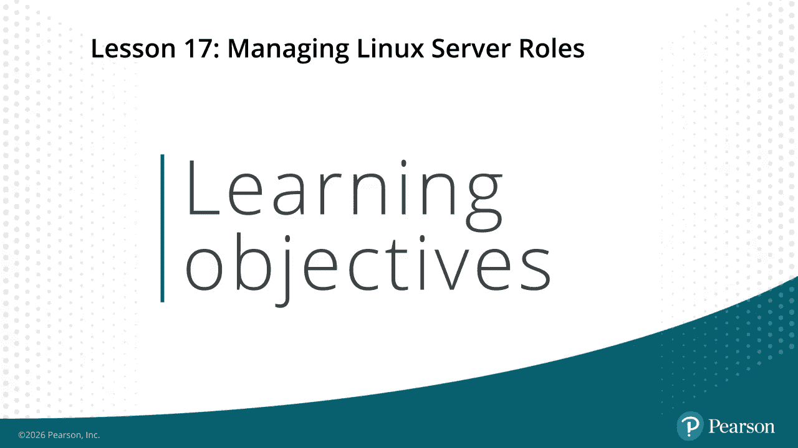
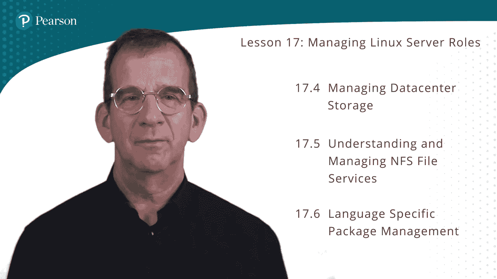

# 🖥️ 管理 Linux 服务器: 5.1: 学习目标

在本节课中我们将要学习 Linux 服务器的时间服务、证书和自签名证书的创建方法、数据中心存储与 NFS，以及与编程语言相关的包管理。课程最后还会安排一个实验，让你亲自配置一台 NFS 服务器。

内容比较多，但我会用大白话把每个知识点讲清楚，适合零基础的初学者跟着学习。


上一节我们简单介绍了课程的大致背景，本节中我们来看看时间服务。



时间服务是保证 Linux 服务器正常运行的基础，如果系统时间不准，日志记录和定时任务都可能出错。我们可以使用下面的命令查看当前时间状态：

```bash
timedatectl
```

为了让多台服务器的时间保持一致，通常需要使用 chrony 或 ntpd 等工具从网络时间服务器同步标准时间，这样不同机器上的记录才能正确对应。


上一节我们介绍了时间服务，本节中我们来看看证书和自签名证书。

证书的作用是证明服务器身份，让客户端确认连接的是可信主机。自签名证书是指由服务器自己生成，不需要向第三方机构购买，非常适合测试环境或内网使用。我们可以使用 openssl 工具生成一个自签名证书，命令如下：

```bash
openssl req -x509 -newkey rsa:4096 -keyout key.pem -out cert.pem -days 365 -nodes
```

生成证书之后，服务器就可以使用它来开启加密连接，虽然浏览器可能会提示不安全，但在内部测试中完全够用。


上一节我们介绍了证书，本节中我们来看看数据中心存储和 NFS。

数据中心存储的目的是让多台服务器之间共享文件，NFS 是其中一种常用的网络文件系统协议。通过 NFS，远程目录可以像本地目录一样被挂载和使用。在服务器上，共享目录的配置通常写在下面这个文件中：

```
/etc/exports
```

修改这个文件后，我们就能控制哪些客户端可以访问哪些目录，以及访问权限是只读还是可读写。


上一节我们介绍了 NFS 存储，本节中我们来看看与编程语言相关的包管理。

不同的编程语言有各自的包管理工具，用来安装和管理代码库，比如 Python 使用 pip，Node.js 使用 npm。以下是常见的语言包管理命令示例：



- Python: `pip install 包名`
- Node.js: `npm install 包名`

学会这些命令后，你就可以在服务器上快速搭建所需要的运行环境。


上一节我们介绍了语言包管理，本节中我们来看看本课的实验内容。

实验环节我们会动手操作，尝试在 Linux 服务器上配置一台 NFS 服务器。具体步骤包括安装 NFS 服务软件、设置共享目录、启动服务，以及从客户端挂载共享目录。完成这个实验后，你就掌握了 NFS 服务器的基本配置方法。


本节课中我们一起学习了时间服务、证书和自签名证书、数据中心存储与 NFS、语言特定的包管理，还完成了配置 NFS 服务器的实验。希望这些内容能帮助你更好地管理 Linux 服务器，后续课程我们会继续深入。
