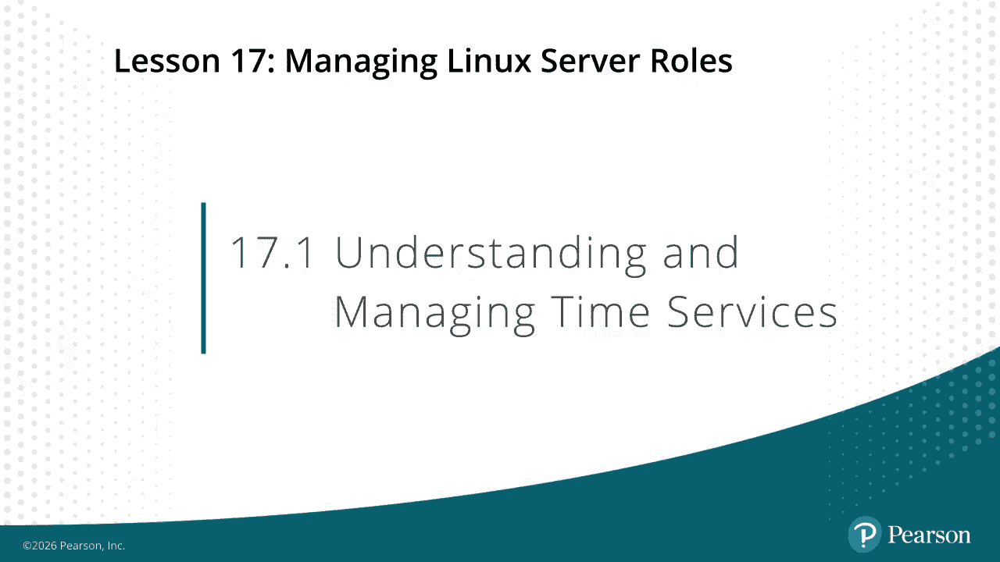
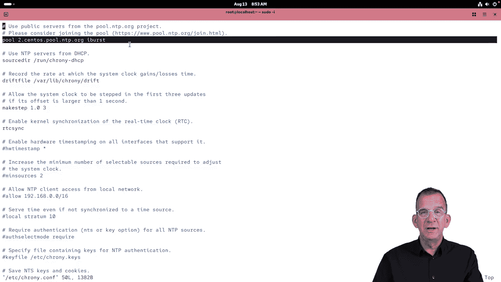
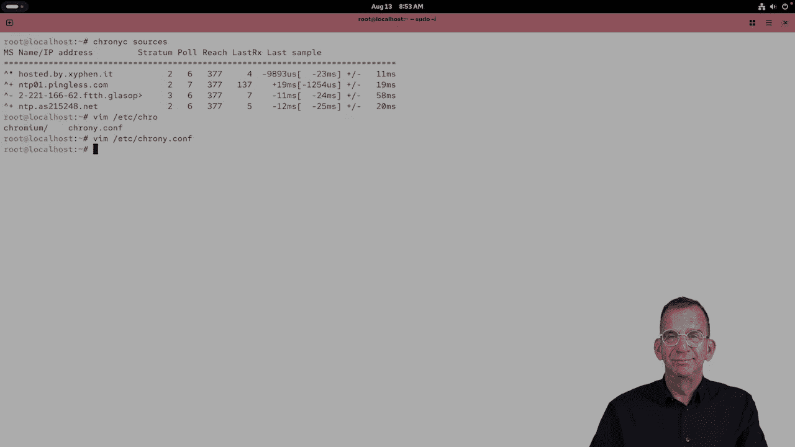

# CompTIA Linux+ V8：第 5 节：理解和管理时间服务 🕐




在本节课中我们将学习如何在 Linux 系统中管理时间服务。你会了解到 NTP 协议的基本作用，认识不同 Linux 发行版常用的时间同步工具，并掌握如何使用 timedatectl、hwclock 以及 ChronyD 来保证系统时间准确。此外，我们还会讲解 Stratum 层级的含义，学习如何查看同步状态，并查看 ChronyD 的配置文件。无论你是刚接触 Linux 的新手，还是正在准备 CompTIA Linux+ 认证，这些内容都能帮助你建立起对系统时间的清晰认识。


## 什么是 NTP 时间同步


Linux 系统通常使用网络时间协议，也就是 NTP，从互联网获取时间，并把本地机器的时钟和互联网时间保持一致。简单来说，NTP 的作用就是让你的电脑时钟不要和真实时间差得太远，从而保证日志、定时任务和证书等功能正常工作。

不同的 Linux 发行版提供了不同的工具来配合 NTP 工作。常见的有较老的 NTPD，集成在 systemd 内部的 systemd-timesyncd，以及 RedHat 家族常用的 ChronyD。这些程序本质上都是服务，它们会和你事先定义好的时间服务器进行对时。

常用的公共时间服务器包括 ntp.org，这些服务器对公众开放，并且因为连接了原子钟，所以时间非常精确。很多服务器都会使用这些公共服务器来完成时间同步。


## 常用的时间管理命令


以下是几个你会经常用到的命令。

- timedatectl：这是一个相对较新的工具，可以用来设置标准时间和时区。它把你需要的功能都集中在一起，是目前推荐优先使用的方式。
- date：这是一个老旧的工具，现在不太推荐用来修改时间，但它在显示时间方面非常方便。你可以用它把时间按照你所在地区的习惯显示出来。
- TZ select：这也是一个老工具，用来选择当前时区。现在更现代的替代品是 timedatectl，建议优先使用 timedatectl。

除了系统时间，计算机主板上还有一个硬件时钟。hwclock 工具就是用来管理这个硬件时间，并把系统时间和硬件时间同步起来。你的系统时间通常是基于硬件时间设定的，所以硬件时钟的准确性很重要。

核心命令如下：

```
hwclock -s   # 把硬件时钟写入系统时钟
hwclock -w   # 把系统时钟写入硬件时钟
```

如果系统时间通过互联网同步后，和硬件时间差别太大，NTP 可能会拒绝同步。这时候就需要用 hwclock 把时间设置正确。常见的情况有两种。第一种是硬件时钟是对的，但系统时钟不对，这时使用 hwclock -s。第二种更常见，比如因为主板电池问题导致硬件时钟不准，这时你先在系统上设好时间，再使用 hwclock -w 把时间同步到硬件时钟里，之后系统就能恢复正常。


## systemd-timesyncd 与 ChronyD


上一节我们介绍了通用的时间管理命令，本节我们来看看两个具体的系统服务。

systemd-timesyncd 是 systemd 提供的一个服务，用来做简单的基于 NTP 的时间同步。systemd 还提供了一个小型守护进程，用于控制时间相关服务的启动和停止。timedatectl 是用来配合 systemd-timesyncd 工作的常用工具。如果你的配置比较复杂，不建议使用 systemd-timesyncd。这就是为什么在 RedHat 系统上，你会看到 ChronyD 而不是 systemd-timesyncd。

RedHat 家族上，你应该重点了解 ChronyD。ChronyD 的配置文件位于 /etc/chrony.conf，几乎每台服务器都会运行 ChronyD，因为每台服务器都需要和互联网时间保持同步。


## 检查时间同步状态


如果你想查看当前的同步状态，可以使用 chronyc sources 命令。

以下是演示中用到的命令。

- date：显示当前日期和时间，例如“星期三，8 月 13 日，8:50”。
- timedatectl：按两次 Tab 键可以看到所有可用子命令。其中 `timedatectl status` 会给出更详细的信息，包括时区、系统时钟同步情况、本地时间与协调世界时的对比，并且可以用来设置时区。
- hwclock：显示硬件时钟时间。理想情况下，硬件时钟和系统时钟应该非常接近。

现在 systemctl status chronyd 会显示 ChronyD 服务当前已加载，并且会给出它使用的服务器信息。另外，你也可以使用 chronyc sources，它能给出主要信息，不过可读性不如前者。


## Stratum 层级概念


在时间同步中，你需要关注同步的服务器是否拥有可靠的 Stratum 层级。Stratum 表示你距离最终时间源有多近。

层级关系如下：

```
Stratum 1：直接连接到互联网时间源（原子钟）
Stratum 2：与 Stratum 1 同步
Stratum 3：与 Stratum 2 同步
……以此类推
Stratum 16：该服务器不可用，不能用于同步
```

通常你在互联网上找不到 Stratum 11，因为中间会有 10 台服务器。但 Stratum 11 常用于局域网内部的时间服务器。如果你不连接互联网，想自己提供 NTP 服务，应该使用 Stratum 11。一旦接入互联网，互联网时间更可靠，会自动优先使用。如果你看到 Stratum 16，说明该服务器不能使用，配置文件位于 /etc/chrony.conf。


## ChronyD 配置文件


ChronyD 的配置文件在 /etc/chrony.conf。你可以看到类似这样的行：

```
pool 2.centos.pool.ntp.org iburst
```

这表示从这个地址获取时间。另外一种方式是使用 `server` 关键字，后面跟一个 IP 地址或主机名，这样就会和那台特定的服务器同步时间。

添加服务器后，不要忘记用 `systemctl status chronyd` 检查服务是否运行，也要用 `chronyc sources` 确认同步是否正常。


## 本节总结






本节课中我们一起学习了 Linux 时间服务的基本概念，包括 NTP 的作用、不同发行版的时间同步工具，以及 timedatectl、date、hwclock 的使用方法。我们还了解了 systemd-timesyncd 和 ChronyD 的区别，学习了如何检查同步状态，并掌握了 Stratum 层级和 ChronyD 配置文件的基础知识。希望这些内容能帮助你更好地管理 Linux 系统的时间。

