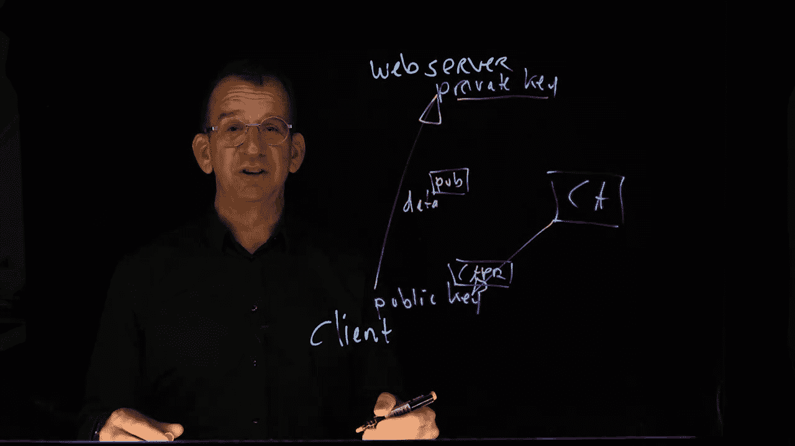

CompTIA Linux+ V8：第5部分第3课：理解和管理证书服务 🔐

在本节课中，我们将学习证书服务的基本概念，重点理解公钥基础设施（PKI）是如何运作的，以及服务器和客户端之间如何通过证书建立安全通信。证书服务看起来比较抽象，但只要掌握了公钥和私钥的基本关系，就能看懂网站为什么能使用 HTTPS，也能明白浏览器偶尔弹出安全警告的原因。

## 什么是公钥基础设施

首先，我们需要了解支撑证书服务的核心体系是什么。

PKI 是 Public Key Infrastructure 的缩写，中文翻译为公钥基础设施。简单来说，它是一套提供公钥和私钥的基础设施，主要目的是用来保护各种网络服务的安全。

**公式：**
```text
PKI = Public Key Infrastructure（公钥基础设施）
```

## 私钥与公钥的作用

在 PKI 体系中，密钥分为两种，分别承担不同的任务。

私钥是服务器用来证明自身身份的凭证，必须严格保密，不能外泄。公钥则会发送给客户端，用于安全通信。客户端拿到公钥后，就可以用它发送加密后的流量，这些流量随后会在服务器端用私钥解密。

**代码示例：**
```text
私钥：服务器持有，用于身份验证和解密
公钥：发给客户端，用于加密发送的数据
加密流程：客户端用公钥加密 -> 服务器用私钥解密
```

## 证书颁发机构与自签名证书

光有密钥还不够，还需要证明公钥是真实可信的，这时就涉及到证书颁发机构了。

为了保证公钥和私钥对的真实性，密钥需要经过签名。这个签名通常由外部的证书颁发机构（CA）完成。除了使用外部机构，你也可以使用自签名证书，也就是由内部 CA 签发、不被广泛信任的证书。

听起来可能不太合理，但如果是在自己的站点内部使用，完全没有必要花钱去请外部证书颁发机构担保，因为证书只给自己的客户端用，可信度可以在内部自行处理。因此自签名证书非常常见。不过需要注意，如果浏览器遇到自签名证书，通常会发出警告，你在上网时很可能已经见过类似的提示。

**代码示例：**
```text
外部 CA 签名：公钥由公开可信的 CA 签发
自签名证书：内部 CA 签发，浏览器会显示警告
```


## 消息摘要与数字签名

接下来，我们看看证书背后用到的核心数学技术。

消息摘要是指消息内容的固定长度数值表示，由哈希函数计算得到。在安全通信中，发送方通常会先生成消息摘要，然后用非对称密钥对中的私钥对它进行加密。

**公式：**
```text
消息摘要 = 哈希函数(消息内容)
```

非对称密钥对意味着发送方和接收方使用不同的密钥。发送方用私钥生成数字签名，接收方再用公钥解密签名，从而验证发送方身份，建立加密通道。

## TLS 证书的工作流程

有了这些基础，我们可以看看 TLS 证书在实际中是怎么用的。

假设有客户端和 Web 服务器。当你要把敏感数据发送给 Web 服务器时，希望传输过程是安全的。Web 服务器持有私钥，当你开始与服务器通信时，会先拿到服务器的公钥。公钥和私钥在数学上有关联，属于同一对。

但第一个问题是，怎么确定这个公钥是合法的？答案是靠证书颁发机构（CA）。CA 在 PKI 证书中对公钥进行了签名。CA 会用自己的私钥（CA 私钥）来签名这个公钥。因为证书颁发机构是广为人知的，浏览器等软件内置了 CA 的公钥，所以收到签名后的公钥时，可以验证它是合法的，从而建立信任。

一旦确认可以信任 Web 服务器，就可以建立安全通道。在这个通道里，数据会用服务器的公钥加密，发送到服务器后，只有服务器的私钥才能解密。这就是常见 HTTPS 流量的工作方式。

以下是 TLS 证书通信的主要步骤：
1. 客户端请求连接 Web 服务器
2. 服务器提供公钥和证书
3. 客户端通过 CA 公钥验证证书合法性
4. 客户端用服务器公钥加密数据
5. 服务器用私钥解密数据

## 总结



本节课中，我们一起学习了证书服务的核心知识，包括公钥基础设施（PKI）、公钥与私钥的作用、证书颁发机构与自签名证书、消息摘要与数字签名，以及 TLS 证书在 HTTPS 通信中的完整流程。
