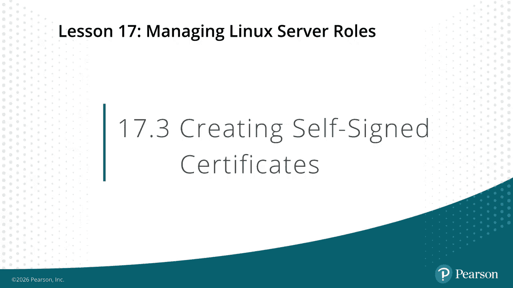
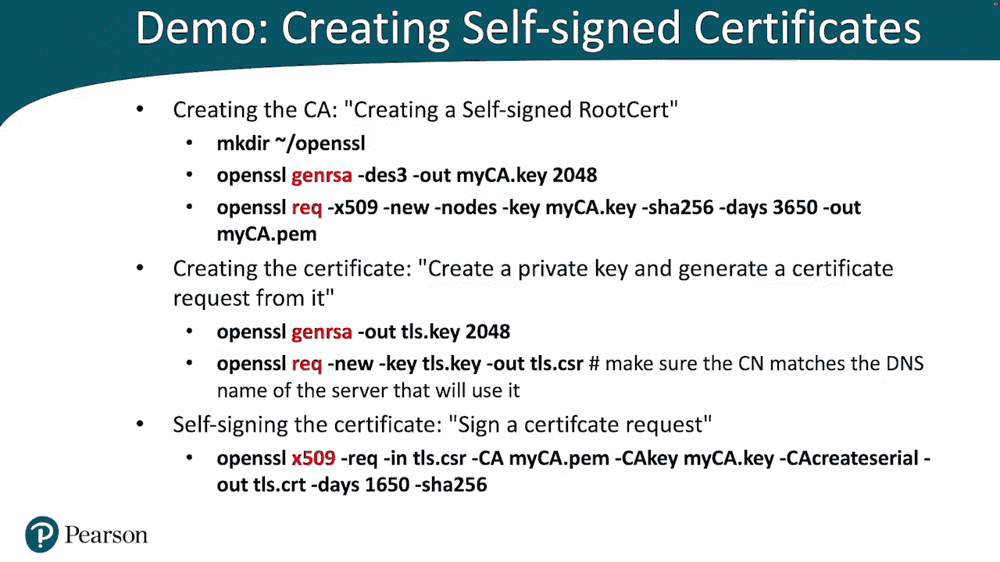
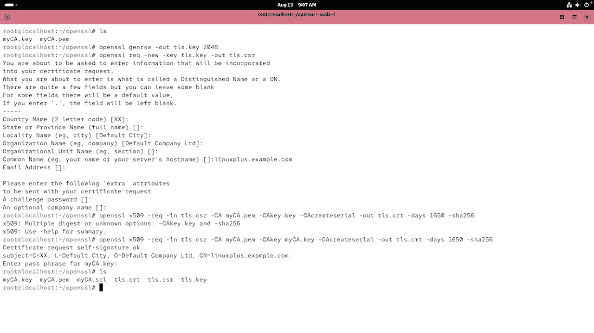
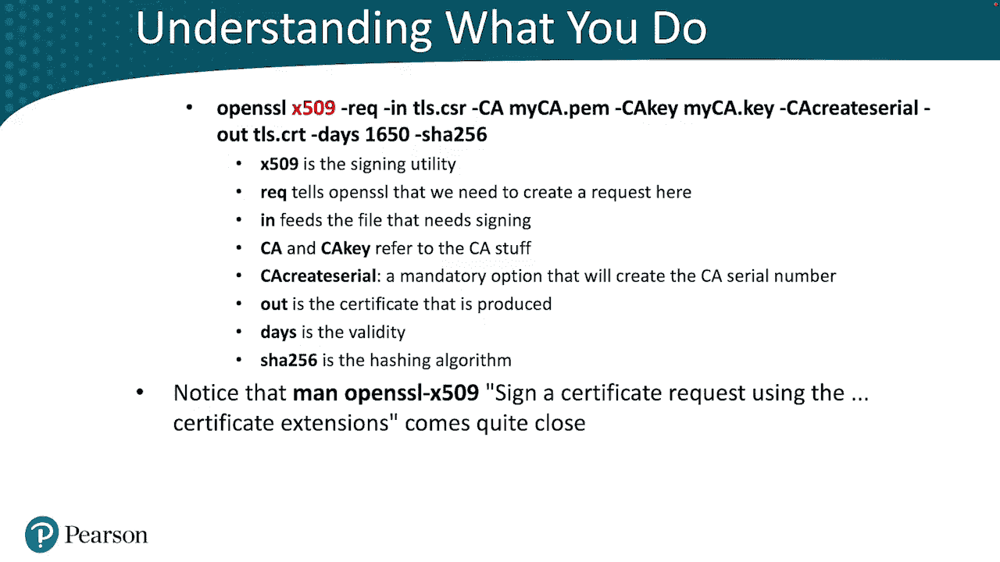

🔐 CompTIA Linux+ V8：404.173：创建自签名证书




在本节课中我们将要学习如何在Linux系统中创建自签名证书。证书是保护网络服务通信安全的重要工具，很多Linux服务都依赖PKI证书来建立TLS加密通道。虽然正式的证书通常需要由受信任的证书颁发机构签名，但如果证书仅在内部网络中使用，那么自签名证书是一种简单可行的选择。本节将带你一步步完成从搭建私有CA到颁发服务器证书的全过程，并解释背后的OpenSSL命令含义。

在动手操作之前，我们先来理解一下证书在Linux服务中的作用。PKI证书通常被用于各种Linux服务，用来保护网页服务等资源的安全。理解证书的工作原理是非常必要的。要使用公钥体系，证书通常需要由证书颁发机构进行签名。自签名证书是快速上手自己证书体系的简便方法。如前所述，如果证书只在内部网络中使用，那么使用自签名证书是完全可以接受的。这些证书可以应用于任何需要TLS加密通道的服务，例如内部网站或公司内部API。

```text
证书流程简化版：
服务器私钥 -> 证书签名请求(CSR) -> CA签名 -> 服务器公钥证书
```

上一节我们介绍了证书的基本概念，本节中我们来看看如何建立属于自己的证书颁发机构。自签名证书的核心在于签名，而签名操作必须由证书颁发机构来完成。因此第一步就是创建这个CA。我们需要在一个专门的目录里进行操作，避免文件混乱。接下来要使用OpenSSL命令生成CA的私钥。虽然有些发行版提供了更简单的前端命令，但这些命令最终都会调用OpenSSL，而且不同发行版之间可能有差异，所以建议你直接花时间学习OpenSSL本身。



```bash
mkdir openssl
cd openssl
openssl genrsa -out myCA.key -aes256 2048
```

这里生成的是一个RSA私钥，`-aes256`指定加密算法，`-out`指定输出文件为myCA.key，`2048`表示使用2048位密钥长度。生成的这个私钥就是证书颁发机构的私钥，用来给公钥证书签名，属于非常敏感的业务资产，必须妥善保护。因此系统会要求你设置一个密码短语，以后每次使用这个私钥时都需要输入这个密码。

以下是创建CA证书时会用到的关键命令：

```bash
openssl req -x509 -new -nodes -key myCA.key -sha256 -days 3650 -out myCA.pem
```

- `-x509`：表示生成X.509格式的自签名证书，而不是证书签名请求。
- `-new`：表示生成一个新的请求。
- `-nodes`：表示不对私钥进行额外加密。
- `-key myCA.key`：指定读取CA的私钥文件。
- `-sha256`：使用SHA-256哈希算法生成安全摘要。
- `-days 3650`：设置证书有效期为3650天，大约十年。CA证书通常有效期较长，因为如果CA证书过期，它签名的所有证书也会随之失效。
- `-out myCA.pem`：输出CA证书文件，这个文件会发给客户端，用于验证由该CA签发的证书。

执行这条命令后，系统会要求输入CA私钥的密码，然后询问一些关于CA的详细信息，比如国家、州、城市等。对于仅内部使用的证书，这些信息可以随意填写，因为它们主要用于互联网上的身份验证，在内网环境中不那么关键。不过填写完整信息是个好习惯。

完成了CA的搭建，我们现在拥有了CA的密钥材料，本节中我们来看看如何为服务器生成私钥和证书签名请求。现在我们需要为服务器创建一个独立的私钥，并从这个私钥中提取证书签名请求。生成服务器私钥的命令与CA私钥类似，但不再强制使用`-aes256`加密算法，当然它依然是一个私钥。从私钥中提取证书签名请求时，必须填写通用名（Common Name）。通用名就是你的服务器主机名，这一点非常重要。假设我们将其设置为`linuxplus.example.com`，你需要仔细考虑，因为这个证书将由服务器使用，如果证书中的名称与客户端访问时使用的主机名不匹配，客户端就会拒绝该证书。其他信息如国家、州、城市都是可选的。

```bash
openssl genrsa -out tls.key 2048
openssl req -new -key tls.key -out tls.csr
```

以下是服务器端密钥与请求生成的关键步骤：

- 生成服务器私钥`tls.key`，使用2048位RSA密钥。
- 使用该私钥生成证书签名请求`tls.csr`，这个请求稍后将由CA进行签名。
- 在生成请求过程中，重点确认通用名与服务器实际主机名一致。

证书签名请求已经准备就绪，本节中我们来看看如何使用刚才建立的证书颁发机构对这个请求进行正式签名。签名操作由OpenSSL的x509工具完成。我们需要把证书签名请求作为输入，指定CA证书作为颁发机构标识，同时还需要访问CA的私钥。CA会为自己的管理记录生成一个序列号，输出文件将是服务器的公钥证书。要确保这个证书的有效期不超过CA证书的有效期，否则会出现证书已经过期而CA证书仍然有效的尴尬情况。加密算法继续使用SHA-256。

这里讲者曾经出过一次小错误，忘记给CA私钥参数传递正确的文件名，应该是`myCA.key`，修正后命令即可正常运行。执行过程中会再次要求输入之前设置的CA密码短语。完成后，你会得到两个关键文件：`tls.crt`是公钥证书，会发给客户端；`tls.key`是服务器自身使用的私钥。

```bash
openssl x509 -req -in tls.csr -CA myCA.pem -CAkey myCA.key -CAcreateserial -out tls.crt -days 3650 -sha256
```



以下是签名命令的各个参数含义：

- `-req`：表示处理证书签名请求。
- `-in tls.csr`：输入的证书签名请求文件。
- `-CA myCA.pem`：证书颁发机构的公钥证书。
- `-CAkey myCA.key`：证书颁发机构的私钥，用于完成签名动作。
- `-CAcreateserial`：强制选项，用于创建CA的序列号文件。
- `-out tls.crt`：输出的最终公钥证书文件。
- `-days 3650`：证书有效期，以天为单位。
- `-sha256`：签名所使用的哈希算法。

刚才我们走完了完整的实操流程，这个过程对初学者来说比较复杂，本节中我们来看看这些命令背后的通用原理，方便你以后查阅和复用。OpenSSL始终是通过具体的子命令来工作的。`genrsa`是生成私钥的通用工具，`-aes256`是推荐用于证书颁发机构的加密算法，因为它强度相对较高，`-out`用于指定输出文件。`req -x509`这个组合既可以生成证书请求，也可以直接生成自签名证书，`new`表示新建请求，`nodes`表示如果创建私钥则不加密，`key`指定读取密钥文件的来源，`sha256`生成安全哈希，`days`指定证书有效天数，`out`输出一个自包含的PEM格式证书文件，这是密码学中常见的标准，可以用来分发完整的证书链。

如果你想查看更多细节，可以使用`man openssl-req`查阅手册页，其中专门有关于创建私钥和生成证书签名请求的说明。你不需要把所有命令都死记硬背，只要有系统访问权限，手册页会提供非常具体的参数解释。

以下是整个流程中涉及的主要OpenSSL子命令及其用途：

- `openssl genrsa`：生成RSA私钥。
- `openssl req`：处理PKCS#10证书请求和证书生成。
- `openssl x509`：证书签名与显示工具。

你也可以在`man openssl-x509`中找到关于使用证书扩展签名请求的详细信息。



本节课中我们一起学习了如何创建自签名公私钥证书对。我们首先建立了属于自己的证书颁发机构，生成了CA私钥和CA根证书；接着为服务器生成了私钥，并从中提取了证书签名请求，重点确认了通用名必须与服务器主机名匹配；最后使用CA对证书请求进行了签名，得到了可以发给客户端的公钥证书和服务器本地使用的私钥。这些证书可以在内部网络的Web服务中使用，为你的TLS加密通道提供基础安全保障。
