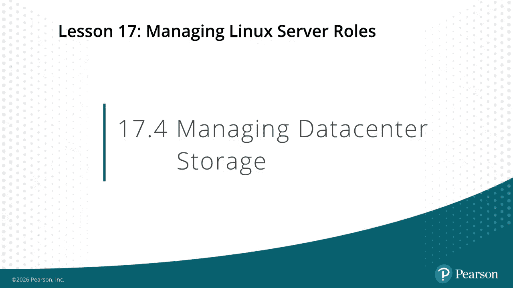
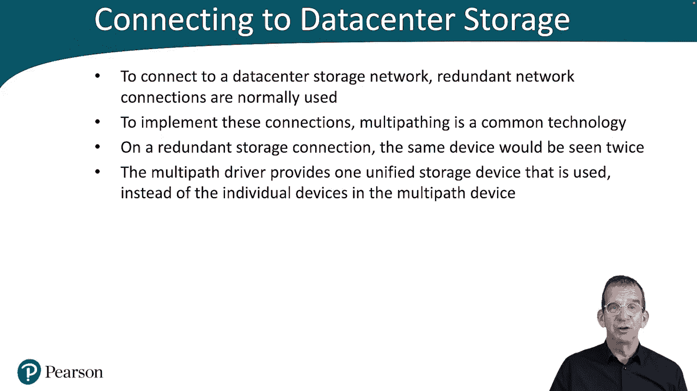

# 数据中心存储管理：第5节：数据中心存储基础 💾




在本节课中，我们将一起学习数据中心存储的基础知识，重点了解服务器如何连接到集中式存储，以及常见的存储网络技术是如何工作的。


## 一、数据中心中的集中式存储


在数据中心环境中，通常会使用集中式存储来统一管理数据，而不是让每台服务器各自保存文件。

以下是集中式存储的核心思想：
- 服务器本身不再在本地磁盘中保存文件。
- 所有文件都存放在集中式存储设备上。
- 这样的设计让数据保护和备份变得更加容易。

集中式存储的基本逻辑可以用下面的公式来表示：

```
服务器文件 = 集中式存储设备上的文件
```

当你把文件从本地硬盘迁移到集中式存储后，存储设备就成了所有服务器共享的数据中心。这意味着即使某台服务器出现故障，存放在集中式存储中的数据仍然安全，管理员也可以更方便地统一进行备份和恢复操作。


## 二、常见的数据中心存储解决方案


在数据中心里，连接服务器和存储设备最常用的两种技术是光纤通道（Fibre Channel）和 iSCSI。

以下是这两种方案的主要特点：
- 两者都需要使用专门的存储网络，把服务器连接到存储设备。
- 光纤通道依赖于特定的硬件厂商，协议的开放程度相对较低。
- iSCSI 在 Linux 环境中非常流行，因为它的数据包可以通过普通的 IP 网络发送。

iSCSI 的核心优势在于，它把传统存储协议封装在 IP 网络中传输。这样一来，硬盘和服务器之间不再需要直接相连，而是通过网络中间进行通信。Linux 服务器可以很容易地充当 iSCSI 目标设备，从而把本地磁盘暴露给外部使用。如果配置得当，一台普通的 Linux 服务器甚至可以转变成数据中心存储区域网络中的一部分。


## 三、iSCSI 的目标与发起人


要让服务器访问远程存储，需要在两端分别部署不同的组件。

以下是 iSCSI 通信的两个关键角色：
- iSCSI Target：运行在存储端，负责把磁盘资源暴露给外部。
- iSCSI Initiator：运行在客户端服务器上，负责主动发现并连接目标设备提供的磁盘。

这两个组件的协作关系可以简单描述为：

```
iSCSI Initiator  -->  网络  -->  iSCSI Target  -->  远程磁盘
```

客户端上的发起人组件会主动寻找目标设备提供的可用磁盘，一旦找到，就可以像使用本地硬盘一样使用这些远程存储资源。这种架构让存储资源的分配变得更加灵活，管理员不需要在每台服务器上都安装实体硬盘，只需要通过网络连接即可扩展存储容量。


## 四、冗余网络连接与多路径技术


在实际连接数据中心存储时，通常会配置冗余的网络连接，以防止单点故障导致存储不可用。

以下是使用冗余连接的原因和可能出现的问题：
- 连接外部磁盘时，网络电缆可能会断开。
- 如果只有一条网络连接，电缆故障会导致存储无法访问。
- 当配置多条冗余连接时，同一块硬盘可能会被操作系统识别多次。
- 在这种情况下，你可能会看到同一块硬盘出现两次，甚至四次，具体取决于存储配置。

为了解决同一设备被重复识别的问题，通常会使用多路径技术（Multipathing）。

多路径技术的核心作用可以用下面的公式来表示：

```
多个网络路径 + 多路径驱动 = 一个统一的存储设备
```

多路径驱动会确保系统只看到一个统一的存储设备，而不是多个重复的磁盘。它还会自动选择合适的网络连接进行数据传输。如果其中一条网络连接断开，多路径驱动会自动切换到另一条正常的连接，这样服务器就能保持与存储设备的连接，业务不会中断。


## 五、本节总结


在本节课中，我们一起学习了数据中心集中式存储的概念，了解了光纤通道和 iSCSI 两种常见的存储网络方案，重点介绍了 iSCSI 中目标与发起人的工作原理，并解释了冗余网络连接与多路径技术如何保障存储连接的稳定性。



希望这些内容能帮助你初步理解数据中心存储是如何管理的。
