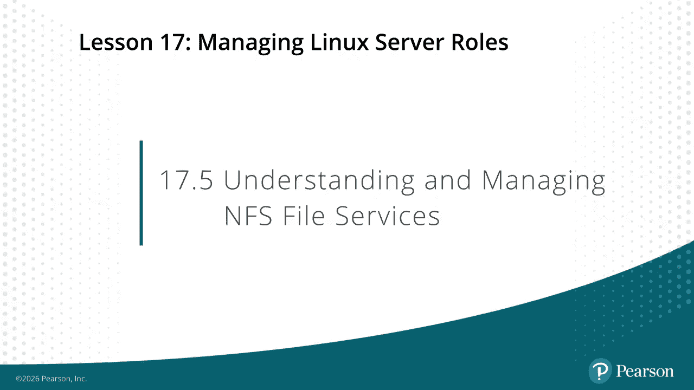
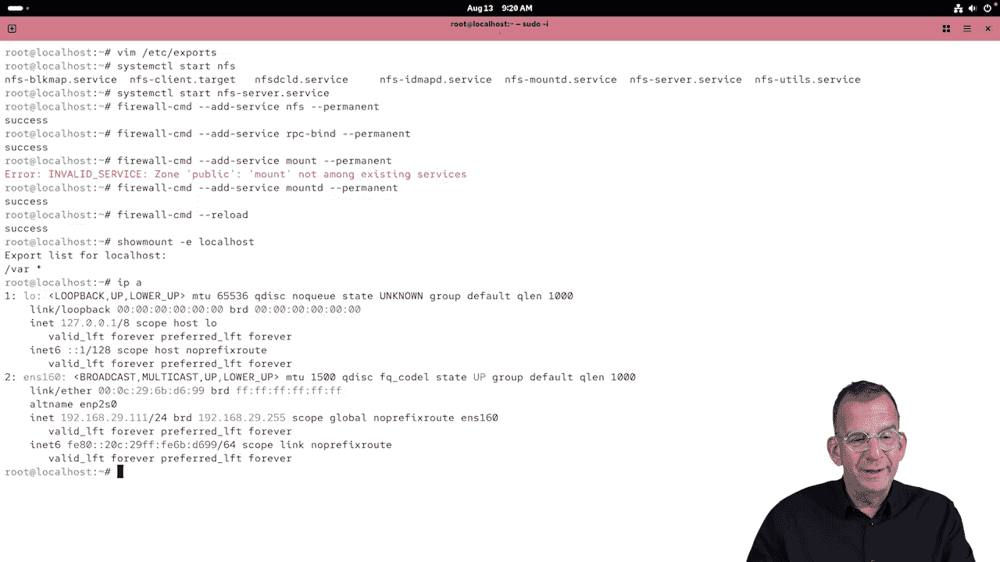
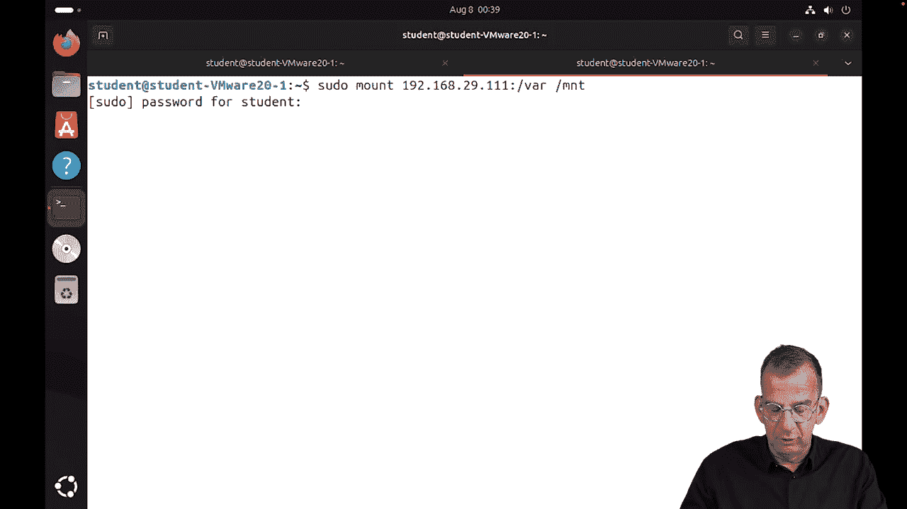
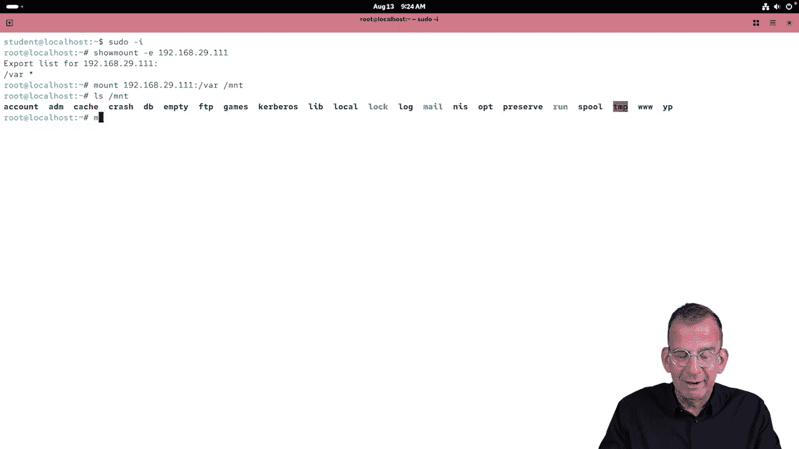

# CompTIA Linux+ V8：05：理解与管理 NFS 文件服务 📁

在本节课中，我们将一起学习 NFS 文件服务的基本概念，以及如何在 Linux 系统上搭建和管理 NFS 服务器。你将了解 NFS 的工作原理，学会配置导出目录，掌握防火墙放行规则，最后在客户端上挂载远程共享目录。

---

## 一、NFS 基础概念

NFS 是一种可以用来把目录导出到 NFS 客户端的服务。简单来说，它允许服务器上的某个文件夹被网络上的其他电脑当作本地目录来使用，从而实现文件共享。

NFS 是 Unix 系统原生的文件共享协议，已经存在很长时间了。因为它直接在 Linux 内核层实现，所以运行速度快，整体结构也很简单。

在 NFS 中，共享目录是在 /etc/exports 配置文件中定义的，NFS 服务器服务会对这些共享目录提供访问权限，让客户端能够连接过去使用。

目前常见的 NFS 使用的是第四版及以后的版本，通过 TCP 端口 2049 提供访问服务。NFS 第三版采用了不同的实现方式，但已经非常老旧，自 2000 年代初期起就不再推荐使用。

在早期的传统 NFS 中，使用的是动态端口，这让防火墙放行变得更加困难，管理起来也不够方便。

---

## 二、客户端发现与挂载共享

NFS 客户端可以使用 show mount 命令并加上 -e 参数，来发现服务器上发布了哪些共享目录。

当客户端想要挂载共享时，可以使用 mount 命令，并加上可选的 -t nfs 参数来指定挂载类型是 NFS。完整的挂载命令格式如下：

mount -t nfs 服务器名:共享目录 本地挂载点

这里的本地挂载点就是 NFS 共享目录在客户端上的本地路径，挂载成功后客户端就可以像访问本地文件夹一样访问远程目录了。

---

## 三、防火墙放行规则

如果你想让 NFS 流量通过防火墙，在很多情况下，仅仅打开 2049 端口是不够的。这是因为很多 NFS 相关的客户端工具仍然在使用较老的组件，这些组件可能需要额外的端口和服务。

因此，在防火墙上需要添加几个相关服务，包括 RPC bind、MountD 和 NFS 本身，才能保证客户端能够正常连接和使用共享目录。

---

## 四、搭建 NFS 服务器

下面我们来看看如何在服务器上设置 NFS。第一步是安装 NFS 相关的软件包。

可以使用 DNF search NFS 命令来查看所有可用的软件包。无论是客户端还是服务端，都需要安装 nfs-utils 包，使用命令如下：

dnf install -y nfs-utils

安装完成之后，需要创建导出配置。具体操作是创建 /etc/exports 文件，并在文件中定义想要导出的内容。以下是一个配置示例：

/var *(rw,no_root_squash)

这行配置的意思是，将 /var 目录导出，允许任何主机访问，其中 rw 表示读写权限，no_root_squash 表示客户端的 root 用户在远程主机上仍然保持 root 身份，不被映射为普通用户。

---

## 五、启动服务与配置防火墙

配置好 /etc/exports 文件之后，可以使用 systemctl 来启动 NFS 服务器服务。服务名称是 nfs-server.service，启动后服务器就开始监听客户端请求了。

接下来需要配置防火墙。使用 firewall-cmd 命令永久添加 NFS 服务：

firewall-cmd --add-service=nfs --permanent

此外，还需要添加 rpcbind 和 mountd 服务。注意这里是 mountd 而不是 mount，这两个服务都是 NFS 正常工作所必需的。

将这些服务加入永久配置之后，使用以下命令重载防火墙，使配置立即生效：

firewall-cmd --reload

---

## 六、本地测试

防火墙重载完成后，可以在本机做一个简单测试，确认共享目录是否正常工作。使用以下命令：

showmount -e localhost

如果能看到挂载列表，说明本地 NFS 服务已经正常运行，共享目录已经正确发布。

---

## 七、远程客户端挂载

既然本地测试通过，就可以从远程主机访问这些共享目录了。首先需要在客户端机器上安装 nfs-utils 包，因为客户端功能也依赖这个软件包。

dnf install -y nfs-utils

获得 root 权限后，使用 show mount 命令查看远程服务器上的共享目录：

showmount -e 192.168.29.111

如果能看到共享列表，就可以进行挂载了。使用 mount 命令将远程目录挂载到本地临时目录：

mount -t nfs 192.168.29.111:/var /mnt

这是一个临时挂载，挂载完成后，可以在 /mnt 目录下看到 NFS 共享目录的内容，命令输出的最后一行也会确认挂载成功，说明客户端已经可以正常访问远程共享目录了。

---

## 八、本节总结

在本节课中，我们一起学习了 NFS 文件服务的基本概念，了解了 NFS 版本与端口，掌握了防火墙放行规则，学会了安装 NFS 服务器、配置导出目录、启动服务，最后在客户端上完成了远程目录的挂载和验证。
