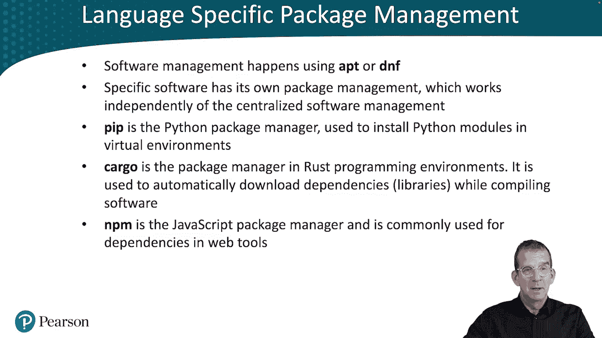

# CompTIA Linux+ 学习教程：05：语言特定的包管理 📦

在本节课中，我们将要学习什么是语言特定的包管理。你已经知道 Linux 系统里可以用 apt 或 dnf 这样的工具来安装软件，但除此之外，很多编程语言自己也带了一套包管理机制，这些工具不依赖系统的集中式软件管理，而是独立运行。作为 Linux 管理员，你不一定每天都要亲自使用这些工具，但你至少需要听得懂开发者在说什么，这样才能在工作中配合得更好，也能在考试中答对相关题目。

---

刚才我们介绍了系统层面的软件管理工具，比如在 Ubuntu 上用 apt，在 Red Hat 系列系统上用 dnf。本节中我们来看看那些属于特定编程语言、独立于系统包管理器之外的包管理方式。

语言特定的包管理是指由编程语言社区自己维护的软件包工具，它不经过操作系统的官方软件源，而是直接从该语言的官方仓库下载代码库或依赖项。这类工具通常由开发者用来管理项目所需的第三方库，而 Linux 管理员只需要知道它们的存在和基本用途即可。

---

接下来我们具体来看几种常见的语言特定包管理工具。以下是这些工具的名称和对应的编程语言：

- Pip：对应 Python 语言
- Cargo：对应 Rust 语言
- NPM：对应 JavaScript 语言

下面我们分别详细说明每个工具的作用。

---

第一个工具是 Pip。Pip 是 Python 的包管理器，专门用于安装和管理 Python 模块。在实际开发中，程序员经常把它和 Python 的虚拟环境一起使用，这样不同的项目可以拥有独立的依赖库，互不干扰。你可以把它理解为 Python 世界里的“应用商店命令行版”。

使用 Pip 的典型命令如下：

```bash
pip install 包名称
```

这条命令会从 Python 官方仓库下载指定的库，并安装到当前的 Python 环境中。

---

刚才我们介绍了 Pip，本节中我们来看看另一个编程环境中的包管理工具。Cargo 是 Rust 编程语言自带的包管理器，同时也负责项目的构建工作。它最重要的功能之一是自动下载编译软件所需的依赖库，开发者不需要手动去网上找每一个库文件，Cargo 会在后台帮你搞定。

使用 Cargo 的典型命令如下：

```bash
cargo build
```

执行这条命令时，Cargo 会读取项目配置，自动获取所有需要的第三方库，然后进行编译。

---

接着我们继续说 JavaScript 方面的包管理工具。NPM 是 JavaScript 的包管理器，在 Web 开发领域被广泛使用。前端程序员通常用它来管理网页项目里的各种依赖包，比如界面框架、工具库或者构建工具等。如果你在服务器上部署 Web 应用，很可能也会遇到 NPM 生成的文件。

使用 NPM 的典型命令如下：

```bash
npm install 包名称
```

这条命令会把指定的 JavaScript 库下载到项目目录中，供前端代码调用。

---



最后一部分我们来谈谈考试相关的内容。以上这些工具——Pip、Cargo 和 NPM——在 CompTIA Linux+ 考试中都有可能出现。你不需要把每个命令都背下来，但至少要做到听到名称时能反应过来它属于哪种语言，知道它大致是用来做什么的。考试中可能会以选择题的形式考察这些概念，只要有印象就能得分。


---

在本节课中，我们一起学习了语言特定的包管理。首先回顾了系统级包管理工具 apt 和 dnf，然后介绍了独立于系统包管理器的语言特定包管理方式。接着分别说明了 Python 的 Pip、Rust 的 Cargo 以及 JavaScript 的 NPM，并给出了每个工具的典型使用命令。最后提醒了考试重点，只要了解这些工具的基本用途和对应的编程语言，就能应对相关考题。
