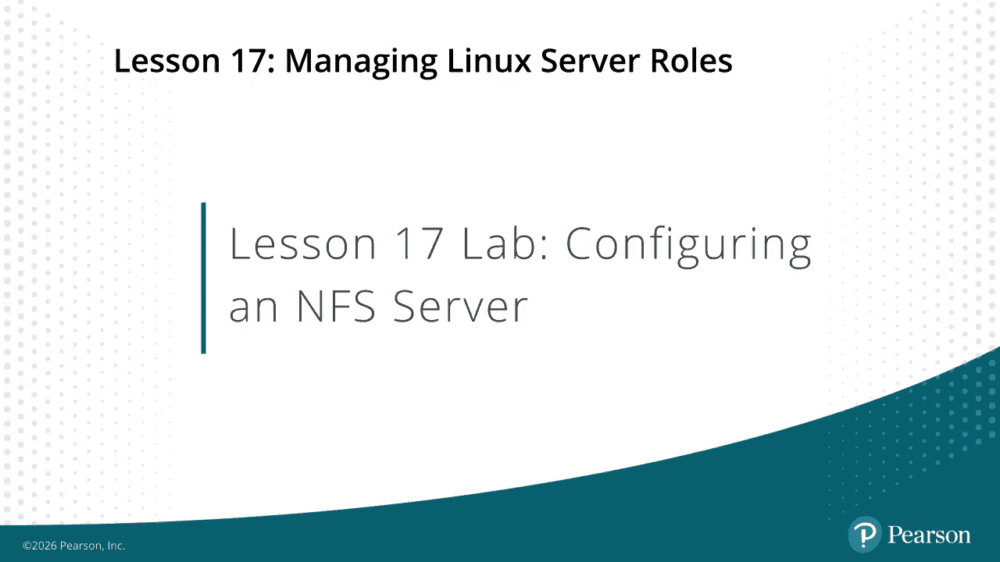
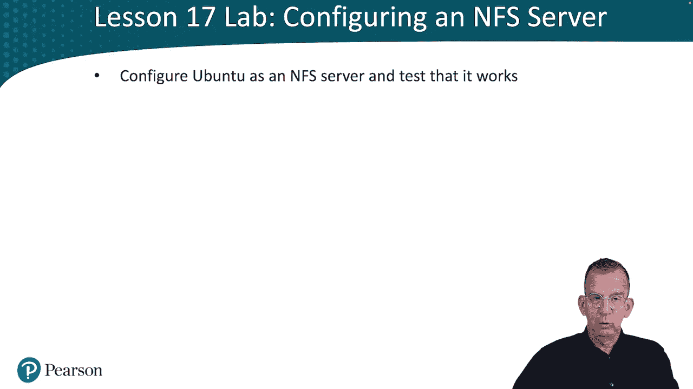

# CompTIA Linux+ V8：17：配置 NFS 服务器实验 🖥️


在本节课中，我们将一起学习如何在 Linux 系统上搭建并配置一个 NFS 服务器。NFS 的全称是网络文件系统，它的作用是让不同的计算机通过网络共享文件夹，就像使用本地磁盘一样方便。我们不仅会讲解基础概念，还会动手进行实验操作，确保你能够独立完成服务器的安装、共享目录的设置以及客户端的挂载测试。在本节课的最后部分，我们将进入实验环节，由你亲自动手配置 NFS 服务器，并验证它是否正常运行。


在开始动手之前，我们需要先搞清楚 NFS 服务器到底是做什么的。简单来说，NFS 允许一台服务器将自己的目录共享给网络上的其他机器，客户端可以把这些远程目录挂载到本地路径下，读写文件时感觉就像在操作本地硬盘。这种方式非常适合多台机器之间需要访问同一组文件的场景，比如办公室里的文件共享或服务器之间的数据同步。


核心概念可以用下面的公式来描述：


```text
NFS 服务器 = 共享目录 + 导出配置 + 网络访问权限
```


有了基本概念之后，接下来我们来看看本次实验的具体目标，你需要完成哪些任务才能算作成功配置服务器。


以下是本次实验需要完成的核心步骤：

- 安装 NFS 服务器软件包
- 创建并设置要共享的目录
- 修改 /etc/exports 配置文件，定义共享权限
- 启动并启用 NFS 服务
- 在客户端机器上挂载共享目录
- 读写测试文件，验证服务是否正常




你将要做的事情是配置服务器来使用 NFS 共享，并测试它是否正常工作。下面我们进入具体的配置过程，一步步把服务器搭建起来。


以下是安装 NFS 服务器所需的命令：


```bash
sudo apt update
sudo apt install nfs-kernel-server -y
```


以下是创建共享目录并设置权限的命令：


```bash
sudo mkdir -p /nfs/share
sudo chown nobody:nogroup /nfs/share
sudo chmod 777 /nfs/share
```


以下是 /etc/exports 配置文件的示例内容：


```bash
/nfs/share  *(rw,sync,no_subtree_check)
```


以下是重启服务并应用配置的命令：


```bash
sudo exportfs -a
sudo systemctl restart nfs-kernel-server
sudo systemctl enable nfs-kernel-server
```


配置完成之后，不能只假设它正常，必须实际检查服务器是否真的在工作。下面是验证步骤。


以下是验证 NFS 服务器状态的命令：


```bash
sudo systemctl status nfs-kernel-server
showmount -e localhost
```


以下是在客户端挂载共享目录的命令：


```bash
sudo mount -t nfs 服务器IP:/nfs/share /mnt/nfs
```




测试读写功能的操作如下：


```bash
touch /mnt/nfs/testfile
ls -l /mnt/nfs/testfile
```


本节课中，我们一起学习了 NFS 服务器的基本概念、安装方法、共享目录配置以及客户端挂载测试。你已经掌握了如何在 Linux 上部署 NFS 服务，并验证网络文件共享是否正常工作。希望这些内容能帮助你在实际工作中灵活使用 NFS 技术。

