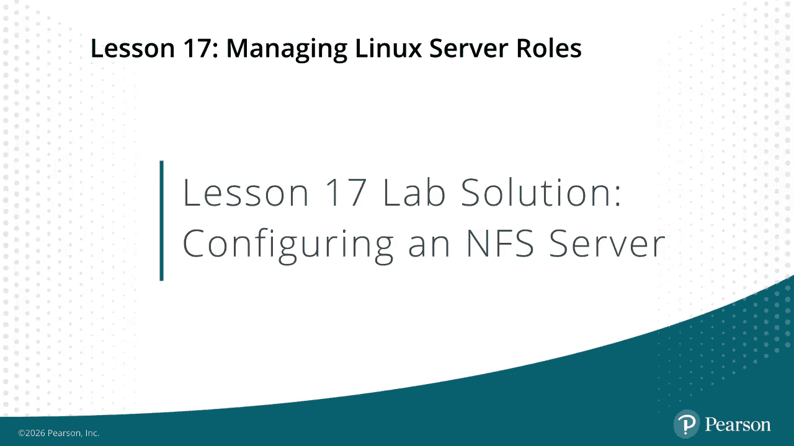
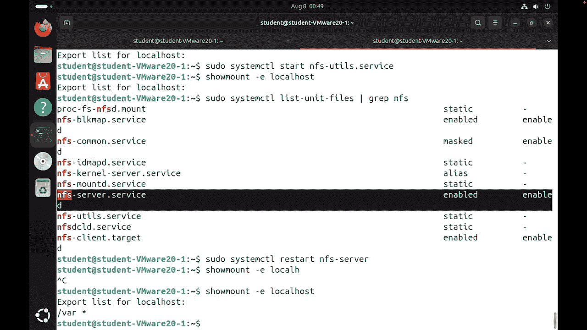

# CompTIA Linux+ V8：17：配置NFS服务器📁


在本节课中我们将要学习如何在Linux系统上搭建NFS服务器。NFS的全称是网络文件系统，它可以让不同的电脑通过网络共享文件夹，就像使用本地磁盘一样方便。本节课是一个实验解答，我们会一步一步安装软件、编辑配置文件、处理防火墙，最后启动服务并验证是否可以正常访问。无论你是完全没有接触过NFS的新手，还是想复习一下相关知识点，这里都会用最直白的语言把每个操作讲清楚，确保你能跟着视频的思路完整操作一遍。




## 安装NFS服务器软件包

在开始之前，我们需要先把服务端和客户端可能用到的软件包都装好，这样后面配置共享目录的时候才不会缺少必要的命令。

以下是安装NFS服务器所需的软件包和对应的操作命令：

- 在Ubuntu系统中，服务端软件包的名称是nfs-kernel-server。
- 如果你同时也要配置客户端，建议把nfs-common一并安装，以免后面挂载共享目录时找不到相关工具。
- 完整的安装命令如下：

```bash
sudo apt update
sudo apt install nfs-kernel-server nfs-common
```

软件包安装完成之后，Ubuntu通常会自动启动相关服务。不过因为我们接下来要修改配置文件，所以稍后还需要手动重启一次服务，让新配置真正生效。


## 配置NFS共享目录

软件装好以后，接下来要做的就是告诉NFS服务器，哪些文件夹允许其他电脑通过网络访问，以及访问者拥有什么样的权限。这部分内容直接决定了客户端能不能看到共享文件，也能不能往里面写数据。

以下是配置共享目录的主要步骤：

- 使用文本编辑器打开/etc/exports文件，这里面记录了所有要共享的目录以及对应的访问规则。
- 把要共享的目录写进去，本实验中使用的是/sfar目录，并指定允许的客户端和访问权限。
- 本实验采用比较宽松的设置，允许读写，并且不限制root用户的权限，对应的配置行如下：

```bash
/sfar *(rw,no_root_squash)
```

这里的rw表示读写权限，no_root_squash表示连接的客户端以root身份访问时，服务器依然保留root权限，不做身份降级处理。NFS的选项非常多，初学者不需要一下子全部搞懂，在这个实验里这样简单配置就足够了。


## 检查防火墙状态

在尝试访问NFS共享之前，最好先确认一下系统防火墙是否会拦截相关流量。如果防火墙开启且没有放行NFS端口，客户端连不上服务器就会很困惑，排查起来也浪费时间。

以下是查看防火墙状态的方法：

- 使用ufw工具检查当前防火墙是否处于激活状态。
- 执行命令：

```bash
sudo ufw status
```

- 如果输出显示inactive，说明防火墙目前没有开启，不需要额外放行端口，这反而让后面的测试更简单。
- 如果防火墙是active状态，记得手动放行NFS相关端口，否则远程客户端无法挂载共享目录。


## 启动和验证NFS服务

配置文件写好之后，NFS服务器还没有真正开始工作，需要重启服务让设置生效，然后才能验证共享是否可用。如果不重启，修改过的/etc/exports就不会被服务器重新读取。

以下是启动服务和验证的操作流程：

- 首先尝试在本地使用showmount命令查看当前可导出的共享目录，看看配置是否已经生效。
- 执行命令：

```bash
showmount -e localhost
```

- 如果什么都没显示出来，说明服务可能没有正常运行，或者服务名没有找对，这时候需要进一步排查。
- 可以用systemctl列出所有跟nfs相关的服务单元文件，找到准确的服务名称：

```bash
systemctl list-unit-files | grep nf
```

- 在Ubuntu上，正确的服务名通常是nfs-server.service，而不是nf-utils之类的名字。
- 因为服务可能已经在运行，直接用start命令不会有明显反应，这是systemd的一个正常特性，不代表命令出错了。
- 最稳妥的做法是重启服务，确保配置文件被重新加载：

```bash
sudo systemctl restart nfs-server
```

- 重启完成后，再次运行showmount -e localhost，应该就能看到刚才配置的/sfar目录了，这意味着NFS服务器在本地已经正常工作。
- 此时你也可以尝试从客户端机器挂载这个共享目录，如果能成功访问，说明整个NFS服务器搭建完成了。




本节课中我们一起学习了如何在Ubuntu上配置NFS服务器。首先安装了nfs-kernel-server和nfs-common两个软件包，然后在/etc/exports中添加了/sfar目录的读写共享规则，接着检查了ufw防火墙的状态确保不会拦截连接，最后通过systemctl重启nfs-server服务，并用showmount -e localhost验证共享目录是否可见。按照这个流程操作，你就可以在自己的Linux环境下搭建一个基本的NFS文件共享服务器，供局域网内的其他电脑使用了。
