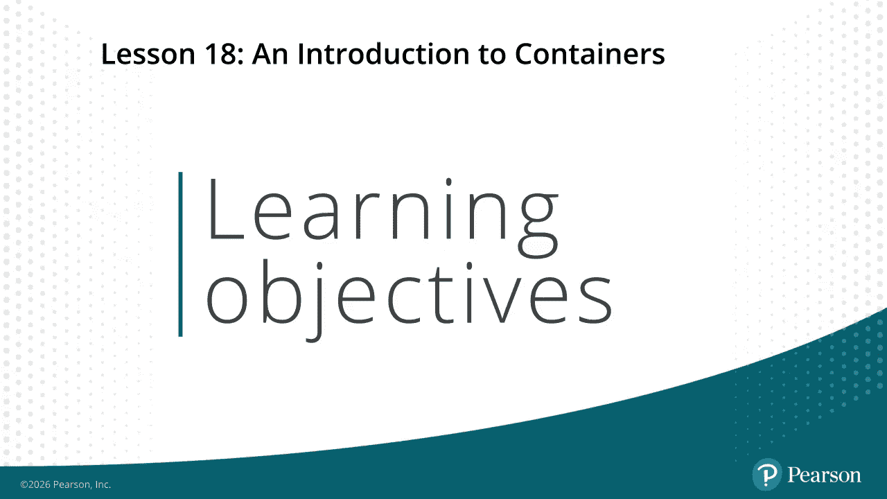
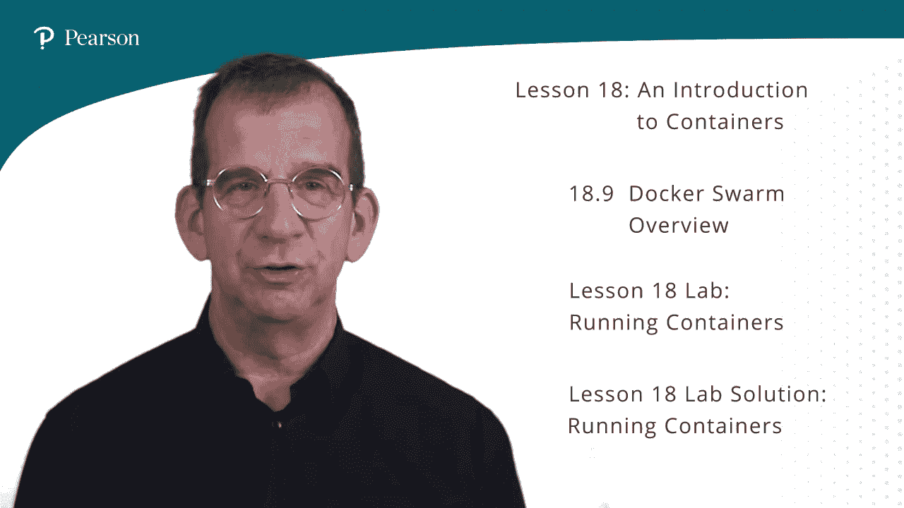

# CompTIA Linux+ V8：410：容器管理学习目标 📦

在本节课中，我们将一起学习容器的基础知识，包括容器是什么，如何使用容器运行时来启动和管理容器，容器镜像的作用，以及容器网络和编排工具。课程最后还会介绍 Kubernetes 和 Docker Swarm，并告诉你课末的实验在哪里。这节课适合初学者，会用大白话把每个概念讲清楚，让你在没有任何基础的情况下也能听得明白。

---

## 1. 容器是什么 📦

上一节我们没有具体内容，本节中我们先来看看什么是容器。你可以把容器理解为一种轻量级的运行环境，它把应用程序和它需要的所有依赖打包在一起，这样无论在哪台机器上运行，效果都一样。这是一个非常直观的概念，你不需要深厚的 Linux 功底就能理解。



容器可以用下面的公式来描述：

容器 = 应用程序 + 依赖库 + 配置文件 + 运行时环境

简单来说，容器就像一个标准的集装箱，里面装好了要运输的货物，你可以把它搬到任何码头上直接卸货，不需要重新打包。这种打包方式让应用的移植变得非常容易。

容器和虚拟机的主要区别在于，容器不需要完整的操作系统内核，它共享宿主机的内核，所以启动速度快，占用资源少。这也是为什么现在很多公司都喜欢用容器来部署应用。

---

## 2. 使用容器运行时管理容器 🔧

本节我们刚认识了容器，接下来我们来看看如何管理容器。管理容器需要用到容器运行时，也就是负责启动、停止和删除容器的软件。没有运行时，容器就无法运行。

常见的容器运行时包括以下几种：

- Docker 引擎
- containerd
- CRI-O

使用容器运行时管理容器的基本命令如下：

```bash
# 启动一个容器
container run 镜像名称

# 查看正在运行的容器
container ps

# 停止一个容器
container stop 容器ID

# 删除一个容器
container rm 容器ID
```

这里的 container 只是示例，实际命令可能是 docker 或 podman，具体取决于你安装的运行时。你只需要掌握启动、查看、停止和删除这几个最常用的操作即可。

---

## 3. 使用容器镜像 🖼️

上一节我们介绍了如何使用容器运行时管理容器，本节中我们来看看容器镜像。镜像是创建容器的模板，里面包含了运行应用所需的一切文件和设置。没有镜像，就无法创建容器。

你可以把镜像想象成照片底片，而容器就是底片冲洗出来的照片。同一个镜像可以启动多个容器，它们互不干扰，每个容器都有自己的运行空间。

容器镜像的核心概念可以表示为：

镜像 → 创建 → 容器

常见的镜像操作包括以下这些：

- 从仓库拉取镜像
- 本地构建新镜像
- 查看本地已有镜像
- 删除不再使用的镜像

镜像通常存储在镜像仓库中，比如 Docker Hub，你可以从上面下载别人做好的镜像，也可以上传自己的镜像供他人使用。这就像应用商店一样，方便大家共享和分发。

---

## 4. 容器网络与编排 🌐

本节我们学习了容器镜像，接下来我们来看看容器网络和编排。容器网络让多个容器之间可以互相通信，编排工具则帮助你管理大量容器的生命周期。单个容器很好用，但实际项目中通常需要多个容器协同工作。

Docker Compose 是一个常用的编排工具，它允许你用一个文件定义多个容器，然后一键启动它们。这让学习微服务变得很简单，因为你可以把不同的服务分装到不同容器中，再通过配置文件把它们连接起来。

Docker Compose 的使用流程如下：

1. 编写 docker-compose.yml 文件
2. 定义需要的服务和容器
3. 运行 compose 命令启动所有服务

编排的核心思想可以概括为：

多容器应用 = 服务定义 + 网络连接 + 卷挂接

---

## 5. Kubernetes 与 Docker Swarm ☸️

上一节我们介绍了容器网络和 Docker Compose，本节中我们来看看 Kubernetes 和 Docker Swarm。Kubernetes 是目前最流行的容器编排平台，它可以在成百上千台服务器上自动部署、扩展和管理容器化应用。对于大规模生产环境，Kubernetes 几乎是标准选择。

运行应用在 Kubernetes 中的基本流程可以用下面的代码表示：

```yaml
apiVersion: v1
kind: Pod
metadata:
  name: 应用名称
spec:
  containers:
    - name: 容器名称
      image: 镜像名称
```



Docker Swarm 则是 Kubernetes 的一个轻量级替代方案，使用起来更简单，适合中小型项目或刚开始接触编排的用户。两者都能实现容器的自动调度和高可用，只是 Kubernetes 功能更强大，学习曲线也更陡峭。如果你只是想快速上手，可以先试试 Docker Swarm。

---

## 6. 课末实验 🧪

在本节课的最后部分，你会找到一个实验和实验参考答案。实验会让你动手操作容器，把刚才学的理论知识应用到实际环境中。建议你先独立完成实验，遇到困难再参考答案，这样学习效果最好。

---

本节课中我们一起学习了容器是什么，如何使用容器运行时管理容器，容器镜像的作用，容器网络与 Docker Compose 编排，以及 Kubernetes 和 Docker Swarm 的基本介绍。希望你通过这节课对容器技术有了初步的认识，并准备好动手去实践。

