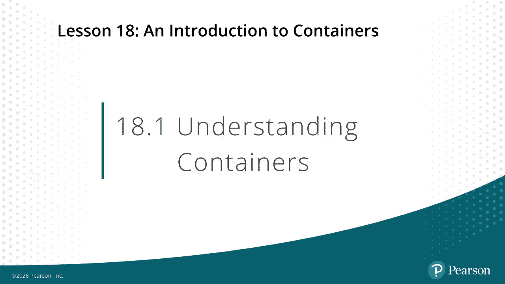
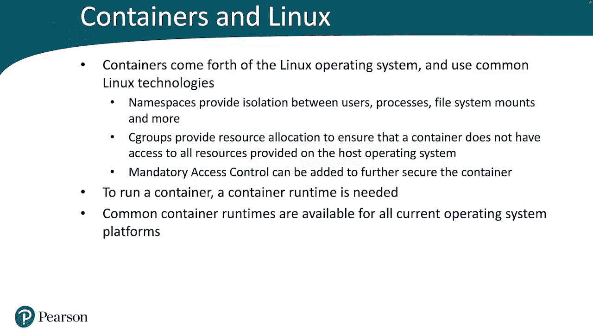

# 🐳 CompTIA Linux+ V8：11：理解容器


在本节课中，我们将一起学习什么是容器，容器镜像是如何工作的，容器的好处是什么，以及容器底层依赖的 Linux 技术有哪些。内容会用大白话讲解，即使你是第一次接触容器，也能看明白。我们会尽量避免晦涩的专业术语，用生活中的例子来帮助你建立直观的认识。




## 什么是容器

容器是一种在完全隔离环境中运行应用程序的方法。简单来说，就是把应用程序关在一个独立的小空间里运行。这个小空间和宿主机上的其他程序是分开的，容器里的应用不会影响外面，外面的程序也默认干扰不了容器。你可以把它想象成一间独立的小房间，房间里只有应用和它运行需要的东西，外面的世界看不到里面，里面的应用也默认看不到外面。这样设计的好处是，不同的应用可以各自安心运行，互不打扰。

为了更直观地理解，我们可以用公式来表示：

```
容器 = 应用程序 + 所有依赖项 + 隔离环境
```

这个公式说明，容器不仅包含应用本身，还包含应用运行所需的所有东西，并且把这些东西和外界隔离开来。


刚才我们介绍了容器的基本概念，下面我们来看看容器镜像是从哪里来的。


## 容器镜像与镜像仓库

容器的基础是容器镜像。容器镜像是一个已经准备好的软件包，里面包含了应用程序运行所需的所有依赖。也就是说，镜像里不仅有应用本身，还有应用需要的库、配置文件、运行环境等等。有了镜像，你就不需要再额外安装别的东西，只需要这个镜像本身就可以运行应用。你不需要关心镜像里面具体安装了什么，只需要直接拿来用即可。

容器镜像通常从容器镜像仓库中获取。常见的公共仓库包括 Docker Hub 和 Quay.io，当然，很多公司也会搭建自己的私有仓库，供内部人员使用。

以下是常见的容器镜像来源：

- 公共镜像仓库，例如 Docker Hub 或 Quay.io
- 私有镜像仓库，由企业内部搭建和维护


镜像有了来源，还需要保证在不同地方都能运行。下面我们看看容器镜像的标准化以及运行容器的好处。


## 镜像标准化与运行容器的好处

容器镜像高度标准化，其背后是 OCI，也就是开放容器倡议（Open Container Initiative）。正因为有这个标准，同样的镜像可以在多种容器方案中使用，不管你使用 Docker、Podman 还是 Kubernetes，镜像都能正常工作。这意味着你不需要为每个平台单独制作镜像，一份镜像到处都能用，不用担心兼容性问题。

运行容器的好处很多。最主要的一点是，你不需要在每台机器上分别安装容器，只要平台上安装了所需的容器运行时，就可以直接运行镜像。而且因为镜像标准化程度很高，你可以在本地的 Docker 或 Podman 上运行某个镜像，也可以在 Kubernetes 集群中运行完全相同的镜像，不用做任何修改。这样部署起来非常方便，也减少了因为环境不同而导致的“我在我的电脑上能运行”的问题。

以下是运行容器的主要好处：

- 无需在每台主机上单独安装容器应用
- 同一个镜像可以在不同的容器平台上运行
- 部署一致，避免环境差异导致的问题


容器之所以能做到隔离和标准化，离不开 Linux 操作系统底层的支持。下面我们看看具体的技术实现。


## 容器底层的 Linux 技术

容器依赖 Linux 操作系统，背后用到了多种 Linux 技术。其中最重要的是命名空间（namespaces），它用于在用户、进程、文件系统、挂载点等方面提供隔离。换句话说，命名空间让容器里的进程觉得自己独占整个系统，但实际上多个容器可以共享同一台主机。每个容器都有自己独立的视图，互不干扰，看起来就像是运行在各自独立的机器上一样。

接下来是控制组（cgroups），它用于资源分配，确保容器不能占用主机操作系统提供的所有资源。比如，你可以限制容器化应用能使用的内存大小，这样它就永远不会把主机的所有内存都吃光，也不会因为一个容器出问题而拖垮整台机器。资源限制可以用简单的公式来理解：

```
容器可用内存 ≤ 设定的内存上限
```

为了进一步提升安全性，还可以添加强制访问控制，比如 SELinux，给容器加上额外的安全防护层，防止容器内的应用越界访问主机上的敏感资源。

以下是容器底层依赖的主要 Linux 技术：

- 命名空间（namespaces）：提供进程、用户、文件系统、网络等方面的隔离
- 控制组（cgroups）：限制和分配 CPU、内存、磁盘 I/O 等资源
- 强制访问控制（例如 SELinux）：增强容器的安全隔离能力


了解了隔离和资源控制，最后一件缺少的拼图是如何实际运行容器。下面我们来看看容器运行时。


## 容器运行时

要运行一个容器，你需要一个容器运行时。常见的容器运行时支持所有当前主流的操作系统平台。有了运行时，镜像才能被真正启动和执行。关于具体的容器运行时有哪些，以及如何选择，我们会在下一个视频中详细介绍。




本节课中，我们一起学习了容器的定义、容器镜像与镜像仓库、镜像标准化和运行容器的好处、容器底层依赖的 Linux 技术，以及容器运行时的基本概念。希望这些内容能帮助你建立对容器的初步认识，为后续深入学习打下基础。
