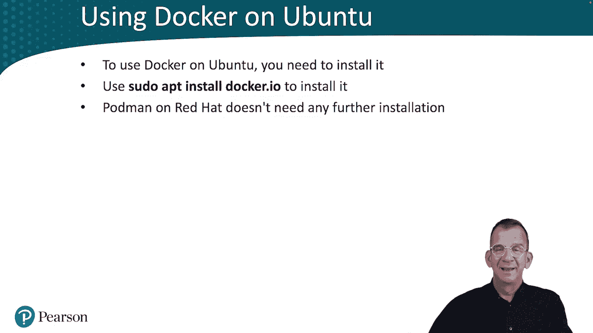
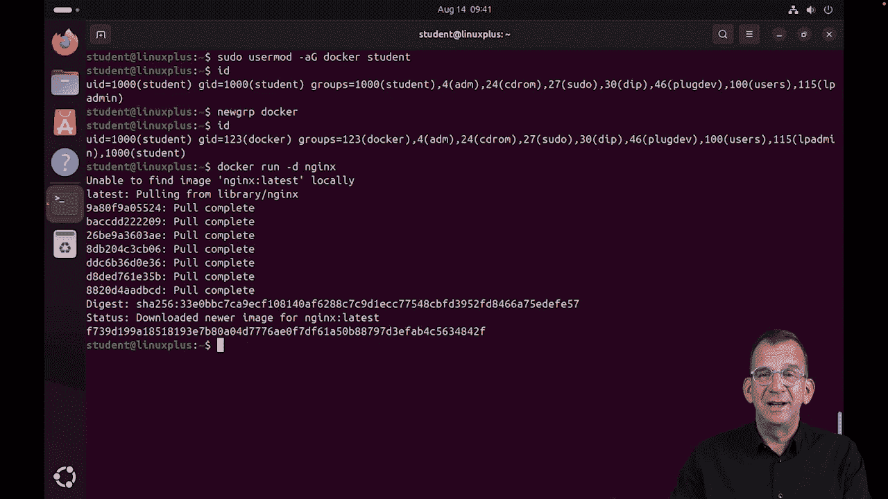

# CompTIA Linux+：第5章：理解容器运行时 📦

## 概述

本节课我们将学习容器运行时的基本概念，了解容器运行时与容器引擎之间的关系，认识 Docker 和 Podman 这两个常见的容器引擎，并学习如何在 Ubuntu 上安装和使用 Docker，最后了解为什么在 Red Hat 系列系统上更推荐使用 Podman。

## 什么是容器运行时和容器引擎

首先，我们来看看什么是容器运行时。容器运行时是负责实际运行容器的软件组件。常见的容器运行时包括 containerd 和 CRI-O，其中 CRI-O 的读法是“cri-o”。容器运行时是容器引擎的一部分。

容器运行时与容器引擎的关系可以用下面的公式表示：

```text
容器运行时 ⊆ 容器引擎
```

接下来，我们聊聊容器引擎。容器引擎是一个完整的软件解决方案，用于启动和管理容器。Docker 和 Podman 是最常见的两个容器引擎，当然市面上也有一些其他的小型容器引擎可供选择。了解了这些基本概念之后，我们再看看 Docker 的发展历史。

## Docker 的发展历史与 Red Hat 的选择

Docker 从 2013 年开始掀起了容器革命，直到 2018 年 Red Hat Enterprise Linux 8 发布之前，Docker 一直是主导的容器引擎。这是因为 Red Hat 不想完全依赖 Docker 的开发进度，Red Hat 想要拥有自己的方案。

因此，在 RHEL 8 发布时，Red Hat 提供了 Podman 作为 Docker 的替代品，并停止了对 Docker 的支持。你可能会问，这对现有的 RHEL Docker 用户是不是个问题？其实不是问题，因为容器镜像在开放容器倡议（OCI）中已经标准化，如果你把 Docker 换成 Podman，它依然可以工作。同时，Podman 的命令行体验与 Docker 命令行完全相似。如今，Podman 在所有主流 Linux 发行版中都可以作为 Docker 的替代品使用。了解了 Docker 和 Podman 的关系之后，我们来看看如何在 Ubuntu 上安装 Docker。

## 在 Ubuntu 上安装 Docker

接下来，我们来看看如何在 Ubuntu 上使用 Docker。如果你想在 Ubuntu 上使用 Docker，你需要先安装它，这很简单，只需使用 docker.io 安装源即可。



以下是在 Ubuntu 上安装 Docker 的方法：

- 使用 apt 安装 docker.io 包
- 安装完成后，Docker 服务即可正常使用

安装完成之后，我们来看看如何解决 Docker 的权限问题。

## 解决 Docker 权限问题

那么，安装完成后如何测试 Docker？先试一下运行 Docker，执行 docker run nginx，结果可能会提示权限被拒绝。

出现这种情况是因为，运行 Docker 的用户必须是 Docker 组的成员。

你可以使用以下命令将用户添加到 Docker 组：

- usermod -aG Docker student

这里的 student 是本地账户名。通常，添加组成员后需要注销并重新登录才能生效，但这里有个小技巧，可以使用 newgrp docker 命令，然后再次使用 id 命令，你就能看到自己已经是 Docker 组的成员了。于是就可以使用 docker run -d nginx 了，-d 表示后台运行模式，你会看到系统在本地找不到镜像，于是它会去拉取镜像并运行，Docker 现在已经启动并运行了。解决了权限问题之后，我们再讨论一下为什么不应该在 RHEL 系统上安装 Docker。

## 为什么不在 RHEL 系统上安装 Docker

另外，不要尝试在 RHEL 系列系统上安装 Docker，因为 RHEL 系列并不支持 Docker，每次系统更新都可能导致问题，应该使用 Podman 作为替代。好消息是，Podman 的命令行体验与 Docker 完全一样，所有参数都相同。所以，你会使用 podman run -d nginx 而不是 docker run -d nginx，关于这个我们将在接下来的几节课中详细介绍。了解了这些内容之后，我们来总结一下本节课的重点。

## 总结



本节课中我们一起学习了容器运行时和容器引擎的区别与联系，了解了 Docker 和 Podman 这两个常见容器引擎的发展背景，掌握了在 Ubuntu 上安装 Docker 并解决权限问题的方法，还明白为什么在 RHEL 系统上应该优先使用 Podman 而不是 Docker。

