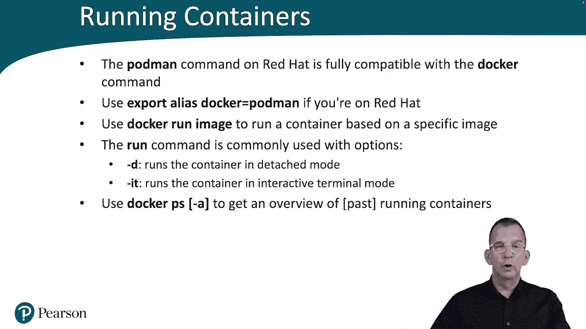
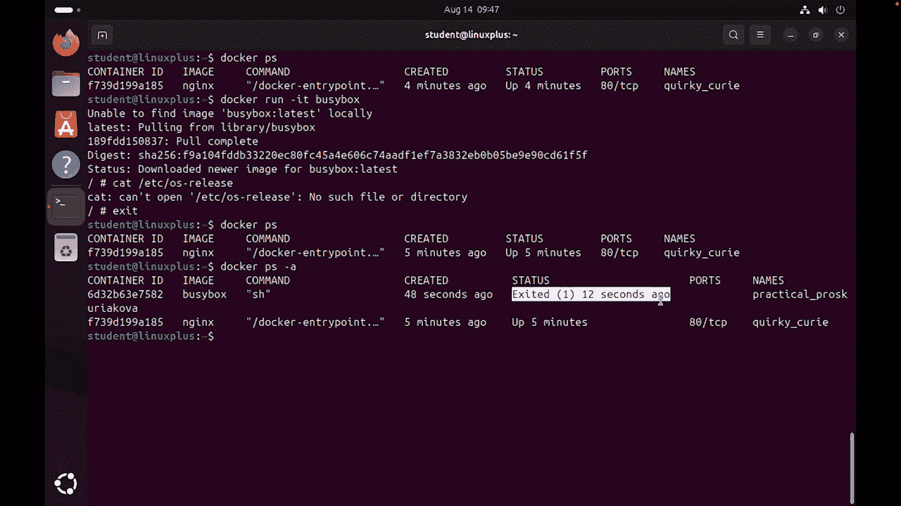
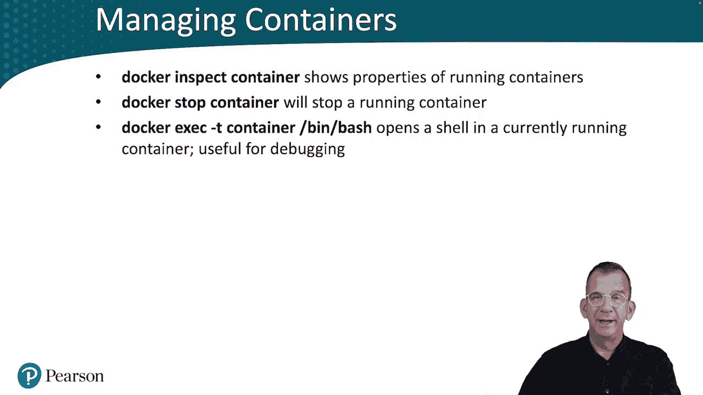
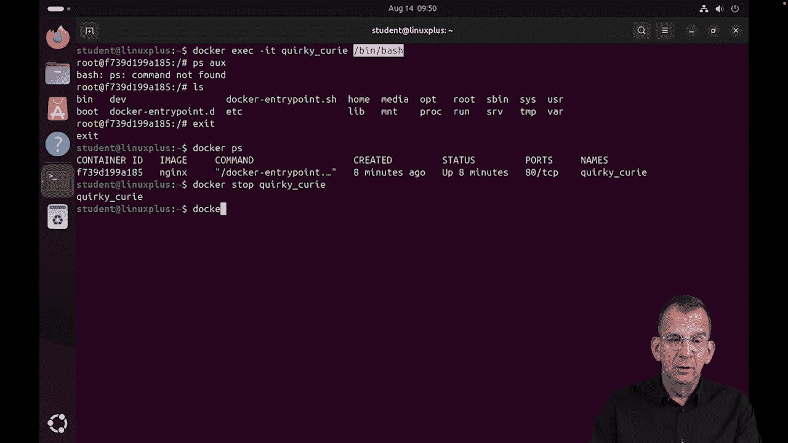
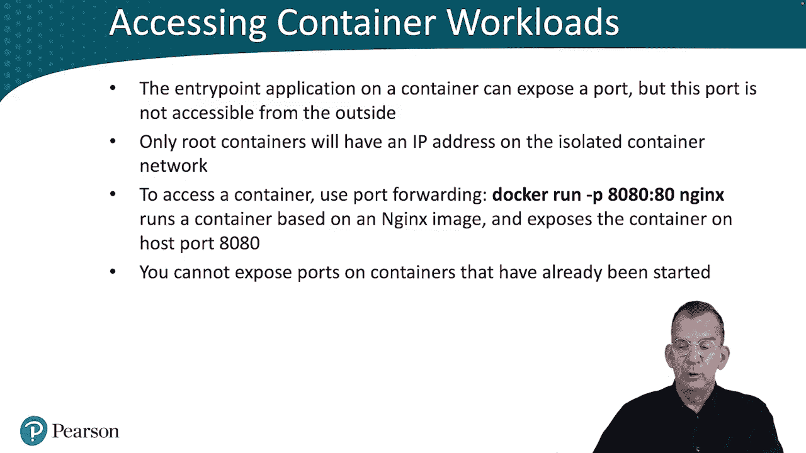
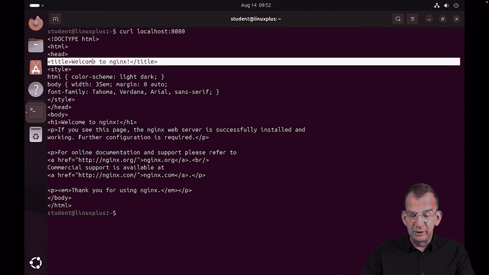

🐳 使用 Docker 和 Podman 运行容器：5：运行容器


在本节课中，我们将学习如何在 Docker 和 Podman 中运行容器。你将了解启动容器的基本命令，如何查看容器运行状态，如何进入容器内部进行调试，如何停止容器，以及如何通过端口转发访问容器里的服务。无论你使用的是 Docker 还是 Podman，核心操作思路基本是一样的，初学者也可以轻松跟上。


## 一、Docker 与 Podman 的兼容性

在红帽系统上，Podman 命令与 Docker 命令完全兼容。这意味着如果你在红帽系统上学习，并且想要完全按照 Docker 的命令来操作，有一个简单的办法。你可以设置一个别名，让系统把 Docker 命令重定向到 Podman。除非你是非常高级的用户，否则在运行容器时你不会察觉到任何区别。

以下是设置别名的命令：

```bash
alias docker=podman
```

执行这条命令之后，你输入的 Docker 相关操作都会由 Podman 来处理，日常使用体验几乎没有差别。




## 二、启动容器的基本命令

运行容器的核心思想非常简单，就是使用 `docker run` 命令后面加上镜像名称。这里的镜像名称是指你在 Docker Hub 上找到的特定容器镜像。Docker Hub 是 Docker 使用的标准容器仓库，你可以访问它的网站来搜索各种容器镜像。

公式化表达如下：

```
docker run <镜像名>
```

启动容器时经常会用到一些选项。以下是常见选项的说明：

- `-d`：以后台模式运行容器。不加这个选项，容器会占据你的当前终端屏幕，你看不到其他输出。
- `-i`：以交互式终端模式运行容器。如果你想在刚启动的容器中运行 Shell，这就是你需要的选项。

想要查看刚刚启动的所有容器，可以使用 `docker ps` 命令。你也可以加上 `-a` 选项，这样不仅能看到当前运行的容器，还能看到过去启动过但现在已经不再运行的容器。


## 三、查看容器运行状态



假设我们已经执行过 `docker run -d nginx` 这样的命令。此时如果再运行 `docker ps`，就能看到当前正在运行的容器。每个容器都有一个容器 ID，你可以用这个 ID 来管理容器。

容器启动时会使用一个标准命令，通常被称为 Entrypoint，它负责决定容器到底要做什么。容器会暴露它的服务端口，并且会有一个自动生成的名称，你也可以用这个名称来管理容器。



如果我们运行 `docker run -i busybox`，就会得到另一个示例。BusyBox 是一个非常常用的容器镜像，之所以常用是因为它非常小巧，是一个只占几兆字节的极简 Linux 发行版。

进入这个容器后，你会突然发现自己处于一个 root Shell 中，这是因为你身处 BusyBox 容器镜像之内。如果你不确定自己身在何处，可以查看系统发行版标识文件。不过要注意，BusyBox 非常精简，甚至连操作系统发行版标识文件都没有。这个文件是 Linux 基金会的标准，理论上应该存在于所有 Linux 发行版中，用来标识你当前所在的发行版。

当你在这个 Shell 中输入 `exit` 时，你会退出该 Shell。但此时如果再用 `docker ps` 查看，你会发现 BusyBox 容器已经不显示了。这是因为 Shell 是容器的主命令，当你退出主命令时，容器也就结束了。如果你想查看包括已退出容器在内的所有容器，就需要使用 `docker ps -a`。


## 四、进入容器内部进行调试

当容器正在运行时，你可以对其进行管理，常用的命令包括以下几种：

- `docker inspect <容器>`：显示容器的属性。
- `docker stop <容器>`：停止正在运行的容器。
- `docker exec -it <容器名称或ID> /bin/bash`：在当前运行的容器中打开终端，这对于调试非常有用。

例如，我想查看名为 quirky curie 的 Nginx 容器，可以使用 `docker inspect` 命令。输出结果是 JSON 格式，里面包含了容器运行的所有信息。其中一个重要部分是路径，也就是容器启动时默认使用的应用程序和参数。你可以看到它启动了 Nginx，如果继续向下滚动，还能找到容器的所有属性，这在容器运行不符合预期时非常有用。

这个容器在后台运行，我可以使用 `docker exec -it quirky curie /bin/bash` 连接到它的交互式终端。需要注意的是，并不是所有容器都内置了 bash，因为容器通常被用作极简环境。如果使用 bash 报错，建议尝试使用 `/bin/sh` 代替。

进入容器后，你可以尝试查看运行中的进程，但你会发现 `ps` 命令找不到。这就是容器的本质：容器是极简环境，镜像里只包含运行你的应用所需要的东西，没有别的。在这种情况下，`ps` 命令不可用，但你可以使用 `ls` 命令来查看容器里的文件。



当你从 `docker exec` 启动的 Shell 中输入 `exit` 时，不用担心，你并没有关闭容器。此时 `docker ps` 仍然会显示该容器，因为你退出的是一个次要命令，而没有停止整个容器。如果你想真正关闭容器，应该使用 `docker stop` 命令作用于你的容器。检查之后，你会发现 `docker ps` 不再显示它，这正是我们想要的结果。


## 五、通过端口转发访问容器服务

我们还需要讨论如何访问容器里的工作负载。容器启动的标准应用就是入口应用，它可以暴露一个端口。但是，默认情况下这个端口无法从外部访问，因为从网络角度来看，容器运行在一个隔离的环境中。只有容器会在这个隔离的容器网络上拥有 IP 地址。

要访问容器，你需要设置端口转发，将容器端口暴露到运行容器的主机上。你可以使用类似下面的命令：

```bash
docker run -p 8080:80 nginx
```



这条命令会基于 Nginx 镜像运行容器，并将容器的端口暴露到主机的 8080 端口。需要注意的是，已经启动的容器无法再暴露新端口。

启动容器时，`docker run` 的参数必须始终写在 `docker run` 之后，而不是写在容器镜像名称之后。如果你把参数写在镜像名后面，这些参数会被解释为容器镜像主命令的参数，而不是 Docker 运行命令的参数。

当我使用 `docker ps` 时，可以看到端口转发信息，例如 `0.0.0.0:8080` 转发到容器的 80 端口。这意味着如果你使用 `curl` 访问 `localhost:8080`，就能访问到容器。如果系统里没有 `curl`，可以先用 `sudo apt install curl` 安装。再次尝试 `curl localhost:8080`，你会看到 Nginx 的欢迎页面。虽然这看起来没有什么特别，但它证明了容器已经可以被外部访问了。


## 六、总结



本节课中我们一起学习了使用 Docker 和 Podman 运行容器的方法。我们了解了 Docker 与 Podman 的兼容性，掌握了 `docker run` 启动容器的基本命令，学会了用 `docker ps` 和 `docker ps -a` 查看容器状态，通过 `docker inspect` 和 `docker exec` 进入容器内部调试，使用 `docker stop` 停止容器，以及通过 `docker run -p` 进行端口转发来访问容器服务。掌握这些基础知识后，你就可以在自己的系统上开始部署和管理容器化应用了。

