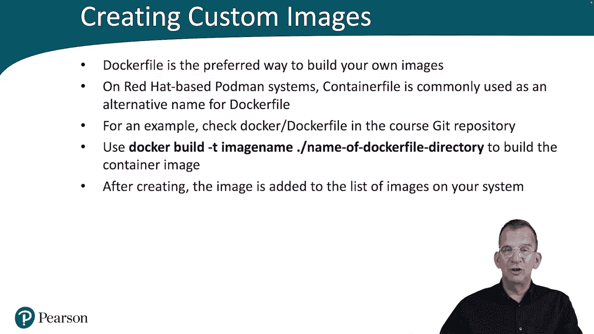
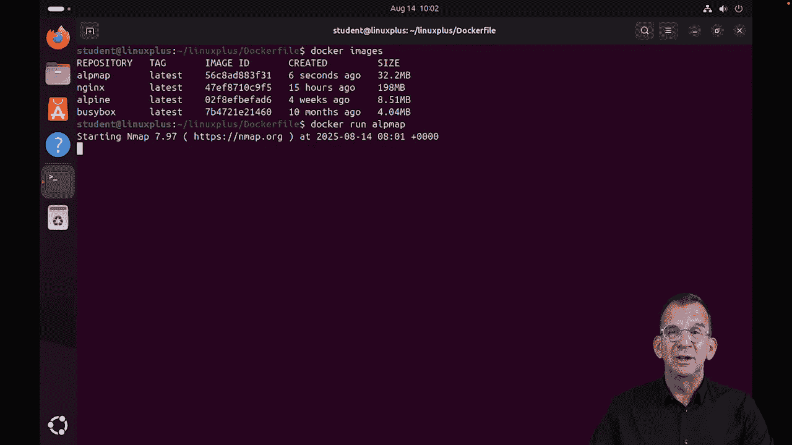

# CompTIA Linux+ V8：第5章：管理容器镜像 🐳

## 本节概述

在本节课中，我们将一起学习如何管理容器镜像。容器镜像是运行容器的基础，理解镜像的获取、查看、检查、删除以及自定义构建，是掌握容器技术的关键一步。我们会用大白话把每一个命令讲清楚，让初学者也能快速上手，不需要之前有容器方面的经验也能看懂。

## 容器镜像的基本概念

容器是基于镜像创建的，所以在启动容器之前，你需要先了解镜像的一些基本知识。简单来说，容器镜像就像是一个模板，里面包含了运行应用程序所需要的所有文件、配置和依赖项。

在默认情况下，所有镜像都会被保存到镜像仓库中，也就是我们常说的 Docker Hub。当你想要运行一个容器时，系统会先从仓库中获取对应的镜像，然后将其存储到本地磁盘上，之后才能启动容器。这个过程确保了容器可以快速启动，而不需要每次都从网络重新下载同样的内容。

## 查看本地已有的镜像列表

上面我们介绍了容器镜像的基本概念，本节中我们来看看如何查看本地已经下载好的镜像。

以下是查看镜像列表的常用命令：

```bash
docker images
```

执行这个命令后，你会看到系统当前保存的所有镜像，包括镜像的仓库名、标签、镜像 ID、创建时间和大小。比如有些基础镜像非常小巧，比如 busybox 只有四兆左右，这说明镜像可以被精简到非常小的体积，方便分发和部署。

## 检查镜像的详细配置

刚才我们学习了如何列出本地镜像，接下来我们要看如何深入查看某个镜像的内部配置信息。



以下是检查镜像详情的命令：

```bash
docker image inspect <镜像名称>
```

这个命令很有用，因为它会告诉你镜像启动容器时到底会发生什么。它会显示镜像中的环境变量、默认运行命令、入口点等详细配置。与直接使用 `docker inspect` 不同，`docker image inspect` 明确告诉系统你要检查的是一个镜像，而不是容器，这样就不会产生歧义，也不会让 Docker 去猜测你的意图。

通过查看这些配置，你可以在真正启动容器之前，先判断这个镜像会做什么，这对排查问题和理解镜像行为非常有帮助。

## 删除不再需要的镜像

了解了如何查看和检查镜像之后，我们再来看看如何清理不再使用的镜像，以释放磁盘空间。

以下是删除镜像的命令：

```bash
docker rmi <镜像名称>
```

当你不再需要某个特定的容器镜像时，可以使用这个命令将其从本地移除。操作完成后，该镜像将不再出现在 `docker images` 的列表中，从而避免占用不必要的存储空间，保持系统整洁。

## 使用 Dockerfile 构建自定义镜像

前面我们讲了如何管理现有的镜像，接下来我们要学习如何创建属于自己的自定义镜像。

要自定义镜像，通常需要编写一个 Dockerfile。在基于 Red Hat 的系统中，这个文件有时也被称为 Containerfile，两者的作用是一样的。Dockerfile 中包含了一系列指令，告诉 Docker 如何一步步构建镜像。

以下是一个简单的 Dockerfile 示例：

```dockerfile
FROM alpine
MAINTAINER 示例开发者
ADD 某个文件 /容器内路径/
RUN apk add nmap
ENTRYPOINT ["nmap", "-Sn", "172.17.0.0"]
```

这个示例使用 Alpine 作为基础镜像，Alpine 是一个非常轻量的 Linux 发行版。然后通过 `MAINTAINER` 指定维护者信息，这是开源项目的一种礼貌做法，方便其他人找到原始开发者。接下来使用 `ADD` 指令将文件添加到镜像中，再用 `RUN` 指令在构建过程中安装软件，这里安装了 nmap 网络扫描工具。最后，`ENTRYPOINT` 指定了容器启动时默认执行的命令。

构建自定义镜像的命令如下：

```bash
docker build -t 镜像名称 .
```

这里的 `-t` 参数用于为镜像指定标签，也就是你要给这个镜像起的名字。构建完成后，新镜像会被添加到系统的镜像列表中，你就可以随时使用它了。

## 实操演示：构建并运行自定义镜像

我们刚才学习了 Dockerfile 的编写和镜像构建命令，接下来通过一个实际演示来巩固这些知识。

首先，从课程的 GitHub 仓库中克隆相关代码：

```bash
git clone https://github.com/sconvert/linux-plus.git
```

进入仓库后，你会找到一个名为 Dockerfile 的子目录，其中包含一个示例 Dockerfile。构建命令可能如下所示：

```bash
docker build -t outpmap .
```

在构建过程中，你可能会看到一条关于旧版构建器已弃用的提示，暂时可以忽略，因为该构建器仍然可用。构建完成后，使用 `docker images` 可以看到新创建的镜像已经出现在列表中。

接着运行该镜像：

```bash
docker run outpmap
```

容器会启动并运行其主要应用程序，也就是 nmap 工具。这时候你会看到 nmap 开始工作，可能会在稍后给出扫描结果。但这里的重点不在于 nmap 的具体输出，而在于你已经成功创建了一个自定义容器镜像，并且它正在运行指定的应用程序。

## 容器隔离的优势

完成了自定义镜像的构建和运行之后，我们最后来聊聊为什么容器技术如此受欢迎。

容器之所以强大，主要在于它们运行在完全隔离的环境中。这意味着容器内部的应用程序不会影响到宿主机上其他正在运行的程序，也不会受到它们的干扰。你可以放心地在容器里测试各种软件，而不需要担心给生产环境带来风险。

## 本节总结



本节课中，我们一起学习了容器镜像的基本概念，掌握了查看镜像列表、检查镜像配置、删除无用镜像的方法，还学习了如何编写 Dockerfile 并构建自定义镜像。最后通过实操演示，运行了自己构建的容器镜像，并了解了容器隔离带来的安全优势。希望这些内容能帮助你更好地理解和管理容器镜像。

