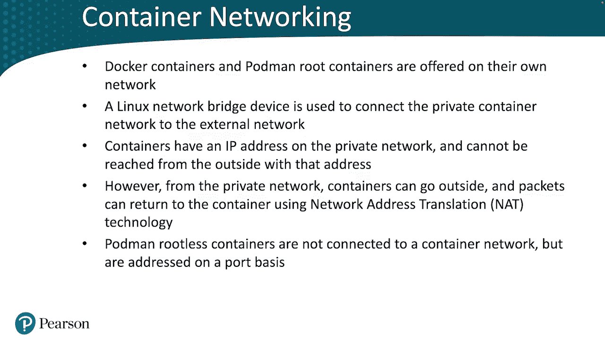
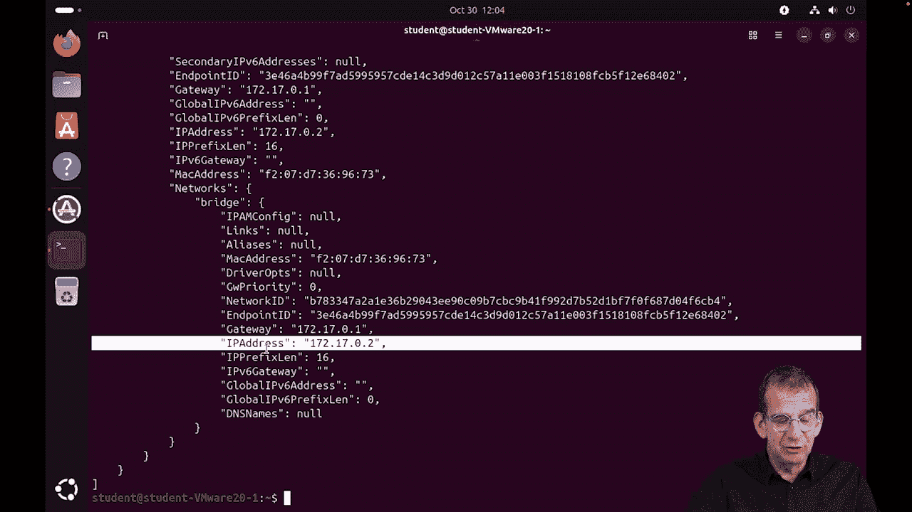

# 🌐 CompTIA Linux+ V8：415：容器网络基础

在本节课中，我们将一起学习容器网络的基础知识。你将了解 Docker 容器和 rootless 容器在网络隔离方面的区别，学习 Linux 网桥如何连接私有容器网络与外部网络，理解 NAT 与防火墙在容器通信中的作用，最后通过一个 Docker 实战演示，直观地看到容器 IP 地址和虚拟网卡是如何工作的。无论你是刚接触容器的初学者，还是想要复习网络基础的学习者，这篇教程都会用大白话把这些概念讲清楚。

---

## 一、容器网络的隔离原理

容器网络的核心目标是隔离。为了让每个容器都能独立运行而不互相干扰，Docker 容器和 rootless 容器都会被分配到各自的网络环境中。因为每个容器都有自己的 IP 地址，而这个 IP 地址必须在完全隔离的条件下提供，这样才能保证容器之间的网络流量不会泄漏或冲突。

以下是容器网络隔离的几个关键点：

- 每个容器拥有独立的 IP 地址。
- 容器的 IP 地址必须在完全隔离的环境中分配。
- 隔离机制防止容器网络流量相互干扰。

---

## 二、Linux 网桥与外部网络连接

虽然容器处于隔离状态，但它们仍然需要与外部世界通信。为此，Linux 系统会使用网桥设备来连接私有容器网络与外部网络。简单来说，网桥就像一座桥梁，把容器内部的私有网络和外面的公共网络连接起来。

在实际操作中，容器拥有自己的 IP 地址，但因为位于私有网络上，外部无法直接访问容器。不过，容器可以从私有网络主动访问外部网络，返回的数据包会通过网络地址转发回容器。

以下是 Linux 网桥连接容器与外部网络的过程：

1. Docker 自动创建一个名为 docker0 的网桥设备。
2. 容器通过虚拟网线连接到 docker0 网桥。
3. 网桥将容器的私有 IP 地址映射到外部网络。

---

## 三、NAT 技术与防火墙的作用

数据包如何从外部网络找回容器呢？这里就用到了网络地址转换技术，也就是 NAT。NAT 技术由 Linux 防火墙实现，它负责在容器和外部网络之间转换地址，确保返回的数据包能准确送达正确的容器。

这就是为什么在使用容器时，防火墙配置始终非常重要。如果没有正确的防火墙规则，容器的网络通信可能会被阻断，或者无法正常接收外部返回的数据。

以下是 NAT 与防火墙在容器网络中的核心作用：

- NAT 技术将容器私有 IP 转换为外部可路由地址。
- Linux 防火墙负责实现 NAT 地址转换规则。
- 防火墙规则决定容器能否访问外部网络以及外部数据如何返回。



---

## 四、Podman Rootless 容器的特殊性

除了 Docker，还有一种常见的容器工具叫 Podman。如果你使用的是 Podman rootless 容器，情况会有些不同。这类容器没有 IP 地址，因此也不会连接到任何容器网络。

Podman 的设计理念是：容器本质上只是一个运行中的特定进程，而寻址进程的通用方式是使用端口号，而不是给每个容器分配 IP 地址。所以在 Podman rootless 模式下，容器网络的处理方式与 Docker 有显著区别。

以下是 Podman rootless 容器与 Docker 容器的网络差异：

- Docker 容器默认拥有独立 IP 地址。
- Podman rootless 容器没有 IP 地址。
- Podman 更倾向于通过端口号寻址运行中的进程。

---

## 五、Docker 容器网络实战演示

理论讲完了，现在我们进入实际演示环节。在 Docker 环境中，你可以通过一系列命令来观察容器网络的具体表现。

首先，确保当前用户属于 docker 组，否则无法运行容器。你可以使用以下命令将当前用户添加到 docker 组：

```bash
sudo usermod -aG docker student
```

为了让新的组成员身份立即生效，无需重新登录，可以使用以下命令激活：

```bash
newgrp docker
```

接下来，启动一个 nginx 容器。如果本地没有 nginx 镜像，Docker 会自动从远程仓库拉取。这里需要注意加上 -d 参数以分离模式运行容器：

```bash
docker run -d nginx
```

启动完成后，使用 `docker ps` 命令查看运行中的容器。然后使用 `ip a` 命令查看网络接口，你会看到除了普通的 eth0 之外，还多出了一个名为 docker0 的设备，这就是 Docker 自动创建的网桥。

在 docker0 网桥中，存在一根虚拟网线，在 `ip` 命令的输出中可以看到类似 `veth` 的虚拟网卡，这根虚拟网线就是连接容器与外部网络的通道。

最后，使用 `docker inspect` 命令查看容器的详细配置。你会发现容器位于名为 bridge 的网络上，该网络拥有自己的网关和 IP 地址，容器正是通过这个网关连接到外部网络的。

以下是查看容器网络信息的常用命令：

- `docker ps`：查看运行中的容器。
- `ip a`：查看宿主机网络接口和 docker0 网桥。
- `docker inspect <容器ID>`：查看容器的 IP 地址和网络配置。

---

## 总结



本节课中，我们一起学习了容器网络的基础知识。我们了解到 Docker 容器和 rootless 容器都需要网络隔离，每个容器都有自己的 IP 地址。Linux 网桥将私有容器网络连接到外部网络，而 NAT 技术和 Linux 防火墙则负责地址转换和数据包返回，确保容器可以安全地访问外部网络。此外，Podman rootless 容器没有 IP 地址，更倾向于通过端口号寻址进程。最后，我们通过 Docker 实战演示，观察了 docker0 网桥、虚拟网线和容器 IP 配置是如何工作的。希望这篇教程能帮助你建立起对容器网络的直观认识。
