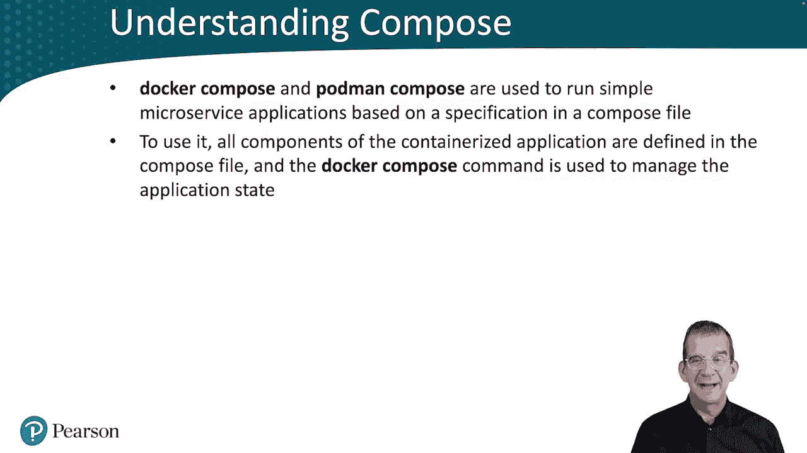
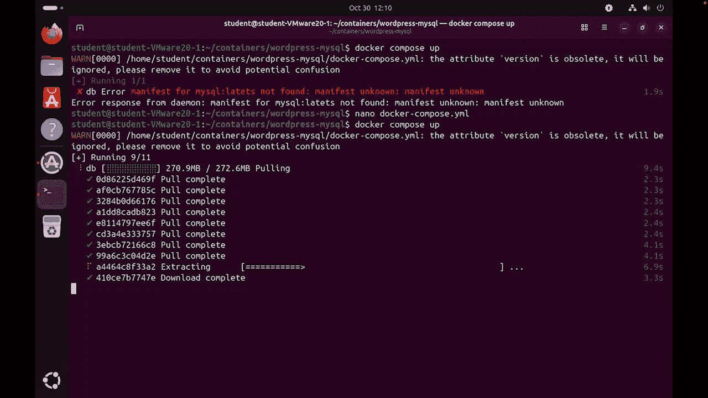

# 🐳 Docker Compose 教程：第5部分：Compose 文件与容器应用管理


在本节课中我们将要学习 Docker Compose 的基本用法，理解 Compose 文件如何定义容器化应用，并掌握使用 docker compose 命令管理应用状态的方法。


## 什么是 Docker Compose


要理解 Docker Compose 是什么，首先要看它解决了什么问题。Docker Compose 是一个专门用来定义和运行多容器 Docker 应用程序的工具。它的基本思路是把应用程序运行所需要的所有组件，比如数据库、Web 服务器、缓存服务等等，全部写在一个配置文件里面，然后通过一条命令把它们全部启动起来。这样一来，你就不需要手动地一条条运行 docker run 命令，也不需要自己去记每个容器应该使用哪些参数，整个应用的启动过程变得简单得多。

我们可以用下面的公式来理解 Docker Compose 的核心作用：




```
完整应用 = Compose 文件 + docker compose 命令
```


Compose 文件就是这个应用的完整定义，它告诉 Docker 你想要使用哪些镜像，容器之间应该如何连接，需要挂载哪些目录，以及要开放哪些端口。有了这个文件之后，你就可以把整个应用的运行状态交给 Docker Compose 来统一管理，而不需要分别去操作每一个容器。


## Compose 文件的核心内容


上一节我们介绍了 Docker Compose 的基本概念，本节中我们来看看 Compose 文件里面通常包含哪些内容。Compose 文件通常使用 YAML 格式编写，文件名一般是 docker-compose.yml。在这个文件里面，你需要定义应用程序包含的每一个服务，而每一个服务都会对应一个具体的容器镜像。

以下是 Compose 文件中常见的配置项：


- service：定义应用中的一个服务，比如数据库服务或 Web 服务。
- image：指定该服务使用的容器镜像名称和版本号。
- volume：定义数据卷，用于在容器之间共享数据，或者实现数据的持久化存储。
- environment：设置容器启动时需要的环境变量，例如数据库的密码或者连接地址。
- ports：把容器内部的端口映射到主机端口上，这样外部就可以正常访问服务了。


这几项配置加在一起，就是启动一个容器化应用所需要的全部信息，缺少哪一项都可能导致应用无法正常运行。


## 安装与准备工作


了解了 Compose 文件的结构之后，本节中我们来看看在真正使用之前，需要做哪些准备工作。在开始使用 Docker Compose 之前，你需要确保系统中已经安装了 Docker 引擎以及 Docker Compose 插件。如果你使用的是基于 Debian 或 Ubuntu 的系统，可以通过 apt 包管理器来完成安装。

以下是安装步骤：


1. 使用 root 权限运行终端命令。
2. 执行 apt install docker-compose 来安装 Docker Compose。
3. 安装完成后，你就可以使用 docker compose 命令来管理应用了。


安装完成之后，你还需要准备一个 Compose 文件。如果你手边已经有一个 Git 仓库，那么可以直接把它克隆到本地，这样就不需要从头开始编写配置文件，可以直接在现有示例的基础上进行修改。


## 查看 Compose 文件示例


安装和准备工作完成以后，本节中我们来看看一个真实的 Compose 文件长什么样。假设你已经把包含容器示例的 Git 仓库克隆到了本地，进入仓库目录之后，你会看到一个名为 WordPress My SQL 的子目录。在这个子目录里面，有一个 docker-compose.yml 文件，我们可以使用编辑器把它打开，查看里面的具体内容。

无论你使用的是 vim 还是 nano，编辑器的作用都是一样的，只是用来查看和修改文本文件。打开文件之后，你会发现里面定义了好几个服务，每个服务都在使用特定的容器镜像。

下面是一个简化后的 Compose 文件结构示例，可以帮助你理解它的组织方式：


```yaml
services:
  db:
    image: mysql:5.7
    volumes:
      - db_data:/var/lib/mysql
    environment:
      MYSQL_ROOT_PASSWORD: example
  web:
    image: wordpress:latest
    ports:
      - "8000:80"
    environment:
      WORDPRESS_DB_HOST: db
volumes:
  db_data:
```


这个示例展示了如何定义数据库服务和 Web 服务，以及它们之间如何通过数据卷和环境变量进行关联，从而组成一个完整的应用程序。


## 启动与排查问题


查看完 Compose 文件的示例以后，本节中我们来看看如何启动应用，以及在启动过程中可能会遇到什么问题。有了 Compose 文件之后，接下来就可以使用 docker compose up 命令来启动应用了。这条命令会读取 Compose 文件，自动去拉取所需要的镜像，然后创建并启动所有定义好的容器。

在实际操作过程中，可能会遇到一些问题。例如在本节课的演示中，启动时提示找不到匹配的镜像清单，原因是某个镜像没有针对当前 CPU 架构（比如 Linux arm64）提供对应的版本。解决办法是修改 Compose 文件中的镜像版本，或者直接替换成可用的镜像，比如改用 nginx:latest。这里的目的只是为了理解 Docker Compose 的工作原理，而不是为了构建一个完美的微服务架构。

如果在启动过程中发现镜像名称有拼写错误，也需要先修正错误，然后重新执行启动命令。当所有镜像拉取完成，容器启动之后，你就能看到一个由 Docker Compose 管理的完整微服务应用正在运行了。

默认情况下，docker compose up 会在前台运行，这意味着你会在终端上直接看到容器输出的日志信息。如果你想退出当前查看界面并停止应用，可以使用 Ctrl+C 组合键。这就是你需要了解的关于 Docker Compose 的基本内容。


## 总结




本节课中我们一起学习了 Docker Compose 的基本概念，了解了 Compose 文件如何通过定义服务、镜像、卷、环境变量和端口来描述容器化应用，并掌握了使用 docker compose up 启动应用以及使用 Ctrl+C 停止应用的方法。

