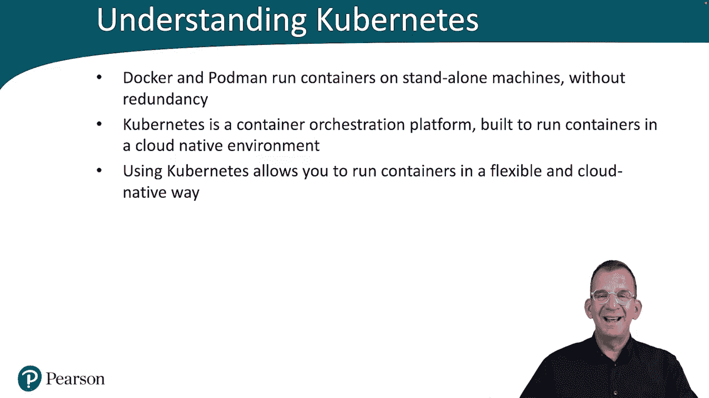
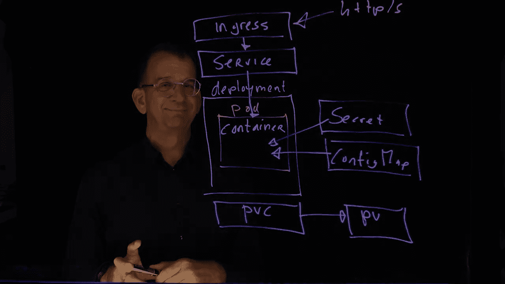

# CompTIA Linux+ V8：417.187：理解 Kubernetes 🚀

在本节课中，我们将要学习 Kubernetes 是什么，以及它如何帮助我们在云原生环境中管理容器。我们会从最基础的容器说起，逐步介绍 Pod、Deployment、持久卷、配置项、服务和入口网关等核心资源。无论你是刚接触容器的初学者，还是想要了解云原生架构的学习者，这篇教程都会用大白话把 Kubernetes 的核心理念讲清楚。

## 什么是容器编排 📦

上一节我们介绍了本节课的学习目标，本节中我们来看看什么是容器编排，以及 Kubernetes 在其中扮演什么角色。

Docker 和 Podman 是用来在独立环境中运行容器的工具。如果你希望把容器应用搬到云上，那么通常会使用 Kubernetes。Kubernetes 是什么？它就是我们所说的容器编排平台，专门用于在云原生环境中运行容器。

简单来说，编排的作用就是确保你的容器运行在它应该运行的位置。云平台通常是一个可以跨越大区域的多服务器平台，而编排器则负责确保你的容器精确地运行在需要的位置。使用 Kubernetes，你可以用一种灵活且云原生的方式来学习和使用容器。

为了实现这些功能，Kubernetes 使用了不同的资源对象。接下来我们就一起看看这些资源是如何协同工作的。

## 从容器到 Pod 再到 Deployment 🔄

上一节我们介绍了什么是容器编排，Kubernetes 的作用，本节中我们来看看 Kubernetes 中最基础的资源层级。



在 Kubernetes 中，一切都始于容器。容器是运行应用程序的最小单元。但是，单独的容器很难直接管理，因此 Kubernetes 引入了 Pod 的概念。

`Pod` 是 Kubernetes 使用的最小实体。你可以在 Pod 中指定选项，以便在 Kubernetes 集群的正确位置运行这个 Pod。不过，Pod 本身还不够，它还需要可扩展性，还需要更新策略。

这就是 `Deployment` 出现的原因。Deployment 提供了扩展和更新的能力，因此它成为提供应用程序访问时最常用的资源。

以下是资源层级的简单表示：

```text
容器 → Pod → Deployment
```

这意味着：先有容器，把容器封装进 Pod，再用 Deployment 来管理 Pod 的数量和更新。

虽然 Deployment 很有用，但它本身也需要一些帮助。这是因为我们需要实现所谓的“解耦”。容器是基于只读镜像创建的，你如何把特定站点的信息添加到 Deployment 中，这是一个需要解决的问题。这就涉及到存储和配置的问题了。

## 使用 PVC 和 PV 存储数据 💾

上一节我们介绍了容器、Pod 和 Deployment 的关系，本节中我们来看看如何为应用程序提供持久化存储。

因为容器镜像是只读的，所以你不能直接在里面保存用户数据。为了解决这个问题，Kubernetes 引入了持久卷声明，也就是 `PVC`（Persistent Volume Claim）。

PVC 通常会尝试获取对 `PV`（Persistent Volume）的访问权限。PV 是持久卷，由云平台提供。

通过这种机制，你可以以独立于应用程序的方式存储数据。即使你的应用程序宕机了，数据依然能够保留下来。

## 使用 ConfigMap 和 Secret 管理配置 ⚙️

上一节我们介绍了如何使用 PVC 和 PV 来持久化存储数据，本节中我们来看看如何管理应用程序的配置信息。

在 Linux 容器中，配置文件通常放在 `/etc` 目录下。你不希望把配置文件硬编码进镜像里，因为那样的话，配置就无法修改了。因此，Kubernetes 提供了 `ConfigMap`，你可以把它注入到应用程序中。

如果你的配置信息比较敏感，比如密码或密钥，那么你应该使用 `Secret`，将其作为 ConfigMap 的安全替代方案注入到应用程序中。

这样，你的应用程序就可以在运行时动态获取配置，而不需要重新构建镜像。

## 使用 Service 暴露应用程序 🌐

上一节我们介绍了如何使用 ConfigMap 和 Secret 管理配置，本节中我们来看看如何让外部用户访问运行在 Kubernetes 中的应用程序。

为了访问你的应用程序，Kubernetes 使用了一种名为 `Service` 的资源。

这里的“服务”和 Linux 中的 systemd 服务完全不同，请不要混淆。在 Kubernetes 中，Service 资源更像是一个负载均衡器，它为你提供对 Pod IP 地址的访问。

如果你的应用已经扩容，存在多个 Pod 实例，那么 Service 就非常必要了。Service 资源会确保你的流量被引导到合适的 Pod 上。

## 使用 Ingress 和 Gateway API 接收外部流量 🚪

上一节我们介绍了如何使用 Service 在内部访问应用程序，本节中我们来看看如何处理从外部进入集群的 HTTP 和 HTTPS 流量。

为了完善整体架构，你还需要在 Service 之上加一个 HTTP 反向代理。这就是 `Ingress` 和现代 Kubernetes 提供的功能。在较新的 Kubernetes 版本中，我们通常称之为 `Gateway API`。

无论是 Gateway API 还是 Ingress，它们都负责接收进来的 HTTP 和 HTTPS 流量，并将其转发到集群内部的服务上。

由此可见，Kubernetes 中有非常多的资源在发挥作用，它们共同构成了一个完整的云原生容器管理平台。

## 本节总结



本节课中，我们一起学习了什么是 Kubernetes 容器编排平台，以及它如何确保容器运行在正确的位置。我们了解了容器、Pod、Deployment 的层级关系，学习了如何使用 PVC 和 PV 存储数据，掌握了 ConfigMap 和 Secret 管理配置的方法，还了解了 Service、Ingress 和 Gateway API 如何帮助我们访问应用程序。希望这些内容能帮助你建立对 Kubernetes 的初步认识。
