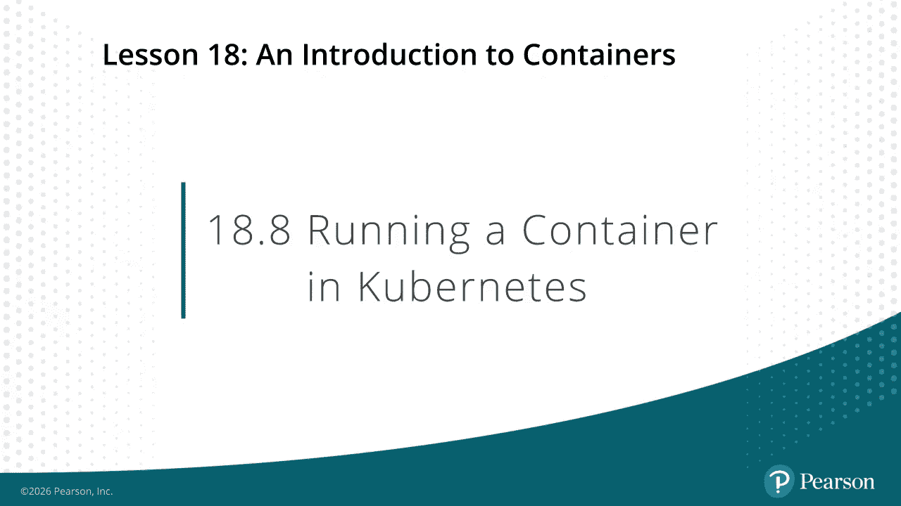
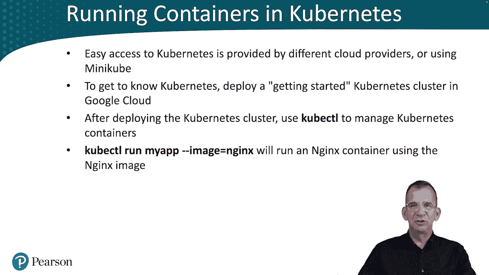
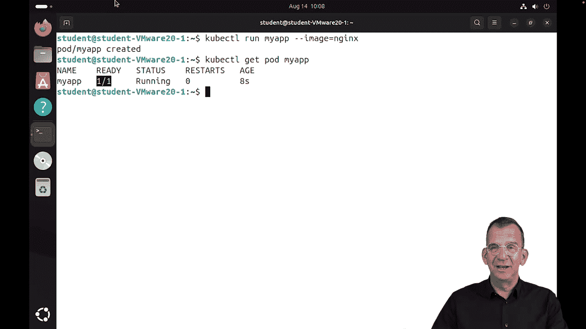

# Linux+ 教程：第 18 节：在 Kubernetes 中运行容器 🐳

## 本节概述


在本节课中，我们将一起学习如何在 Kubernetes 中运行容器。主要内容包括了解什么是 Kubernetes，如何通过不同的云服务提供商，或者使用 Minikube 来快速接触 Kubernetes，以及如何使用 kubectl 命令行工具来管理容器。你也可以在 Google Cloud 中部署一个入门级的 Kubernetes 集群，用来练习和测试。部署完集群之后，我们会使用 kubectl 命令来管理 Kubernetes 里的容器。不管你的 Kubernetes 集群是怎么运行的，kubectl 始终都是管理它的标准方式。本节课的目的不是要让你成为 Kubernetes 专家，因为 Kubernetes 非常复杂，真正掌握它还需要额外的专门培训。但我确实想给你演示一下，怎么在 Minikube 中运行一个被编排的容器，Minikube 是一个非常适合测试用途的 Kubernetes 平台，非常适合初学者在本地进行实验。



刚才我们了解了 Kubernetes 的基本概念和访问方式，接下来我们来看看怎么用 kubectl 来管理容器。

## 使用 kubectl 管理 Kubernetes 容器

kubectl 是 Kubernetes 官方的命令行工具，也是连接和操作 Kubernetes 集群的标准入口。不管你的 Kubernetes 集群运行在云端，还是运行在本地的 Minikube 里，kubectl 都是统一的管理方式，没有什么区别。

以下是 kubectl 的主要作用：
- 连接到 Kubernetes 集群，查看集群里有哪些资源。
- 创建、更新和删除容器、Pod 以及其他的工作负载。
- 查看应用的运行状态，排查常见的问题。

在 Linux+ 的学习目标中，我们不需要把你培养成 Kubernetes 专家，因为 Kubernetes 太复杂了，想真正搞懂它还需要专门的额外培训。不过，我还是会带你看看最核心的操作，让你知道怎么在 Minikube 里运行一个被编排的容器。

了解了 kubectl 的作用之后，我们现在进入实际操作，先来看看怎么启动 Minikube 集群。

## 启动 Minikube 集群

在这台虚拟机里，Minikube 已经准备好了，你只需要启动它就可以了。Minikube 是一个轻量级的 Kubernetes 平台，特别适合拿来做测试和学习，能让你在不花太多精力的情况下体验 Kubernetes 的基本功能。

以下是启动 Minikube 的步骤：

1. 打开终端，确认虚拟机环境已经就绪。
2. 执行启动命令：

```bash
minikube start
```

3. 等待命令执行完毕，Minikube 会在后台创建虚拟机并配置好 Kubernetes 的各种组件。

启动完成之后，你的虚拟机里就运行着一个可以使用的 Kubernetes 集群，接下来就可以用 kubectl 去连接和管理它了。

集群启动完成后，下一步就是在里面运行容器，下面我们来看看怎么操作。



## 运行第一个容器应用

集群启动之后，我们先用 kubectl 看看集群里已经有哪些资源。kubectl 命令平时就是用来连接 Kubernetes 集群的，通过它你可以查看集群内部的各种对象。

以下是查看集群资源的命令：

```bash
kubectl get all
```

执行完之后，你会看到集群里已经创建了很多资源。这是因为之前这个集群已经用来做过演示了，所以里面有一些基础组件存在，这很正常。

接下来，我们要运行一个容器。使用 kubectl run 命令可以直接启动一个容器镜像，并且给它起个名字。在这个例子里，我们要运行名为 my-app 的容器，并且需要指定使用哪个镜像。

这里需要指定镜像，其实很简单，只需要加上 --image 参数，镜像名称是 nginx。

以下是创建容器的命令：

```bash
kubectl run my-app --image=nginx
```

执行这条命令之后，Kubernetes 就会创建一个名为 my-app 的 Pod，并在里面运行 nginx 容器镜像。

容器创建好之后，我们需要确认它是否正常运行，下面是验证步骤。

## 验证容器运行状态

容器创建完成之后，我们需要确认它是不是真的在运行。可以使用 kubectl get pod 命令，查看特定 Pod 的状态信息。

以下是查看 Pod 状态的命令：

```bash
kubectl get pod my-app
```

执行完命令之后，你会看到 my-app Pod 已经处于运行状态，其中的 1/1 表示 Pod 里面有一个容器正在运行，说明应用程序已经可以用了。这样一来，你就在 Kubernetes 里成功运行了第一个编排容器。

关于在 Kubernetes 中运行容器的最简介绍就到这里了，你已经掌握了启动 Minikube、用 kubectl 连接集群、运行容器镜像以及验证运行状态的基本流程。

## 本节总结



在本节课中，我们一起学习了在 Kubernetes 中运行容器的基本方法。首先介绍了 Kubernetes 是什么，以及怎么通过云服务提供商或者 Minikube 来访问 Kubernetes；其次说明了 kubectl 是管理 Kubernetes 容器的标准工具，不管集群在哪里运行都适用；然后演示了怎么在虚拟机里启动 Minikube 集群，接着使用 kubectl run 启动了一个名为 my-app 的 nginx 容器，最后通过 kubectl get pod 验证了容器正在运行，应用已经可用。虽然 Kubernetes 很复杂，想成为专家还需要更多学习，但本节课已经让你掌握了最核心的入门操作。

