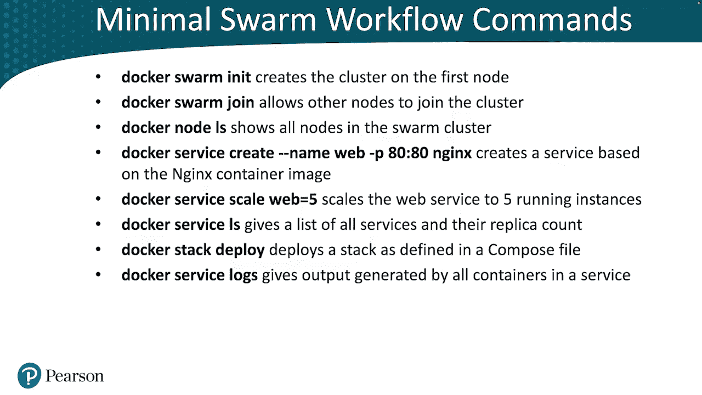
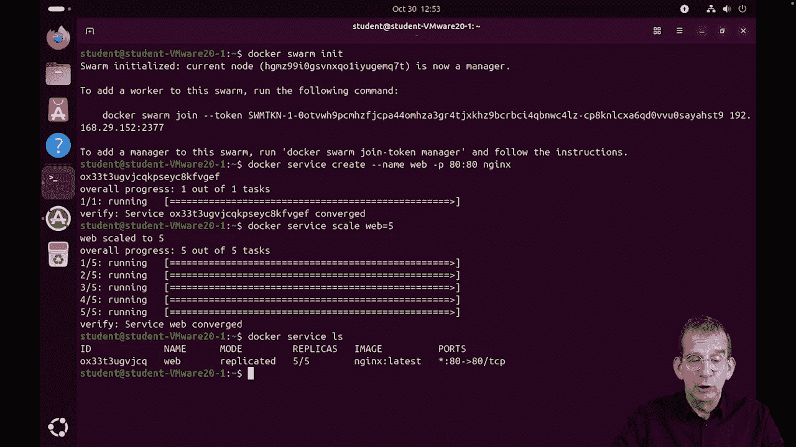

# 🐳 Oreilly CompTIA Linux+ V8：p19：Docker Swarm 概述

## 开篇概述

在本节课中，我们将学习 Docker Swarm 是什么，它有什么用，以及如何使用几个常用命令来创建和管理 Docker 集群。内容会用大白话讲解，避免晦涩的专业术语，让刚接触容器技术的初学者也能听懂。无论你是想搭建一个简单的测试环境，还是想了解集群管理的基本思路，这一节都适合你。

## 什么是 Docker Swarm

进入正文之前，我们先来看看 Docker Swarm 到底是什么东西。简单来说，Docker Swarm 是 Docker 官方提供的一种集群解决方案。它可以让你把多台安装了 Docker 的主机组合在一起，形成一个统一的集群。在这个集群里，所有的主机被统一管理，你不需要分别登录每台机器去操作容器。

从功能上看，Docker Swarm 在很大程度上是在做 Kubernetes 在做的事情。它能自动处理容器的调度、伸缩、网络连接以及故障转移。如果你觉得 Kubernetes 太复杂，想要一个更容易上手的替代方案，Docker Swarm 是个不错的选择。当然，它的功能没有 Kubernetes 那么丰富，但胜在简单，非常适合快速上手和测试。

关于费用，在 Docker 20 之前，使用 Swarm 需要购买 Docker Enterprise Edition 授权。但从 Docker 20 开始，Swarm 变成了开源免费的功能，不再需要任何许可证。这意味着你可以随时把它拿来试用，不用担心授权问题。

公式描述：

```
Docker Swarm = 多台 Docker 主机组成的统一集群
```

## 核心术语讲解

了解了 Docker Swarm 的大致用途之后，本节我们来看看它里面常用的几个专业术语。搞清楚这些词，后面学习命令的时候会轻松很多。

以下是 Docker Swarm 中几个最重要的概念。

- **Swarm**：指的是整个集群，也就是一组 Docker 节点的集合。
- **Node**：指的是 Docker 主机。节点分为两种角色，一种是 Manager 节点，负责控制整个集群；另一种是 Worker 节点，负责执行具体的工作负载。
- **Service**：是对要运行什么的描述，包含容器镜像、端口、副本数量和约束条件。其中 Replicas 指的是同一个容器镜像的多个实例。
- **Task**：是 Service 中实际运行的某一个具体容器。
- **Stack**：是一组 Service 的集合，这些服务合在一起构成一个微服务应用。

用公式来表示这些关系：

```
Service = 镜像 + 端口 + 副本数 + 约束条件
Task = Service 中运行的一个具体容器
Stack = 一组 Service 的集合
```

## 常用命令介绍

术语搞清楚之后，本节我们来看看在实际操作中，Docker Swarm 常用的命令都有哪些。掌握这些命令，你就可以开始动手实践了。

以下是几个最常用的 Docker Swarm 命令。

1. **docker swarm init**：在第一个节点上创建集群，并把当前节点设置为 Manager 节点。
2. **docker swarm join**：让其他节点加入已经存在的 Swarm 集群。
3. **docker node ls**：查看 Swarm 集群中所有的节点列表。
4. **docker service create --name web -p 80:80 nginx**：基于 Nginx 镜像创建名为 web 的服务，并把容器的 80 端口映射到主机的 80 端口。
5. **docker service scale web=5**：把 web 服务扩容到五个副本实例，提升处理能力。
6. **docker service ls**：列出集群中所有的服务，并显示每个服务当前的副本数量。
7. **docker stack deploy**：根据 Compose 文件部署一个完整的栈（Stack）。
8. **docker service logs**：查看某个服务中所有容器产生的日志输出。



具体命令示例如下：

```bash
docker swarm init
docker swarm join <token> <manager-ip>
docker node ls
docker service create --name web -p 80:80 nginx
docker service scale web=5
docker service ls
docker stack deploy -c docker-compose.yml myapp
docker service logs web
```

## 快速演示

光看命令可能还不够直观，本节我们通过一个简单的演示来看看 Docker Swarm 怎么用。

首先，在第一台主机上执行 docker swarm init。执行之后，这台主机就变成了 Manager 节点，命令会打印出一个加入命令。你可以把这个加入命令复制到其他主机上运行，这样它们就能加入到 Swarm 集群中了。

集群搭建好之后，使用 docker service create --name web -p 80:80 nginx 来创建一个名为 web 的服务。执行完成后，Docker 就会基于 Nginx 镜像为你创建这个服务，并设置好端口转发。

接下来，如果你想让这个服务能处理更多的请求，可以使用 docker service scale web=5，让 web 服务运行五个不同的实例。这时候，同一个服务就有多个副本在同时工作了。

最后，使用 docker service ls 就可以看到服务已经在运行，并且当前有五个副本。这时候，你的服务就已经准备好对外提供业务了。

关于 Docker Swarm 的基础介绍就到这里。毕竟 Docker Swarm 本身是一个很大的话题，掌握这些基础知识就足够了。

## 总结



本节课中，我们一起学习了 Docker Swarm 是什么，它如何把多个 Docker 主机组成集群，以及 Swarm、Node、Service、Task、Stack 等核心术语的含义。我们还掌握了 docker swarm init、docker service create、docker service scale 等常用命令，并通过一个简单的演示了解了如何快速部署一个可扩展的容器服务。希望这篇教程能帮你打好 Docker Swarm 的基础。

