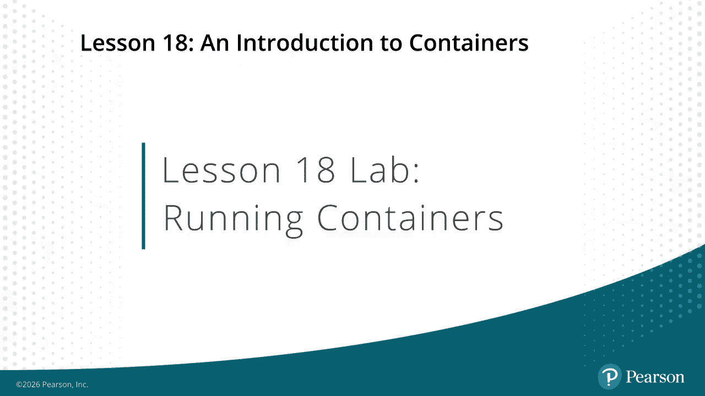
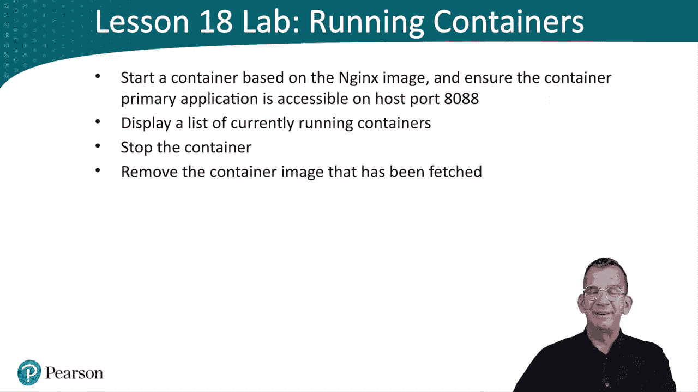

# CompTIA Linux+ V8: 第18课：运行容器实验 🐳

在本节课中我们将要学习如何在 Linux 系统中启动和管理容器。本节是容器实验的收尾部分，我们会快速过一遍之前的内容，并动手完成一次完整的操作流程。目的是让你能够独立启动容器，确认应用程序能否通过指定端口访问，最后把用过的容器和镜像清理干净。虽然步骤不算复杂，但每一个环节都很重要，建议你不要只看文字，最好在自己的机器上实际操作一遍，这样才能真正理解容器是怎么工作的。

## 实验任务概述 📋


这个实验包含几个连贯的步骤，我们需要先启动容器，再验证服务是否可用，然后查看容器列表，接着停止容器，最后删除镜像。以下是本实验需要完成的具体任务：



- 基于 `EngineG X` 镜像启动一个容器。
- 确保容器的主程序可以通过主机端口 `8088` 访问。
- 显示已获取的学习容器列表。
- 停止正在运行的容器。
- 删除已获取的容器镜像。

## 启动容器并验证端口访问 🚀

在上一节我们介绍了镜像的基本概念，本节中我们来看看如何实际启动容器。启动容器的逻辑可以用下面这个简单的公式来描述：

```text
容器启动 = 镜像 + 端口映射 + 运行参数
```

具体操作时，你需要使用 `EngineG X` 镜像来启动容器，并且要把容器内部运行的服务映射到主机的 `8088` 端口上。这样你在本机或者通过网络访问主机的 `8088` 端口时，就能够访问到容器里运行的主程序了。这是整个实验的第一步，也是最关键的一步，因为如果容器没启动起来，或者端口映射没有配置正确，后续的访问验证就无法进行，整个实验也就无法继续下去了。

## 查看、停止与删除容器资源 🛑

容器启动并且端口访问正常之后，我们还需要知道如何管理已经存在的容器资源。接下来的操作包括查看容器列表、停止容器以及删除镜像。以下是需要执行的操作清单：

- 使用命令显示所有已获取的学习容器，查看当前系统中存在哪些容器。
- 执行停止命令，把正在运行的容器安全地关闭。
- 删除之前获取的容器镜像，释放磁盘空间并完成环境清理。

这些操作看起来不多，但它们其实涵盖了容器从启动到销毁的完整生命周期。查看容器列表能让你清楚系统里跑着什么，停止容器可以暂时释放资源同时保留数据，删除镜像则是彻底移除不再需要的文件。在实际工作中，养成定期清理无用容器和镜像的习惯，可以避免服务器磁盘空间被迅速占满，也能让系统保持整洁。



## 本节小结 📚

在本节课中我们一起学习了如何基于 `EngineG X` 镜像启动容器，并确保主程序可通过主机端口 `8088` 访问。接着我们学习了如何显示学习容器列表，停止运行中的容器，最后删除已获取的镜像。通过这一系列操作，你已经掌握了容器最基础的生命周期管理方法，为后续深入学习容器编排和生产环境部署打下了坚实基础。

