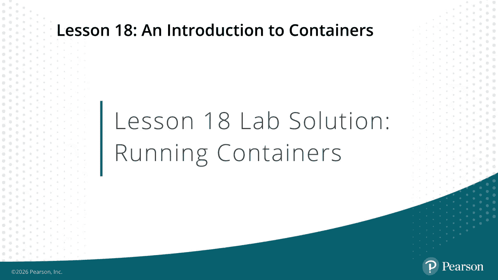
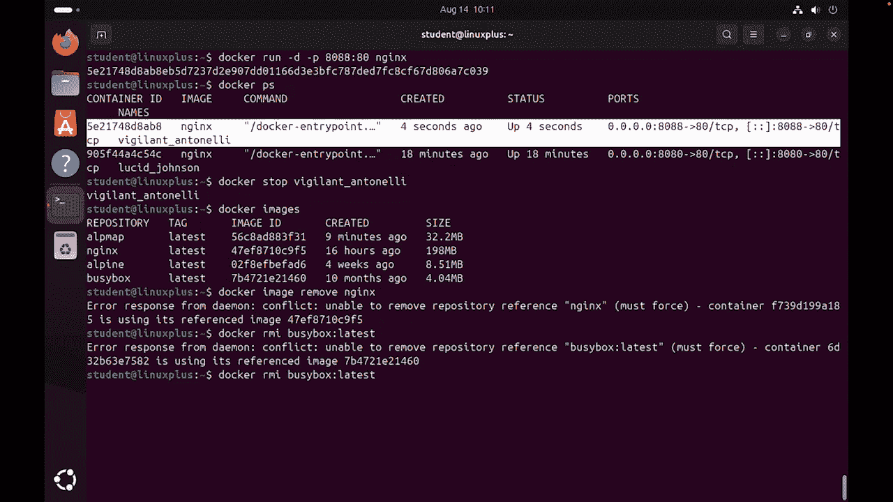

# 🐳 CompTIA Linux+ V8：Lesson 18：运行容器实验解答 🐳



在本节课中，我们将一起学习如何在 Docker 中启动和运行容器。具体来说，我们会以 Nginx 镜像为基础来创建一个容器，并设置端口访问，使外部能够访问容器内的服务。之后，我们会查看容器是否正常运行，学习如何停止容器，并且尝试删除容器镜像，了解在什么情况下可以删除镜像，什么情况下不能删除。最后，我们会看看如何删除不再使用的镜像，包括强制删除的方法。


在开始操作之前，先来看看启动容器需要用到的核心命令。以下是本节实验中主要使用的 Docker 命令：

- `docker run -d -p 8088:80 nginx`：基于 Nginx 镜像启动容器，使用后台运行模式，并将主机 8088 端口映射到容器 80 端口。
- `docker ps`：查看当前正在运行的容器列表。
- `docker stop <容器名称>`：停止指定的运行中的容器。
- `docker images`：列出本地所有的镜像文件。
- `docker image remove <镜像名称>` 或 `docker rmi <镜像名称>`：删除指定的镜像。
- `docker rmi --force <镜像名称>`：强制删除镜像，并移除引用该镜像的容器。


接下来，我们来实际启动一个容器。启动容器的命令如下：

```bash
docker run -d -p 8088:80 nginx
```

这里的 `-d` 表示 detached 模式，也就是让容器在后台运行，不会占用当前的终端窗口。`-p 8088:80` 是端口映射参数，它的意思是把宿主机的 8088 端口映射到容器内部的 80 端口。之所以映射到 80 端口，是因为 Nginx 默认监听的是 80 端口。最后的 `nginx` 就是我们要使用的镜像名称。


容器启动之后，我们需要确认它是否真的在运行。以下是查看命令：

```bash
docker ps
```

执行 `docker ps` 之后，终端会显示当前所有处于运行状态的容器。在输出列表中，我们可以找到容器的名称，原文演示中使用的容器名字是 vigilant antonli。从显示信息可以看到，这个容器是在四秒前启动的，说明它已经成功运行起来了。


如果我们想要停止这个正在运行的容器，可以使用下面的命令：

```bash
docker stop vigilant antonli
```

运行 `docker stop` 之后，名为 vigilant antonli 的容器就会被停止。容器停止以后，如果我们想要删除它所基于的镜像，首先需要知道本地都有哪些镜像。以下是查看命令：

```bash
docker images
```

执行 `docker images` 可以列出本地所有的镜像文件。接着，我们尝试删除 Nginx 镜像，命令如下：

```bash
docker image remove nginx
```

这时候你会发现，删除操作并没有成功。原因很简单，就是因为现在还有一个容器正在基于这个 Nginx 镜像运行。Docker 不允许直接删除正在被运行中的容器所依赖的镜像，否则会导致该容器异常甚至崩溃。


一般情况下，我们不建议直接删除正在使用的镜像，即使使用强制删除参数也不行，因为这样做会让当前运行的容器崩溃，影响服务的正常使用。


如果你确实想要删除某个不再使用的镜像，可以尝试删除其他镜像，比如 busybox。这里有两种等价的命令，一种是新命令，一种是旧命令：

```bash
docker image remove busybox
```

或者

```bash
docker rmi busybox
```

`docker image remove` 是较新的命令写法，而 `docker rmi` 是旧的命令写法，两者的功能基本一样。在演示中，我们选择使用 `docker image remove` 来删除 busybox 镜像。


然而，即使容器已经停止运行，镜像依然可能无法被直接删除。这是因为该镜像仍然被一个容器所占用，只不过这个容器现在处于停止状态，而不是运行状态。这时候，如果你想要强制把镜像干掉，可以使用带有 force 参数的命令：

```bash
docker rmi --force busybox
```

或者使用新命令的写法：

```bash
docker image rm --force busybox
```

加上 `--force` 参数之后，Docker 会先删除引用该镜像的容器，然后再删除镜像本身。这样一来，容器和镜像都会被一并移除。




在本节课中，我们一起学习了如何基于 Nginx 镜像启动容器，如何设置端口映射，如何使用 docker ps 查看运行中的容器，如何使用 docker stop 停止容器，以及如何查看和删除镜像。我们还了解到，不能直接删除正在运行容器所依赖的镜像，而对于不再使用的镜像，可以使用 docker rmi --force 来强制删除容器和镜像。

