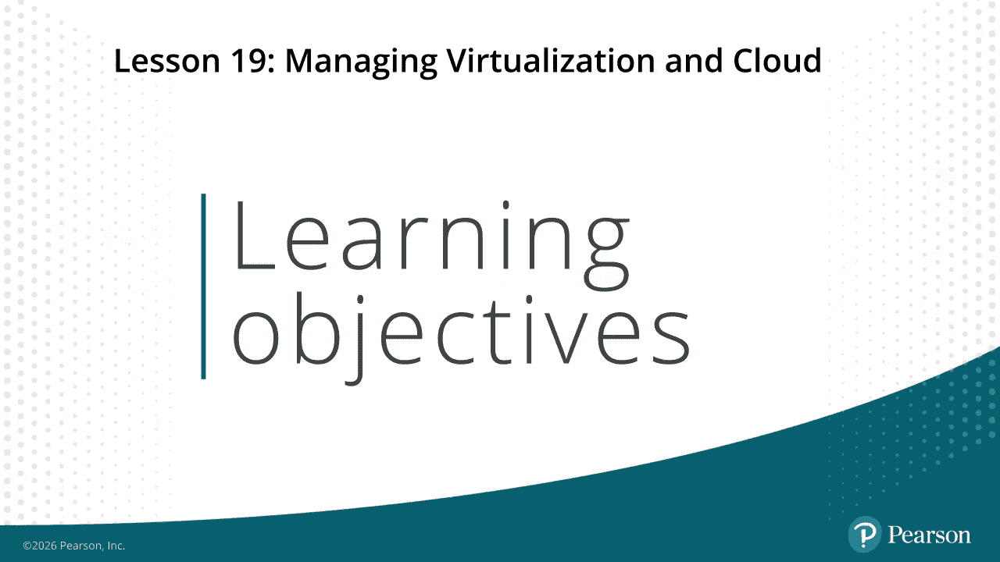
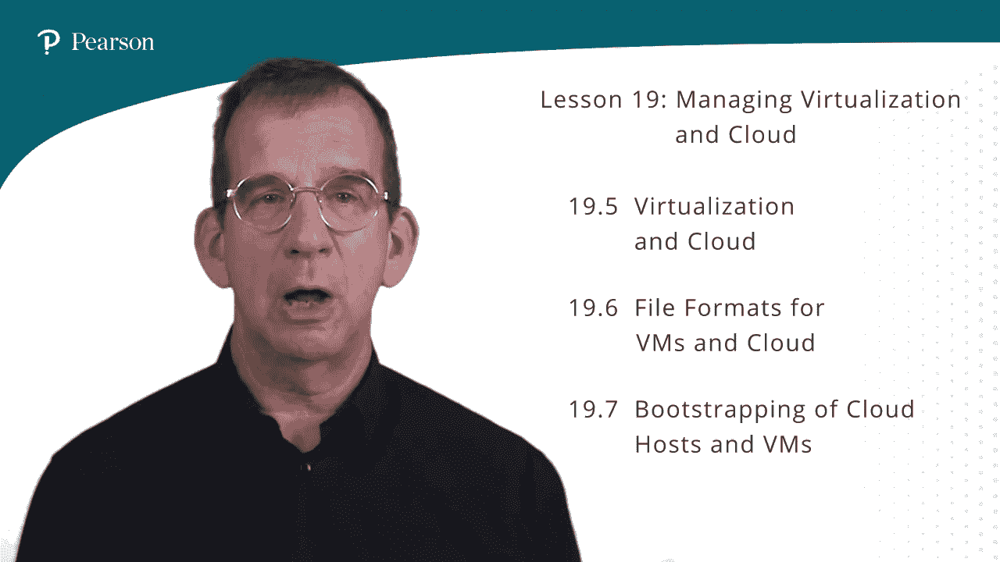

云计算与虚拟化基础：第01课：学习目标 🖥️


在本节课中，我们将一起学习关于虚拟化和云计算的基础知识。内容主要围绕开源虚拟化方案、KVM 虚拟机的使用方法、虚拟网络配置，以及虚拟化与云计算之间的关系展开。此外，还会介绍虚拟机常见的文件格式，最后简要说明相关的解决方案。无论你是刚接触 Linux 的新手，还是想要系统了解虚拟化技术的学习者，这节课都会用大白话把核心概念讲清楚，让你建立起整体的认知框架。


## 第一节：课程欢迎与课程内容导览

你好，欢迎来到这堂关于云中虚拟化的课程。我们将从讨论开源虚拟化选项开始，帮助你理解当前市面上有哪些免费且开放的虚拟化技术可供选择。这是整个课程的起点，也会为后面的内容打下基础。

开源虚拟化选项通常包括以下几种常见方案：



- KVM：基于 Linux 内核的虚拟机监视器
- Xen：早期广泛使用的开源虚拟化平台
- VirtualBox：适合桌面使用的开源虚拟化软件

你可以把开源虚拟化理解为：不需要付费购买商业授权，就可以在一台物理服务器上运行多个独立操作系统的技术。它的核心关系可以表示为：

```text
开源虚拟化 = 虚拟化软件 + 开放源代码 + 社区支持
```


## 第二节：KVM 虚拟机基础

接下来我们将学习 KVM 虚拟机的相关内容。KVM 是 Linux 内核自带的虚拟化模块，它可以把普通的 Linux 服务器变成虚拟机主机，让你在上面创建和运行多个虚拟机。这是企业级虚拟化中非常经典的一种选择，性能稳定且配合其他工具使用时非常灵活。

使用 KVM 虚拟机时，需要关注的几个核心步骤如下：

- 安装 KVM 软件包和相关依赖
- 配置用户权限和虚拟网络
- 创建虚拟机并安装客户操作系统
- 管理虚拟机的启动、停止和快照

你可以把 KVM 想象成一台“大容器”，里面可以装很多个“小电脑”，每个小电脑都有自己的内存、硬盘和网络，互不干扰。它的基本关系可以简单表示为：

```text
KVM 虚拟机 = Linux 内核 + QEMU 模拟器 + 客户操作系统
```


## 第三节：虚拟环境网络与模板克隆

讲完 KVM 之后，我们将讨论虚拟环境中的网络问题，以及如何使用模板和克隆来提高部署效率。虚拟机脱离网络就无法正常工作，而模板和克隆则可以让你避免重复安装操作系统，节省大量时间。

在虚拟网络与模板克隆方面，你需要了解的要点包括：

- 虚拟网桥的配置方法
- 虚拟机之间的网络互通原理
- 如何从现有虚拟机制作模板
- 基于模板快速克隆新虚拟机的步骤

简单来说，模板就像是一个已经装好系统的“黄金镜像”，克隆则是根据这个镜像批量生产新虚拟机。如果把它写成公式，大概是这样：

```text
新虚拟机 = 模板镜像 + 自定义主机名与 IP 地址
```

虚拟网络的作用，就是让这些克隆出来的虚拟机能够彼此通信，也能访问外部网络。


## 第四节：虚拟化与云计算的关系

之后我们会简要介绍虚拟化与云计算之间的关系。很多人容易把这两个概念混淆，但实际上虚拟化是云计算的基础技术之一，而云计算则是在虚拟化之上增加了自动化、按需分配和计费等功能。

两者之间的核心联系可以概括为以下几点：

- 虚拟化提供了资源抽象层，把物理硬件变成可管理的资源池
- 云计算在虚拟化之上增加了自动编排和服务交付能力
- 没有虚拟化，云计算的弹性扩展很难实现
- 虚拟化可以单独使用，但云计算通常依赖虚拟化技术

用一个直观的公式来表示，云计算可以看作是：

```text
云计算 = 虚拟化 + 自动化编排 + 按需付费 + 自助服务
```

换句话说，虚拟化解决了“能不能跑多个系统”的问题，而云计算解决了“如何方便地租用和管理这些系统”的问题。


## 第五节：虚拟机文件格式与云引导

接下来两节课将讨论虚拟机和云中使用的文件格式，以及 Cloudhouse 和虚拟机的引导过程。虚拟机不仅仅是运行状态，它还对应着磁盘上的各种文件，了解这些格式有助于你进行备份、迁移和故障排除。

涉及的文件格式和引导相关内容包括：

- 虚拟机磁盘镜像格式，例如 qcow2、vmdk、vdi 等
- 光盘映像格式，比如 iso 文件
- 云初始化配置文件，用于首次启动时自动设置网络和用户
- Cloudhouse 与虚拟机的引导配置方法

你可以把虚拟机镜像文件理解为虚拟硬盘的“备份包”，而 Cloudhouse 引导则类似于给新虚拟机写一份“开机说明书”，让它启动后自动知道该怎么配置自己。常见格式的对应关系可以简单记为：

```text
虚拟磁盘文件 = qcow2 | vmdk | vdi | raw
```


## 第六节：随选解决方案



最后，课程会介绍一种名为 La a La 的解决方案。这种方案通常强调灵活选择，用户可以根据实际需要挑选所需的服务组件，而不是购买一整套固定的功能包。这在云服务和虚拟化场景中非常常见，能够帮助企业控制成本并按需扩展。

随选解决方案的主要特点可以归纳为：

- 按需选择所需功能模块
- 避免为不需要的服务付费
- 支持随着业务增长灵活扩容
- 适合预算有限或需求变化快的场景

简单来说，它就像餐厅的单点菜单，你只点想吃的菜，不需要买整套固定套餐。


本节课中，我们一起学习了开源虚拟化选项、KVM 虚拟机的基础操作、虚拟网络与模板克隆技术、虚拟化与云计算的关系、虚拟机文件格式以及 Cloudhouse 引导，最后还了解了随选解决方案的概念。希望这些内容能帮你建立起对虚拟化和云计算的初步认识，为后续深入学习打下坚实基础。

