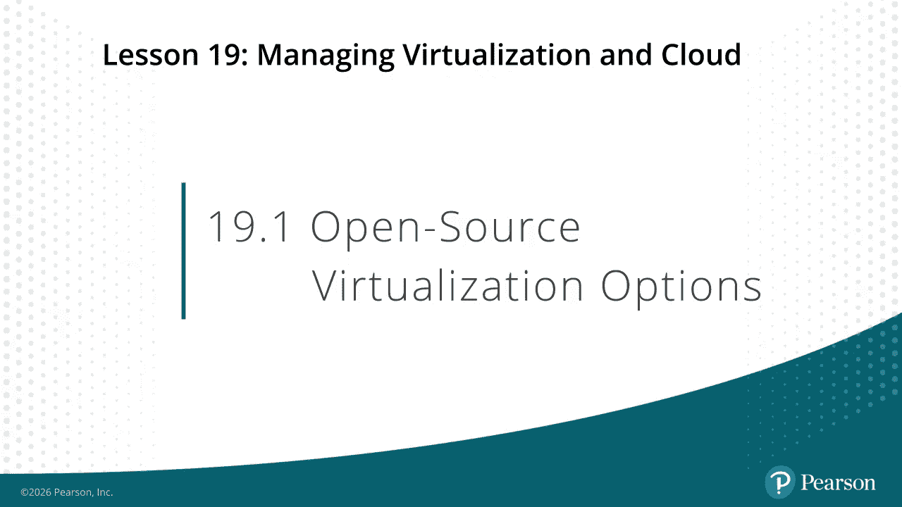
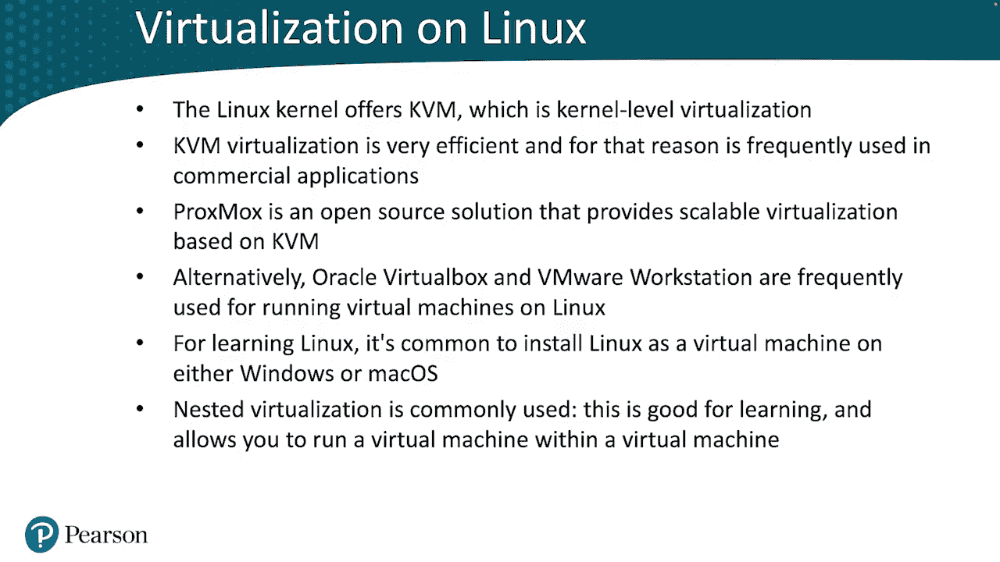

CompTIA Linux+ V8：191：开源虚拟化选项 🖥️



在本节课中，我们将一起学习开源虚拟化的相关知识。虚拟化是现代服务器和个人学习环境中非常重要的一项技术，简单来说，它让我们可以在一台物理计算机上同时运行多个独立的操作系统。无论你是想节省硬件成本，还是想在自己的电脑上安全地尝试 Linux，虚拟化都能派上用场。本节会把虚拟化的基本概念讲清楚，再介绍几种常见的开源虚拟化方案，最后看看怎么在学习环境中使用它们。

## 一、什么是虚拟化 🖥️

首先，我们要搞清楚虚拟化到底是指什么。

虚拟化的意思，就是允许你在软件里面运行一套完整的操作系统。你可以把它理解为在你的电脑里“再装一台电脑”，只不过这台电脑不是真正的硬件，而是由软件模拟出来的。这样一来，你就不需要为每个系统单独准备一台物理机器了。

```
虚拟化 = 在软件层模拟硬件，运行完整的操作系统
```

## 二、虚拟化的核心优势：充分利用硬件资源 ⚙️

了解了虚拟化的定义之后，咱们来看看它为什么这么受欢迎，最直接的好处是什么。

虚拟化最大的好处之一，就是能让硬件资源用得更高效。在虚拟化出现之前，很多人买一台服务器只跑一个应用程序，结果这台机器可能只用到了 20% 的性能，剩下的 80% 全白白浪费了。这显然不划算。有了虚拟化之后，你可以在这台物理机上安装一个虚拟化管理程序，也就是 Hypervisor，然后在上面跑好几台虚拟机。比如五台虚拟机，每台跑 20% 的负载，加起来正好把物理机的性能用满，资源就不再闲置了。

以下是传统模式与虚拟化模式的资源利用对比：

```text
传统模式：
  1 台物理服务器 × 20% 利用率 = 80% 资源浪费

虚拟化模式：
  1 台物理服务器 × 5 台虚拟机 × 20% 利用率 = 100% 资源利用
```

## 三、虚拟化的另一个好处：在同一台机器上运行不同操作系统 🔄

除了节省硬件，虚拟化还有一个很实用的优势，那就是让你在一台电脑上随便切换操作系统。

虚拟化让你可以在自己的计算机上面运行其他操作系统，这对学习新技术特别友好。比如说，你现在可能就是通过虚拟化来学习 Linux+ 相关的考试内容。在虚拟化环境里，宿主操作系统的硬件会通过虚拟化驱动程序展现给虚拟机使用。换句话说，虚拟化层自带一套驱动程序，让你能够和底层宿主系统真正的硬件驱动程序进行通信。这些虚拟驱动程序的设计目的，是让你以最小的性能损耗，直接访问底层的硬件设备。这样即使在虚拟机里面，体验也会比较流畅。

```
虚拟机访问硬件 = 虚拟化驱动程序 → 宿主操作系统硬件驱动 → 真实硬件
```

## 四、Linux 平台上的 KVM 虚拟化 🐧

聊完虚拟化的通用优势，我们把视角放到 Linux 系统上，看看它自带了什么虚拟化技术。

Linux 是做虚拟化的非常好的平台。这是因为 Linux 内核里面直接集成了 KVM，也就是内核级虚拟化技术。因为 KVM 已经嵌入在 Linux 内核中，所以你不需要额外安装复杂的插件就能开始使用。KVM 虚拟化效率非常高，正因如此，它在商业应用里也被广泛采用。如果你已经在用 Linux，那么直接启用 KVM 就是最省事的选择。

```bash
# KVM 是 Linux 内核的一部分，无需额外安装第三方虚拟化内核
Linux 内核 + KVM = 内核级虚拟化平台
```

## 五、常见的开源虚拟化解决方案 ☁️

光知道 KVM 还不够，实际工作和学习中，人们通常会搭配一些成熟的开源平台来管理虚拟机，下面介绍几个比较常见的。

以下是几种常见的开源或广泛使用的虚拟化方案：

- Proxmox：基于 KVM 的开源可扩展虚拟化解决方案，近年来人气快速上升。一个重要原因是，某些商业虚拟化厂商（比如 VMware）大幅涨价，导致很多用户转向 Proxmox 这样免费开源的替代品。
- Oracle VirtualBox：常用于在 Linux、Mac OS 或 Windows 上运行学习用的虚拟机，操作相对简单，很适合初学者。
- VMware Workstation：同样常用于桌面虚拟机学习，支持在多种主机系统上运行虚拟机。

对于学习 Linux 来说，最常见的做法就是在你现在的操作系统上面装一个 Linux 虚拟机，这样既不会影响主系统，又能随时练习命令。

## 六、嵌套虚拟化：在虚拟机里再跑虚拟机 🔁

如果你觉得在物理机上跑虚拟机已经很有趣了，那么还有一种更进阶的玩法值得了解，那就是嵌套虚拟化。

嵌套虚拟化在学习环境中被广泛使用。它的意思很简单，就是允许你在一个虚拟机之内，再运行另一个虚拟机。听起来像“套娃”，但实际上非常实用，尤其是当你想学习如何管理虚拟化平台本身，或者测试某些需要多层虚拟化的场景时，这项技术能派上大用场。



```
物理机 → 虚拟机 A → 虚拟机 B（嵌套虚拟化）
```


本节课中，我们一起学习了开源虚拟化的基本概念。首先明确了虚拟化就是在软件里运行完整操作系统，接着看了它在硬件利用率和多系统运行方面的优势，了解了虚拟化驱动程序如何降低性能损耗。随后重点介绍了 Linux 内核自带的 KVM 虚拟化技术，以及 Proxmox、VirtualBox 和 VMware Workstation 等常见方案，最后简单了解了嵌套虚拟化。下一节课，我们将继续深入学习关于 KVM 虚拟机的更多内容。
