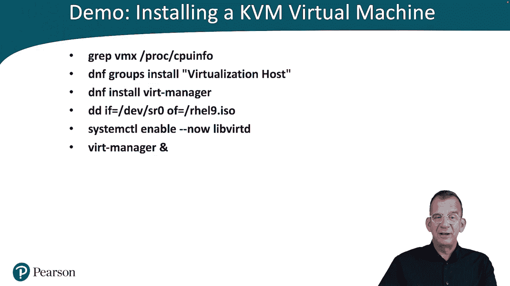
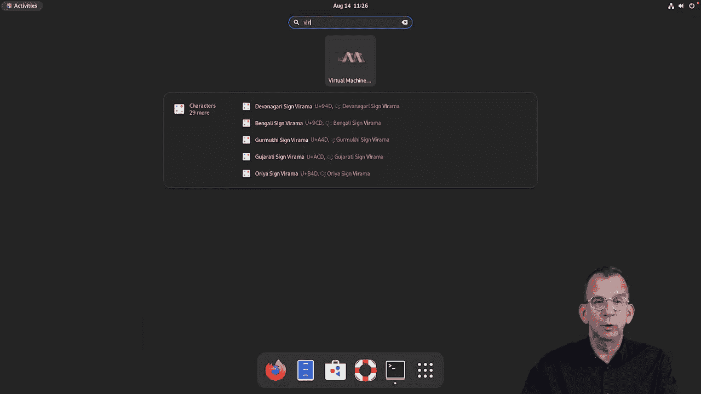
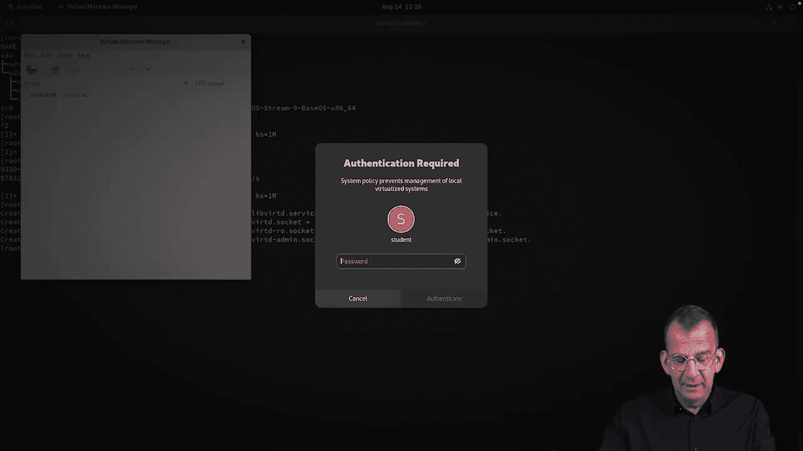
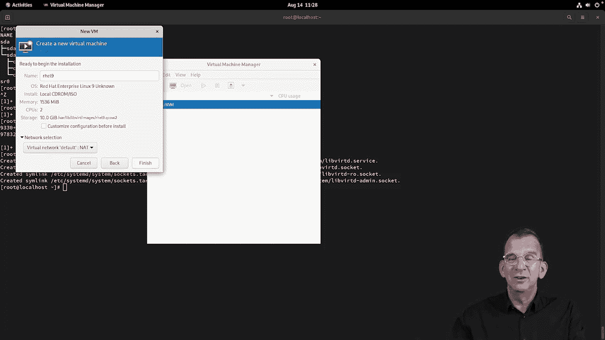

# CompTIA Linux+ V8：5-24：管理KVM虚拟机 🖥️


在本节课中，我们将学习如何在Linux系统上管理和安装KVM虚拟机。KVM是Linux自带的虚拟化技术，能让一台物理机器同时运行多个独立的操作系统。本课会先检查硬件是否支持虚拟化，再安装所需软件包，接着配置系统服务，最后使用图形界面把虚拟机创建出来。因为演示中使用的系统是CentOS 9，所以部分步骤会针对这个版本说明，毕竟在CentOS 10的软件仓库里，虚拟机管理器这个包已经不再提供了。


## 第一节：检查CPU是否支持虚拟化 🔍

在装任何东西之前，首先要确认CPU能不能跑虚拟机，这是整个KVM平台的基础，没有这个支持后面的步骤也就没有意义了。

以下是检查CPU虚拟化支持的方法：

- Intel CPU：在 `/proc/cpuinfo` 里找 `vmx` 标志。
  ```bash
  grep vmx /proc/cpuinfo
  ```
- AMD CPU：在 `/proc/cpuinfo` 里找 `svm` 标志。
  ```bash
  grep svm /proc/cpuinfo
  ```

如果命令有输出，就代表你的CPU支持虚拟化。接下来我们还得看看内存和硬盘够不够，通常8GB内存总共就够了，再用 `df -h` 看看根分区是否有几十GB空闲空间，用来存虚拟机文件也是绰绰有余。




## 第二节：安装虚拟化主机软件包组 📦

硬件确认没问题之后，下一步就是安装让KVM跑起来所需的基础软件，这些软件包提供了虚拟化平台的核心组件。

以下是安装虚拟化主机软件包组的命令：

```bash
dnf groupinstall "Virtualization Host"
```

这个组会安装很多包，但它们都是KVM虚拟化平台的基础，缺一不可。安装完成后，系统才具备运行虚拟机的最基本能力。


## 第三节：安装图形管理工具并准备安装镜像 💾

有了基础虚拟化软件，还需要一个方便的管理工具。虽然命令行也能用 `virt-install` 创建虚拟机，但那个方式对初学者来说稍微复杂一点，这里我们先用图形界面。

以下是安装图形虚拟机管理器的命令：

```bash
dnf install virt-manager
```

装好之后，需要准备操作系统的安装镜像。先插入光盘，用 `lsblk` 确认光驱设备，比如 `/dev/sr0` 是否可用，然后用 `dd` 命令把光盘内容克隆成一个ISO文件，方便后面虚拟机使用。

以下是克隆光盘镜像的命令：

```bash
lsblk
dd if=/dev/sr0 of=/var/tmp/rhel9.iso bs=1M &
```

`dd` 命令可能需要等一小会儿，具体时间取决于你的存储速度。你可以把它放到后台运行，先去忙别的，不用原地等待。


## 第四节：启用libvirtd服务 ⚙️



软件都安装好了，但还不能立刻创建虚拟机，必须先启动虚拟化的核心服务。



以下是启用并启动libvirtd服务的命令：

```bash
systemctl enable --now libvirtd
```

libvirtd 是Linux上虚拟化的通用接口，不管你用图形的 `virt-manager`，还是命令行的 `virsh`，都依赖它在后台运行。这个服务必须一直保持运行状态，否则所有虚拟化工具都无法工作。确认它正常运行后，环境就算准备就绪了。


## 第五节：启动virt-manager并创建虚拟机 🚀

现在一切都准备好了，可以启动图形界面工具来创建虚拟机了。`virt-manager` 需要管理员权限才能运行，启动时记得使用适当的特权。

以下是使用图形界面创建虚拟机的主要步骤：

1. 打开 `virt-manager`，进入 QEMU/KVM 系统界面。
2. 选择从 ISO 镜像安装操作系统。
3. 点击“浏览本地”，找到之前克隆好的 ISO 文件，注意路径是在根文件系统下，而不是家目录。
4. 系统会自动检测镜像里的操作系统，你也可以手动选择，比如 Red Hat Enterprise Linux 9。这里选哪个通用安装配置文件并不是特别重要。
5. 点击“下一步”，设置虚拟机的内存大小和CPU数量，根据自己物理机的配置合理分配即可。
6. 设置虚拟磁盘大小，10GB通常已经足够。
7. 网络设置可以保持默认，不需要特别修改。
8. 点击“完成”，交给 libvirtd 处理剩下的安装过程。

安装开始后，稍等片刻，你就会得到一台正在运行的虚拟机。


## 本节课总结 📝



在本节课中，我们一起学习了如何在Linux上管理和安装KVM虚拟机。具体包括检查CPU是否支持VMX或SVM虚拟化特性，查看内存和磁盘空间是否足够，安装Virtualization Host软件包组，安装virt-manager图形工具，使用dd命令克隆安装镜像，启用libvirtd核心服务，最后通过图形界面完成虚拟机的创建与启动。按照这些步骤，你就可以在自己的Linux系统上跑起第一台KVM虚拟机了。

