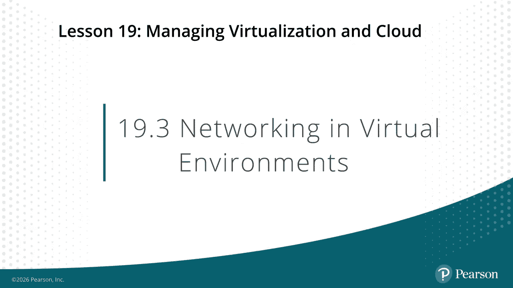
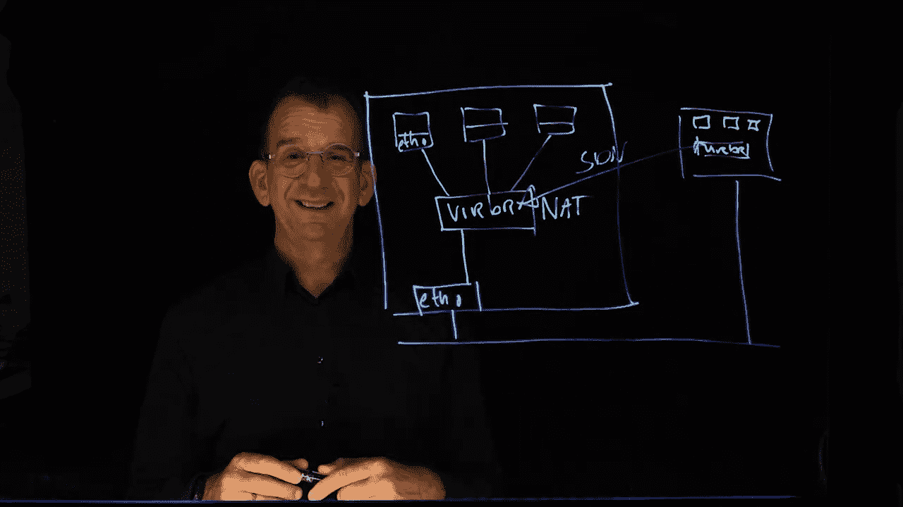
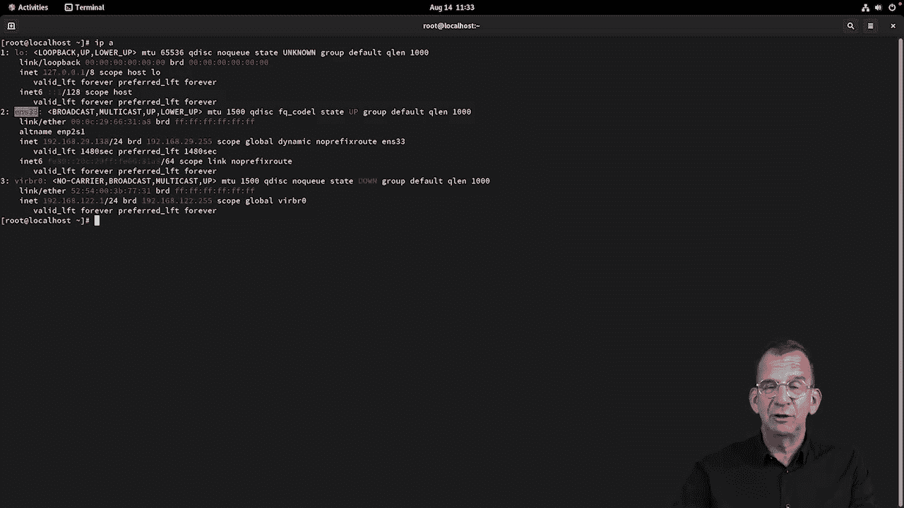

# CompTIA Linux+ 认证教程：第五章：虚拟环境中的网络 🌐

在本节课中，我们将要学习虚拟环境中的网络是如何工作的。这篇教程会帮助你理解虚拟机是如何连接网络的，以及多个虚拟化主机之间是如何实现网络互通的。我们会用大白话来讲解这些概念，让初学者也能快速上手。




## 第一部分：虚拟化主机与物理网卡 🖥️

上一节我们介绍了虚拟化的基本概念，本节中我们来看看虚拟化主机是如何连接外部网络的。

在虚拟化环境中，我们首先需要有一台虚拟化主机。这台主机就是运行虚拟机的物理服务器。在这台虚拟化主机上面，它拥有一个物理网络接口，为了方便理解，我们可以把它叫做 ETH0。

以下是虚拟化主机与物理网卡的关系说明：

- 物理网卡 ETH0 是主机连接外部网络的通道。
- ETH0 直接连接到外部的物理网络。
- 所有流量的进出都需要经过这块物理网卡。

你可以把物理网卡想象成房子的大门，外面的网络世界要想和里面通信，必须经过这扇门。

**核心概念公式：**

```text
物理网卡 ETH0 <==> 外部物理网络
```

这个公式表示，虚拟化主机通过 ETH0 这块物理网卡与外部网络建立连接。


## 第二部分：虚拟机与虚拟桥接 🌉

在了解了物理网卡之后，我们现在来看看虚拟机是如何接入网络的。上一节我们介绍了虚拟化主机的物理网卡，本节中我们来看看虚拟机和虚拟桥接的关系。

假设在这台虚拟化主机上面，我们运行了多个虚拟机，比如说是虚拟机 1、虚拟机 2、虚拟机 3，以及更多。这些虚拟机都需要上网，而且它们之间也需要相互通信。那么它们是怎么实现联网的呢？

答案是使用虚拟桥接设备。通常情况下，在虚拟化主机里面会有一个虚拟网桥设备。这个虚拟网桥可以通过不同的方式来实现，比如说 Open vSwitch 也可以被当作加强版的虚拟网桥来使用，但它的基本思想是一样的。

以下是虚拟桥接的工作原理：

- 虚拟网桥连接物理网卡 ETH0 和虚拟机的虚拟网卡。
- 每个虚拟机都会连接到这个虚拟网桥上面。
- 虚拟网桥让所有虚拟机可以相互通信。
- 因为虚拟网桥实现了网络地址转换技术，也就是 NAT，所以虚拟机也可以访问外部网络。

你可以把虚拟网桥想象成房子里面的一个分配器，物理网卡进来的网络信号，通过分配器分发给每个房间里面的虚拟机。

**核心概念代码：**

```text
虚拟网桥 = 物理网卡 ETH0 + 虚拟机虚拟网卡
```

这段代码表达的意思是，虚拟网桥把主机的物理网卡和虚拟机的虚拟网卡连接在一起，形成一个统一的网络转发点。


## 第三部分：跨主机网络与软件定义网络 🔗

如果只有一台虚拟化主机，上面的方案已经足够了。但是现实情况往往比这更复杂。上一节我们介绍了单主机上的虚拟桥接，本节中我们来看看当有多台虚拟化主机时应该怎么做。

假设现在有另一台虚拟化主机，在这台主机上面也运行着一些虚拟机，而且这些虚拟机也有自己的虚拟网桥。这时候我们就会遇到一个问题，怎么才能让所有主机上的虚拟桥接设备组成一个大网络呢？

这时候就需要引入软件定义网络，也就是 SDN。SDN 对于单机的独立虚拟化来说可能有点复杂，但是如果你要构建一个虚拟化数据中心，把所有的虚拟网桥加入到一个软件定义网络中就是非常重要的。这样做之后，虚拟机会觉得它们都在同一个网络上面，即使它们实际上运行在不同的物理主机上。

以下是跨主机网络的关键点：

- 多台虚拟化主机各自拥有独立的虚拟网桥。
- 需要一个统一的机制把这些虚拟网桥连接起来。
- 软件定义网络 SDN 提供了这种统一管理的能力。
- 虚拟机跨主机通信时，会感觉自己处于同一个二层网络中。

**核心概念公式：**

```text
SDN = 多台主机虚拟网桥的统一逻辑网络
```

这个公式说明，SDN 的作用就是把分散在不同主机上的虚拟网桥，通过软件方式整合成一个大的虚拟网络。


## 第四部分：使用命令查看虚拟网桥 🔍

理论部分讲完了，我们现在来看看在实际的 Linux 系统中，如何验证虚拟网桥是否存在。上一节我们介绍了跨主机的 SDN 概念，本节中我们来看看如何用命令查看本机的虚拟网桥配置。



你可以使用 `ip addr` 这条命令来查看网络接口信息。在命令输出结果里面，你可能会看到名为 `verBR0` 的接口，这就是虚拟网桥。这个虚拟网桥拥有一个内部接口，用来为虚拟机创建内部网络。

以下是 `ip addr` 命令可能显示的关键接口：

- `verBR0`：这是虚拟网桥设备，负责转发虚拟机的流量。
- 内部接口：虚拟网桥上的内部端口，创建虚拟机内部网络。
- `ENS33`：这是普通的物理网卡，虚拟机通过它访问外部网络。

**核心概念代码：**

```bash
ip addr
```

运行上面这段代码之后，你会在输出中看到 `verBR0` 和 `ENS33` 等接口，从而确认虚拟网桥已经正确配置。


## 本节总结



本节课中，我们一起学习了虚拟环境中的网络基础知识。我们介绍了虚拟化主机的物理网卡 ETH0，解释了虚拟机如何通过虚拟网桥连接网络，讨论了多台主机如何通过软件定义网络 SDN 实现互通，最后还演示了如何使用 `ip addr` 命令查看虚拟网桥。希望这篇教程能帮助你建立起对虚拟化网络的直观认识。
