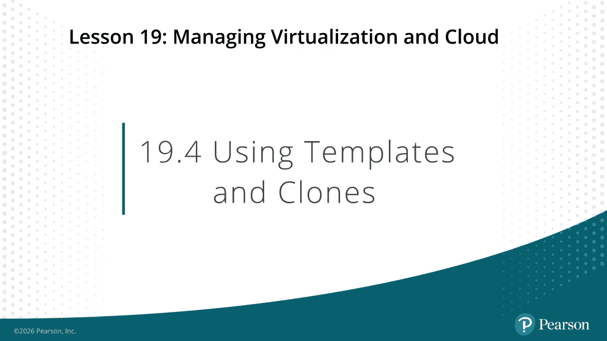
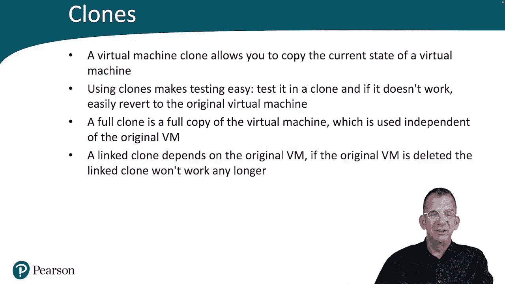

# CompTIA Linux+：第26节：使用模板和克隆 🖥️


在本节课中，我们将一起学习虚拟化环境中两个非常实用的功能，也就是模板和克隆。这两个功能不仅在传统的虚拟机环境里非常重要，在云计算平台中也同样发挥着关键作用。无论你是刚开始接触虚拟化，还是已经在使用虚拟机做一些测试工作，掌握模板和克隆都能让你的操作变得更加高效，也能帮你避免很多不必要的重复劳动。下面我们就从模板的基本概念开始说起，看看它是如何简化虚拟机创建过程的。




## 模板的作用与原理

那么模板到底是怎么工作的？简单来说，模板可以用来让创建虚拟机变得更加容易。在模板里面，管理员会预先定义好标准设置，这样一来，当我们从模板来创建虚拟机的时候，只需要做很少的个性化设置就可以了。这样一来，我们就能在任意地方轻松安装一台基础虚拟机，不需要每次都从头开始配置网络、用户和软件包。

模板的核心思想可以用下面这个简单的公式来描述：

```text
基础虚拟机 = 模板中的标准设置 + 少量的个性化自定义
```

也就是说，模板负责提供统一的底座，而具体的差异化配置则留在最后阶段处理，这样创建虚拟机的速度就会快很多。


介绍完模板之后，我们顺便提一下 Vagrant，虽然它不在考试范围内，但了解它的定位也有帮助。


## 关于 Vagrant 的简要说明

Vagrant 是一种常用的解决方案，它利用模板来部署多台虚拟机，速度更快，方式更简单、更高效。不过 Vagrant 并不是 Linux+ 考试内容的一部分，所以我不会详细讲解它的工作原理。我们也没有必要去深入研究 Vagrant，因为所有主流的虚拟化解决方案都内置了模板选项和克隆选项，学会这些通用概念就足够应对考试和实际工作了。


讲完 Vagrant 之后，我们回到正题，重点来看看克隆是怎么回事。


## 克隆的概念与使用场景

接下来我们来看看克隆。克隆允许你复制虚拟机的当前状态。如果你打算对虚拟机做重大修改，创建克隆总是一个明智的主意。因为万一修改之后效果不理想，或者系统出了问题，你可以轻松地恢复到原来的状态。使用克隆可以让测试变得简单，你可以在克隆里面进行各种实验，如果测试不成功，也可以随时恢复到原来的虚拟机。

下面是使用克隆进行测试的典型流程：

1. 基于原始虚拟机创建一个克隆；
2. 在克隆上进行软件安装、配置修改或系统升级；
3. 如果测试通过，可以保留克隆或者应用到原始虚拟机；
4. 如果测试失败，直接删除克隆，原始虚拟机不受任何影响。


了解了克隆的基本用途之后，我们再细分一下克隆的类型。


## 完全克隆与链接克隆的区别

虚拟机克隆主要分为两种类型，分别是完全克隆和链接克隆。完全克隆是虚拟机的完整副本，它可以独立于原始虚拟机使用，也就是说即使原始虚拟机被删除了，完全克隆仍然可以正常运行。而链接克隆则依赖于原始虚拟机，如果原始虚拟机被删除，链接克隆就无法再正常工作了。

我们可以用下面这段伪代码来直观理解两者的区别：

```python
# 完全克隆：独立副本，与原机无关
full_clone = 完整复制(original_vm)
full_clone.can_run_without_original = True

# 链接克隆：依赖原机，共享部分数据
linked_clone = 链接复制(original_vm)
linked_clone.can_run_without_original = False
```

简单来说，如果你需要一台完全独立的测试机器，选择完全克隆；如果你只是想节省磁盘空间并且能接受对原机的依赖，链接克隆会更合适一些。


## 本节总结



本节课中，我们一起学习了模板和克隆在虚拟化环境中的重要性，了解了模板如何通过预定义标准设置来简化虚拟机创建，也了解了克隆如何帮助我们安全地进行系统修改和测试。此外，我们还区分了完全克隆和链接克隆的区别，知道了完全克隆可以独立运行，而链接克隆依赖于原始虚拟机。希望这些内容能帮助你更好地理解虚拟机管理的相关知识点。
