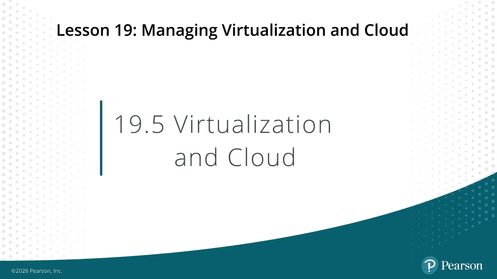
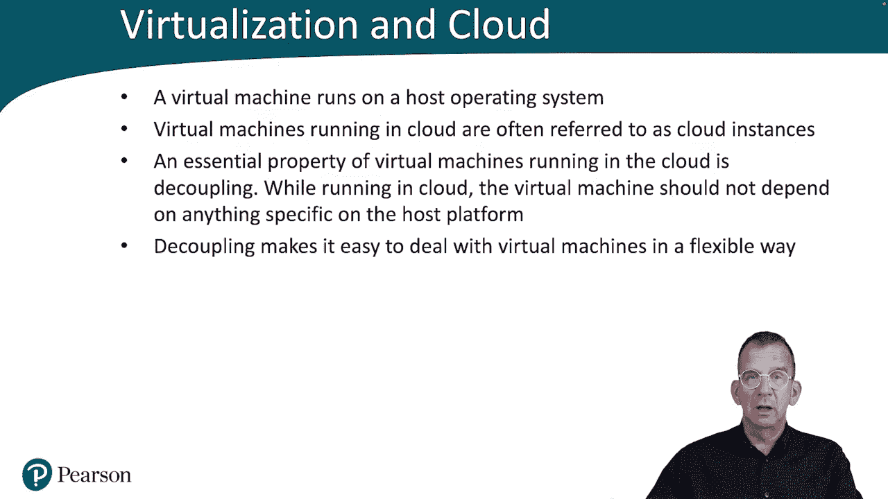

# CompTIA Linux+ V8：5.27：虚拟化与云计算🖥️☁️




在本节课中，我们将要学习虚拟化技术与云计算之间是如何关联的，以及虚拟机在不同环境下是如何运行的。我会用大白话把这些概念讲清楚，让你明白为什么现在很多公司都喜欢把业务搬到云上。如果你刚开始接触 Linux 和虚拟化，不用担心，我们会一步一步来，把每个知识点都拆解开来看，确保你看完之后能对整体架构有一个清晰的认识。


在正式进入云计算之前，我们先来回顾一下虚拟机最基本的运行环境，也就是它在宿主操作系统上是怎么工作的。这一点非常重要，因为只有搞清楚虚拟机和宿主系统之间的关系，你才能理解后面云计算里的那些变化。下面我们就从最基础的部分开始说起。


以下是虚拟机在宿主系统上运行的基本原理：

- 宿主操作系统负责提供底层硬件资源，比如 CPU、内存和存储空间。
- 虚拟机运行在宿主系统之上，就像是在操作系统内部再模拟一台独立的电脑。
- 每个虚拟机都可以安装自己的操作系统，和宿主系统可以是不同的。


有了上面的基础，我们现在可以把视野扩大，看看虚拟机如果被放到云里面会发生什么变化。其实云计算并不是什么神秘的技术，它本质上就是把很多物理服务器集中在一起管理，让虚拟机不再被绑定在某一台具体的机器上。这样一来，使用虚拟机就变得更加自由和灵活了。


以下是虚拟机在云端运行的主要优势：

- 虚拟机不再依赖于一台特定的物理主机，可以在云中的任意位置运行。
- 这意味着你的虚拟机可以随时迁移，不需要死磕某一台服务器。
- 即使底层的物理硬件出了问题，虚拟机也能快速在其他地方重新启动。


当虚拟机运行在云平台上的时候，它通常会有一个专门的名称，大家在实际工作中可能会经常听到这个词。了解这个术语有助于你在阅读文档或和同事沟通时更加得心应手。


下面用一个简单的公式来描述什么是云实例：

```text
云实例 = 虚拟机 + 云平台环境
```


这个云实例拥有一个非常核心的特性，那就是解耦。这个词听起来有点抽象，但实际上很好理解，它指的是虚拟机和底层硬件之间不再有绑定关系。我们接下来详细看看这个概念到底意味着什么。


以下是解耦在虚拟机中的具体表现：

- 虚拟机不依赖宿主平台上的任何特定配置或硬件细节。
- 因为不绑定特定主机，虚拟机可以被随意移动到其他位置。
- 如果某个宿主机器宕机了，虚拟机可以轻松在另一台机器上启动起来。


解耦带来的好处不仅仅是技术上的便利，它还直接影响到企业如何使用 IT 资源。因为虚拟机可以灵活迁移和管理，所以很多公司都开始把自己的系统迁移到云端。下面用一个简单的流程来展示解耦是如何帮助企业应对故障的。

```text
原宿主机故障 → 云平台检测 → 虚拟机自动迁移 → 新宿主机启动 → 业务恢复
```


总的来说，解耦让虚拟机的管理变得非常灵活，这也是为什么现在越来越多的公司都在使用基于云的软件和服务。云计算不再是一个遥远的概念，它已经成为了很多企业 IT 基础设施的核心部分，掌握这些基础知识对你学习 Linux 会很有帮助。




在本节课中，我们一起学习了虚拟化与云计算的关系，了解了虚拟机在宿主系统和云端的运行方式，也掌握了“云实例”和“解耦”这两个核心概念。希望通过这节课，你能对云计算的基本工作原理有一个直观的认识，为后续的 Linux 学习打下坚实的基础。

