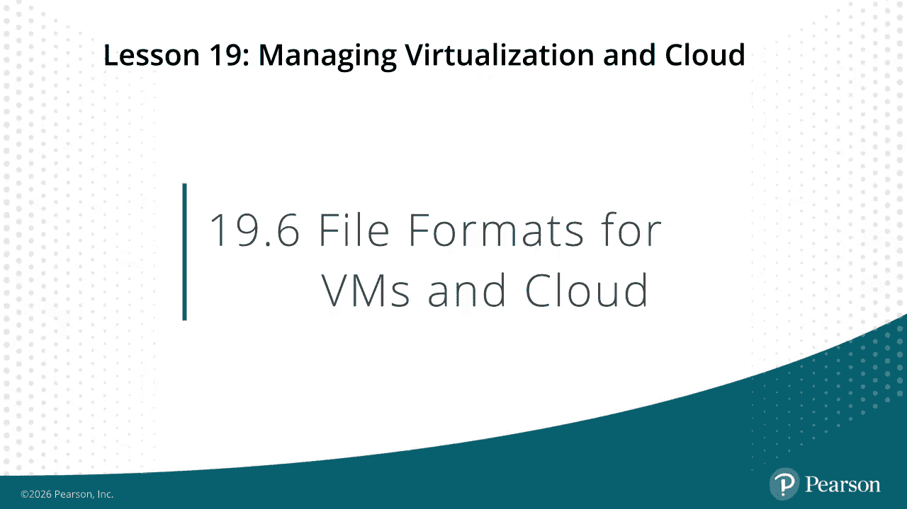
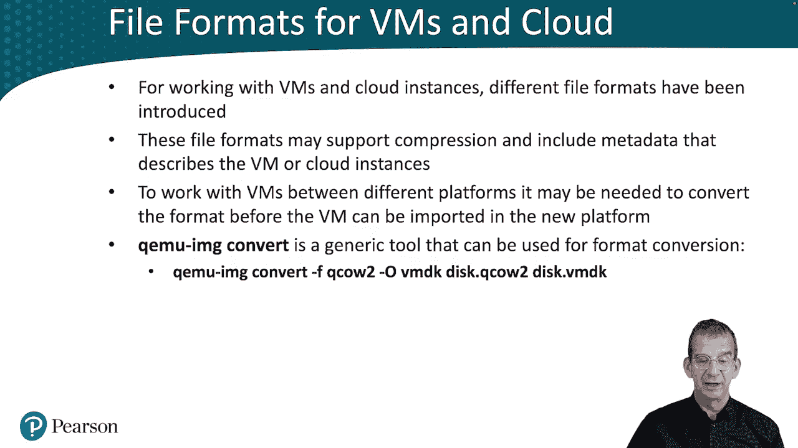
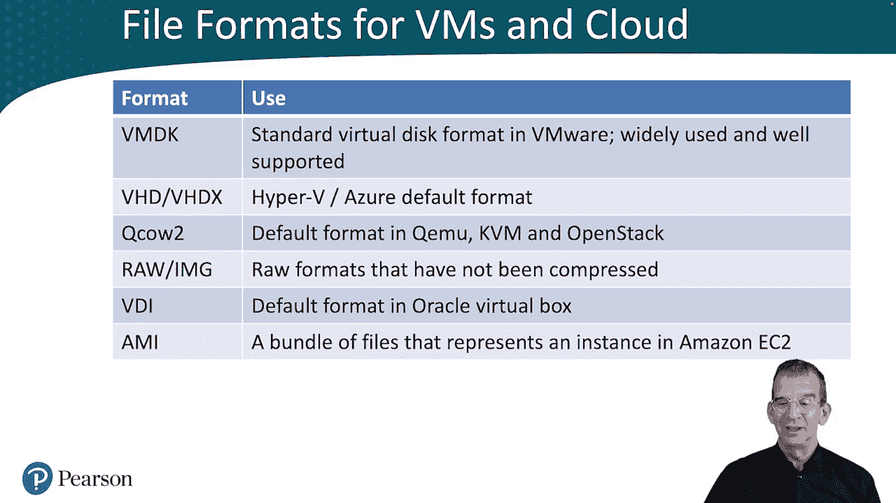

# CompTIA Linux+ V8：428.196：虚拟机与云的文件格式 📦



在本节课中我们将要学习虚拟机和云实例所使用的文件格式。这些格式决定了虚拟机磁盘如何被保存、传输以及在不同平台之间使用。无论你是在本地运行虚拟机，还是在云平台上部署实例，了解这些文件格式都是非常基础且重要的一步。我们会从为什么需要不同的格式开始，然后介绍常见的格式类型，最后看看如何在它们之间进行转换。


## 为什么需要不同的文件格式

上一节我们介绍了虚拟化的基本概念，本节中我们来看看为什么虚拟机和云实例需要不同的文件格式。在处理虚拟机和云实例时，引入了不同的文件格式，目的是保证设置能够高效存储，并且偶尔也能在不同系统之间实现互操作性。简单来说，就是让虚拟机的配置和数据占用更少的空间，同时也方便在不同厂商的平台上迁移。

这些文件格式可能支持压缩，并包含描述虚拟机或云实例的元数据。压缩可以让镜像文件体积更小，方便传输和存储；元数据则记录了虚拟机的硬件配置、操作系统类型等信息，供管理软件读取。如果没有这些信息，虚拟机在导入新平台后可能无法正常启动。

如果要在不同平台之间使用虚拟机，可能需要在导入新平台之前转换格式。这是因为不同的虚拟化平台默认使用不同的磁盘文件格式，直接拿一个平台的镜像文件到另一个平台上往往无法直接使用。转换工具的作用就是把源格式变成目标平台能够识别的格式。


## 常用的转换工具

在格式转换的场景中，一个有用的工具是 QEMU image convert，这是一个通用工具，可用于镜像转换。例如，使用 QEMU image convert -f qcow2 可以识别源格式为 QCOW2，使用 -o vmdk 可以定义输出格式为 VMDK，然后指定源磁盘名称和目标磁盘名称即可完成转换。

以下是 QEMU 镜像转换的命令示例：

```bash
qemu-img convert -f qcow2 -O vmdk source.qcow2 target.vmdk
```

在这个命令中，`-f` 表示源文件格式，`-O` 表示目标文件格式，后面跟着原始磁盘文件名和目标磁盘文件名。通过这种方式，你可以把一种格式的虚拟机磁盘转换成另一种格式，以便在不同的虚拟化平台之间迁移使用。




## 常见虚拟机磁盘文件格式

本节我们来看看市面上常见的虚拟机磁盘文件格式。以下是主要格式及其适用场景：

- **VMDK**：是 VMware 中的标准虚拟磁盘格式。它被广泛使用并且支持良好，绝大多数 VMware 产品都能直接读取这种格式的文件。
- **VHD 和 VHDX**：是 Hyper-V 和 Azure 环境中的默认格式。如果你在微软的虚拟化平台或 Azure 云上工作，通常会遇到这两种格式。
- **QCOW2**：是开源 QEMU KVM 和 OpenStack 中的默认格式。它支持压缩和快照，在 Linux 虚拟化领域非常常见。
- **原始格式（Raw）**：镜像是原始格式，通常未压缩且不包含元数据。这种格式最简单，直接对应磁盘的二进制数据，但体积较大且没有额外信息。
- **VDI**：是 Oracle VirtualBox 中的默认格式。如果你使用 VirtualBox 运行虚拟机，磁盘文件通常以 VDI 结尾。
- **AMI**：是 Amazon EC2 中的实例镜像。它是一个包或集合，代表云中的一个实例，用于在 AWS 上启动相同配置的虚拟服务器。

核心概念可以用下面的公式来理解：

**虚拟机文件格式 = 磁盘数据 + 压缩方式 + 元数据信息 + 平台兼容性**

不同的格式在这四个方面的侧重点不同，所以在选择或转换时需要注意目标平台的要求。


## 总结



本节课中我们一起学习了虚拟机和云实例的文件格式。我们了解了为什么需要不同的文件格式，这些格式如何支持压缩和元数据，以及在跨平台迁移时为什么可能需要格式转换。我们也介绍了 QEMU image convert 工具的使用方法，并列出了 VMDK、VHD/VHDX、QCOW2、原始格式、VDI 和 AMI 等常见格式及其适用平台。希望这些内容能帮助你在实际工作中更好地处理虚拟机镜像文件。

