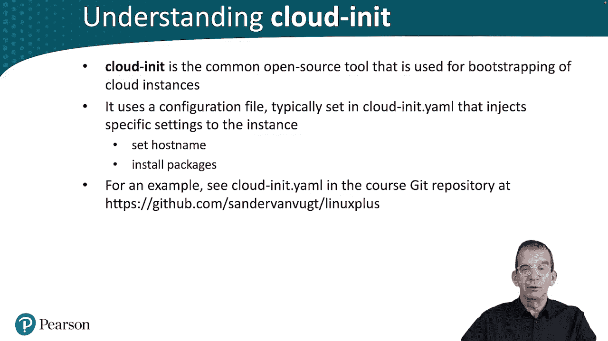
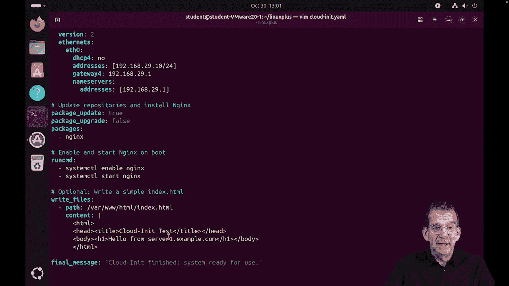

# 🖥️ CompTIA Linux+ V8：05:29：云主机与虚拟机引导

在本节课中，我们将要学习云主机和虚拟机的引导过程，也就是所谓的 bootstrapping。你会了解到云实例与传统安装系统有什么不同，以及 cloud-init 这个工具是如何在云环境中帮我们完成系统初始化的。内容会尽量用大白话来讲解，即使你是初学者也能听得懂。接下来，我们先从最基础的概念开始说起。


## 什么是引导（Bootstrapping）

首先，我们先来看看什么是引导。在云计算的世界里，引导是一个很重要的概念。简单来说，云实例并不是像我们在自己的电脑上那样，通过 U 盘或者光盘逐步安装出来的操作系统。相反，云实例是直接从一个已经做好的镜像中部署出来的。

这个镜像就像是一个模板，里面已经包含了操作系统的基本文件。当我们在云平台上定义了一些属性，比如主机名、网络设置或者存储配置之后，这些属性会被注入到镜像里面。镜像加上这些注入的属性，最终就变成了一个可以运行的系统。我们把这个过程叫做引导，也就是 bootstrapping。

用公式来表示这个关系，可以写成：

引导结果 = 云镜像 + 云中定义的实例特定属性


## 云引导与传统引导的区别

说完了什么是引导，我们再来看看云引导和传统引导有什么不同。如果你之前接触过在物理机或虚拟机里安装 Linux，那么你一定知道传统系统启动时会经历一套固定的流程，比如引导加载程序、内核加载、服务启动等等。但在云环境下，事情不太一样。

云中的引导过程会直接替代已安装系统的正常启动程序。这意味着，当你在云里面使用 Linux 时，不需要再去关心传统引导里那些复杂的引导项配置，也不需要手动操作 group 这类底层启动设置。你真正需要面对的，是云平台提供的引导设置。


## 云引导的典型过程

了解了区别之后，我们来看看云引导在实际发生的时候，通常会按照以下顺序进行：

1. 实例特定的设置会先在云平台中定义，然后被注入到正在创建的实例里面。
2. 接下来，系统会应用网络配置和存储配置，可能还会自动安装一些更新。
3. 最后，实例可能会加入到外部系统中，比如 Active Directory，或者通过 Ansible 进行配置管理。


## cloud-init 简介

讲完了云引导的一般流程，接下来我们重点认识一下 cloud-init。它是一个非常重要的组件，也是云引导过程中常用的开源工具，专门用来给云实例做引导和初始化。cloud-init 的作用就是把云平台下发的配置，落实到每一个新创建的实例里面。

cloud-init 使用一个配置文件来完成这项工作，这个配置文件通常是用 YAML 格式编写的，并且直接在云平台中设置。通过这个配置文件，cloud-init 能够向实例注入各种特定的设置，比如设置主机名、安装软件包、配置网络等等。


## cloud-init 配置文件示例

为了让你更直观地理解 cloud-init 是怎么工作的，我们可以看一个实际的 YAML 配置示例。这个示例定义了实例需要的主机属性，以及网络和服务相关的设置。

以下是一个简化的 cloud-init 配置文件结构：



```yaml
# cloud-init 配置示例
hostname: web-server-01
fqdn: web-server-01.example.com

packages:
  - nginx

runcmd:
  - systemctl start nginx
  - systemctl enable nginx
```

在这个例子里，我们首先指定了实例的主机名和完全限定域名，也就是 FQDN。然后我们声明要安装 nginx 软件包，最后通过 runcmd 部分告诉系统启动并开机自启 nginx。所有这些配置，都会在镜像被部署到适当的云环境时，自动生效。


## 实操演示：查看配置文件

如果你想亲眼看看这个配置文件长什么样，可以按照下面的步骤操作：

1. 首先，我们需要从 Git 仓库把示例代码克隆到本地。
2. 接下来，建议先安装一个真正的文本编辑器，方便查看和修改 YAML 文件。
3. 打开仓库里的 cloud-init YAML 文件，你就能看到它定义了主机名、FQDN 以及网络相关的设置。
4. 文件中还会说明应该启动哪些服务，比如 Nginx，并且会提供 Nginx 的配置文件引用。

按照这些步骤操作完之后，你就能清楚地看到，cloud-init 是如何把一个普通的云镜像，变成一台完全配置好的运行系统的。


## 本节总结



在本节课中，我们一起学习了云主机和虚拟机的引导过程。我们了解到，云实例不是安装出来的，而是从镜像部署并注入属性而成的；云引导替代了传统系统的启动流程，所以我们主要关注云平台提供的引导设置；cloud-init 是实现这一过程的核心开源工具，它通过 YAML 配置文件向实例注入主机名、软件包和服务设置。希望这些内容能帮你建立对云引导的基本认识。
