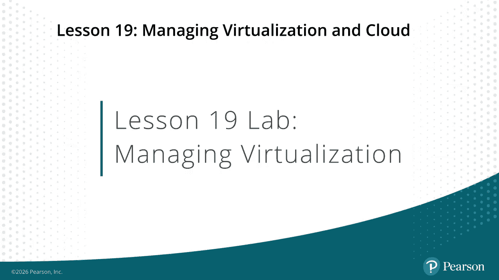
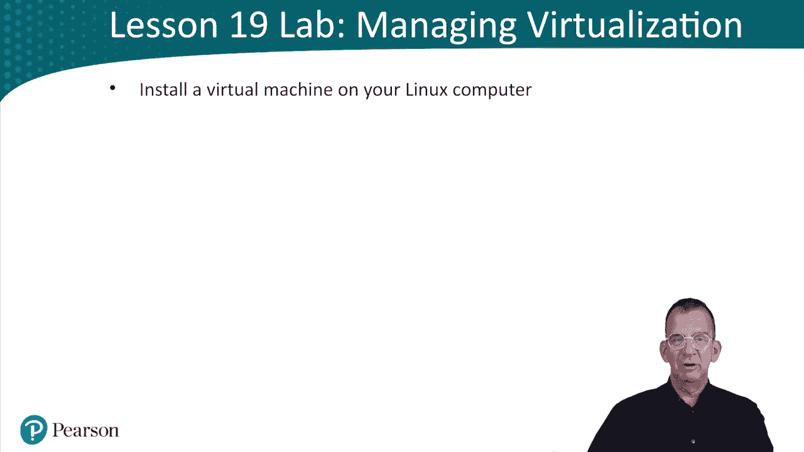

🖥️ Oreilly CompTIA Linux+ V8：Lesson 19 Lab：虚拟化管理

在本节课中，我们将学习如何在Linux系统上完成虚拟化管理的实验操作。本节内容属于Lesson 19 Lab的实践环节，核心目标是让你在自己的Linux计算机上安装虚拟机。通过这个实验，你将掌握虚拟化技术的基础部署步骤，为后续学习虚拟机配置、管理和维护打下坚实基础。虚拟化是现代Linux运维中非常重要的一项技能，它允许你在一台物理机器上运行多个独立的操作系统实例，极大地提升了硬件资源的利用率和系统的灵活性。

刚才我们简要介绍了本节课的学习目标，接下来我们来看看这个实验具体要做什么。

本节实验的任务非常明确，就是在你的Linux电脑上安装一个虚拟机。这里的虚拟机可以理解为在操作系统里面再跑一个完整的计算机系统，就像是在你的Linux里面套了一个壳，里面可以安装Windows或者其他的Linux发行版。这种技术在实际工作中非常有用，比如你可以用它来测试软件，而不需要担心把真实系统搞坏，也可以用来搭建测试环境，方便学习和实验。


以下是实验的核心步骤：

- 检查Linux系统是否支持虚拟化技术
- 安装虚拟化软件或管理工具
- 创建并配置第一个虚拟机实例
- 启动虚拟机并验证安装结果

在了解了实验步骤之后，我们进入到具体的操作环节，下面介绍如何通过命令行来完成虚拟机的安装。



安装虚拟机最直接的方法是使用Linux的包管理器。不同的发行版使用不同的命令，但原理都是一样的，就是从软件仓库下载虚拟化相关的软件包并安装到系统中。安装完成后，你就可以开始创建虚拟机了，而不需要手动去下载复杂的安装文件。

以下是常见的安装命令示例：

```bash
# 对于基于Debian/Ubuntu的系统
sudo apt update
sudo apt install qemu-kvm libvirt-daemon-system libvirt-clients bridge-utils virt-manager

# 对于基于RHEL/CentOS的系统
sudo dnf install @virtualization
```

代码块中展示的命令就是用来安装虚拟化软件的，你需要根据自己使用的Linux发行版选择对应的命令来执行，安装过程中可能需要输入管理员密码并确认下载。

安装完成之后，我们需要确认虚拟化环境是否已经正确就绪，这样才能继续后续的虚拟机创建工作。

你可以通过检查相关服务状态或者查看内核模块来验证安装是否成功。如果命令没有报错，并且服务正在运行，那么说明你的Linux电脑已经具备了运行虚拟机的能力，可以放心地继续下一步操作了。

以下是验证命令示例：



```bash
# 检查libvirt服务状态
sudo systemctl status libvirtd

# 检查KVM模块是否加载
lsmod | grep kvm
```

执行这些验证命令后，如果看到服务处于active状态，或者lsmod命令输出了kvm相关模块，就代表安装成功了。

本节课中我们一起学习了如何在Linux计算机上安装虚拟机，完成了Lesson 19 Lab的虚拟化管理实验。我们了解了实验的基本任务，学习了使用包管理器安装虚拟化软件的方法，并掌握了验证安装结果的命令。希望通过这次实验，你能对Linux虚拟化技术有初步的认识，并为后续的虚拟机配置与管理工作做好准备。

