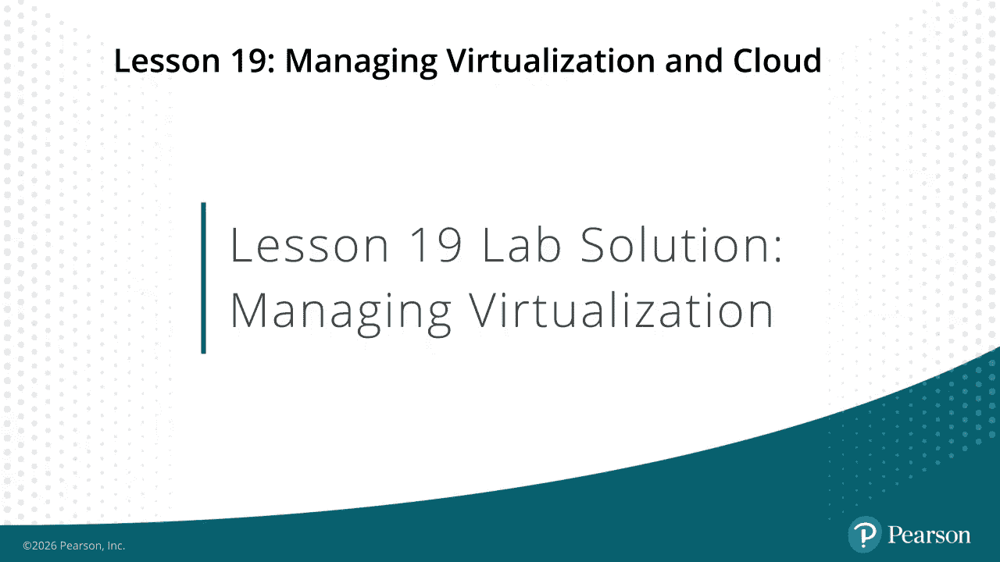
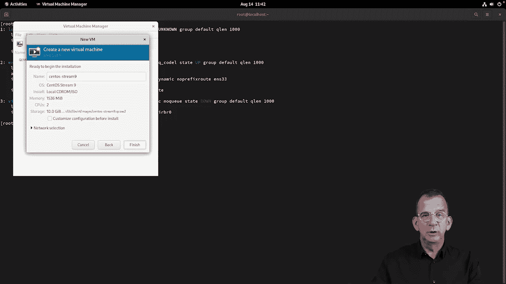

# 🖥️ CompTIA Linux+ V8：431：Lesson 19 Lab Solution Managing Virtualization

在本节课中我们将要学习如何在 Linux 系统里创建和运行虚拟机。虚拟机就像是在你的电脑里再运行一台完整的计算机，你可以在里面安装操作系统，做各种测试而不会影响主机系统。这对学习 Linux 来说非常有用，因为你可以随意尝试，即使把系统弄坏了也不用担心。本节课会一步步带你完成从打开虚拟机管理器到启动虚拟机的全过程，内容适合完全没有接触过虚拟化的初学者，讲解会尽量直白，尽量不用难懂的专业术语。



你需要准备什么

在动手操作之前，先搞清楚运行虚拟机到底需要哪些条件。如果没有这些前提条件，你就无法顺利完成后面的步骤，甚至连虚拟机管理器都打不开。下面列出了最基本的要求。

以下是运行虚拟机所需的准备工作：
- 虚拟机管理器软件
- 管理员凭证，包括用户名和密码
- 安装介质，也就是操作系统的 ISO 镜像文件

打开虚拟机管理器

上一节我们介绍了虚拟化的基本概念，本节中我们来看看如何实际操作。要运行虚拟机，第一步就是启动虚拟机管理器。这是一个图形界面工具，专门用来创建、启动、停止和管理虚拟机。你可以把它理解成虚拟机的控制中心，没有它你就无法方便地进行后续操作，所以它是整个流程的起点。

启动虚拟机管理器

输入凭证并新建虚拟机

管理器打开之后，系统会要求你提供凭证。凭证就是你的登录账号和密码，用来证明你有权限创建虚拟机。只有输入正确的账号密码，系统才会允许你继续。输入正确之后，点击新建按钮，然后选择你想要执行的操作，这里应该选择本地安装。

```text
凭证 = 用户名 + 密码
新建虚拟机 = 点击“新建”按钮 + 选择本地安装
```

选择安装介质

接下来你需要告诉管理器用哪个文件来安装系统。选择本地安装之后，浏览本地磁盘，找到你之前创建好的 ISO 镜像文件。系统会自动检测这个镜像，确认没有问题之后，点击下一步继续。这一步很关键，因为选错镜像文件，后面就无法安装系统。

找到之前创建好的 ISO 镜像文件

配置虚拟机资源

现在需要给虚拟机分配硬件资源。这包括内存大小、CPU 数量和磁盘空间。内存和 CPU 决定虚拟机运行得快不快，磁盘空间决定里面能装多少东西。建议磁盘空间不要设置得太大，10GB 就足够了，给太多会浪费主机的存储空间，而且分配过多可能会导致主机运行缓慢。

```text
虚拟机规格 = 内存大小 + CPU 数量 + 磁盘空间
推荐磁盘空间 = 10GB
```

完成并启动虚拟机

所有设置都做完之后，只需要点击完成按钮。点击之后虚拟机就会自动启动，进入操作系统界面。在那里你可以定义所有不同的属性，比如网络、用户、时区等等，之后就可以正常使用虚拟机了。完成按钮就像是最后一道闸门，点击过了就正式开始了。



点击“完成”按钮启动虚拟机


本节课中我们一起学习了如何使用虚拟机管理器创建虚拟机。我们了解了需要准备的条件，学习了如何输入凭证、新建虚拟机、选择 ISO 镜像、配置内存 CPU 磁盘，最后点击完成启动虚拟机。希望这些内容能帮你成功运行第一台 Linux 虚拟机，为后面的学习打下基础。
