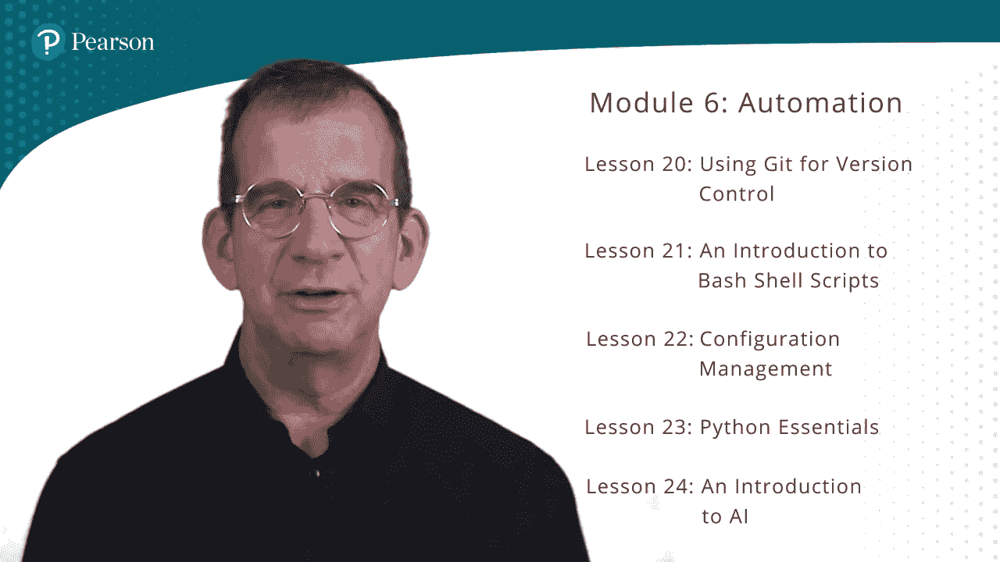

# CompTIA Linux+ V8：模块6：模块介绍 🤖

在本节课中我们将要学习CompTIA Linux+ V8课程中的第6个模块。这个模块的主题是自动化。对于Linux系统管理员来说，自动化技能可以帮助你处理重复性工作，也能让系统维护变得更高效。接下来的内容将简要介绍模块中包含的各个课程，让你对整体学习路径有初步了解。


上一节我们完成了模块的总体概览，本节中我们来看看第一个具体课程，即Git。Git是一种版本控制工具，它的主要作用是让多个开发人员能够在同一个软件项目中一起协作开发。如果没有Git，团队成员很容易互相覆盖对方的代码修改，导致工作丢失。

以下是Git的核心作用：
- 记录每一次代码更改
- 支持多人同时开发同一项目
- 方便回退到之前的版本

相关命令示例如下：
```bash
git clone <仓库地址>
```

上一节我们介绍了Git的基本用途，本节中我们来看看Bash脚本和配置管理。Bash脚本是将多条Linux命令写在一个文件中，让系统按照顺序自动执行。配置管理则是指使用工具来统一控制服务器设置，避免手动配置带来的错误和不一致。

以下是相关概念说明：
- Bash脚本：把多条命令组合成一个可执行文件
- 配置管理：定义系统期望状态，并由工具自动应用

脚本示例如下：
```bash
#!/bin/bash
echo "自动化任务执行中"
```

配置管理也可以用简单公式来表示：
```
系统状态 = 期望配置 + 自动化工具
```

上一节我们介绍了Bash脚本和配置管理，本节中我们来看看Python基础。Python是一门广泛使用的编程语言，作为Linux管理员，掌握Python基础能够帮助你编写更复杂的自动化任务，提升系统管理能力。

以下是Python的常见用途：
- 编写系统管理脚本
- 处理日志和文件
- 调用系统接口完成自动化运维

代码示例如下：
```python
print("Linux自动化入门")
```

上一节我们介绍了Python基础，本节中我们来看看本模块的最后一课，即人工智能简介。人工智能正在逐渐进入运维领域，了解基础概念有助于你适应未来的技术变化。

以下是AI的基础组成要素：
- 算法
- 数据
- 算力



可以用公式概括：
```
人工智能 = 算法 + 数据 + 算力
```

本节课中我们一起学习了模块6的简介。我们了解到自动化是本模块的核心主题，分别看到了Git用于团队协作，Bash脚本和配置管理用于系统自动化，Python基础用于编写管理工具，以及人工智能简介用于拓展技术视野。
