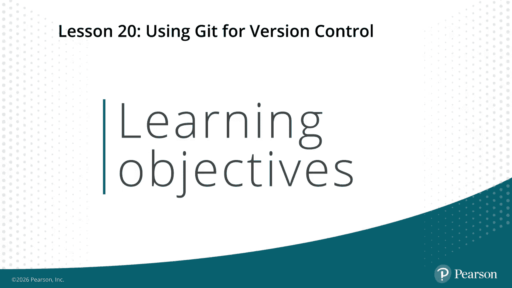
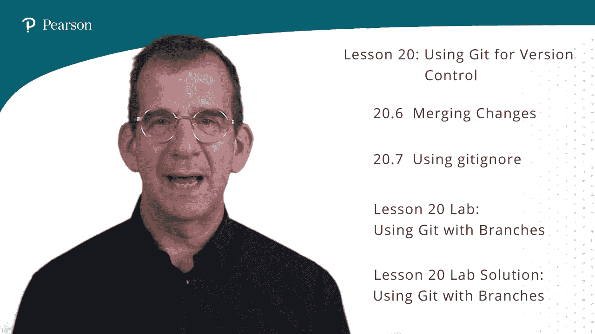

CompTIA Linux+ V8：05：Git 版本控制基础 📦


在本节课中，我们将一起学习 Git 版本控制的基础知识。Git 是目前最常用的代码管理工具，无论你是刚接触 Linux 还是已经有一些经验，掌握 Git 都是非常重要的一步。我们会从 Git 是什么开始，然后逐步讲解如何创建仓库、克隆仓库、撤销更改、合并更改、使用分支，以及如何利用 .gitignore 排除不需要同步的文件。最后，课程还会提供实验和实验参考答案，方便你动手练习。


欢迎使用 Git 进行版本控制。在本课中，你将学习如何使用 Git。


### 什么是 Git



首先，我们来看看 Git 到底是什么。Git 是一个分布式版本控制系统，简单来说，它可以帮你记录文件的每一次修改，方便你在需要的时候回退到之前的版本。你可以把它想象成一个“时间机器”，记录你代码的每一个历史节点，这样就算不小心删错了东西，也能很快找回来。

核心概念可以用下面的公式来理解：

```
Git = 分布式版本控制系统
```

以下是 Git 的几个主要特点：
- 记录文件的历史版本
- 支持多人协作开发
- 可以离线工作，之后再同步


### 创建和克隆 Git 仓库

我会先解释它是什么，接下来你将学习如何创建和克隆 Git 仓库。仓库就是 Git 用来存放项目文件和历史记录的地方。创建仓库意味着在本地初始化一个新的 Git 项目，而克隆仓库则是从远程服务器把一个已有的项目完整复制到自己的电脑上，方便你直接在本地开始工作。

核心操作可以用下面的代码表示：

```
git init        # 创建新仓库
git clone <url> # 克隆远程仓库
```

以下是常见的操作步骤：
- 使用 git init 在当前目录创建本地仓库
- 使用 git clone 复制远程仓库到本地


### 撤销更改、合并更改与分支

然后你将学习如何撤销或合并更改，以及如何使用分支。在实际开发中，代码经常会发生变化，有时候你可能想把文件恢复到之前的状态，这时候就需要撤销更改；合并更改则是把不同分支或不同人的修改整合到一起；分支则是让你可以在不影响主线的情况下，独立地开发新功能，开发完成后再合并回主分支。

核心命令可以用下面的代码表示：

```
git checkout -- <file>   # 撤销文件更改
git merge <branch>       # 合并分支
git branch <name>        # 创建分支
git checkout <name>      # 切换分支
```

以下是相关操作的简要说明：
- 撤销更改：撤销对某个文件的修改
- 合并更改：把两个分支的修改合并在一起
- 使用分支：在独立的分支上开发，互不干扰


### .gitignore 排除文件

我也会解释如何使用 .gitignore 文件来排除某些文件，使其不被同步。除了管理代码本身，有时候我们也不希望把所有文件都交给 Git 追踪，这时候就需要用到 .gitignore 文件了。它是一个特殊的文本文件，里面列出不想被 Git 同步或提交的文件或文件夹，比如编译生成的临时文件、日志文件或敏感配置文件，这样可以保持仓库干净，避免不必要的文件被上传。

.gitignore 的示例内容如下：

```
# .gitignore 示例
*.log
temp/
config.ini
```

以下是 .gitignore 常见的使用场景：
- 忽略编译生成的二进制文件
- 忽略系统生成的临时文件
- 忽略包含密码或密钥的配置文件


### 实验与实验解答



在本课的结束时，你将找到实验以及实验解答。实验环节是检验你是否掌握知识点的好机会，建议你亲自动手操作一遍，把刚才学到的命令和概念都实际运用起来。如果遇到困难，可以参考实验解答来了解正确的做法，对照着检查自己的操作是否正确。


本节课中，我们一起学习了 Git 版本控制的基础内容。我们介绍了 Git 是什么，如何创建和克隆仓库，如何撤销和合并更改，如何使用分支，以及如何通过 .gitignore 排除不需要同步的文件。希望你能通过这些内容，初步掌握 Git 的使用方法，并动手完成课后实验。

