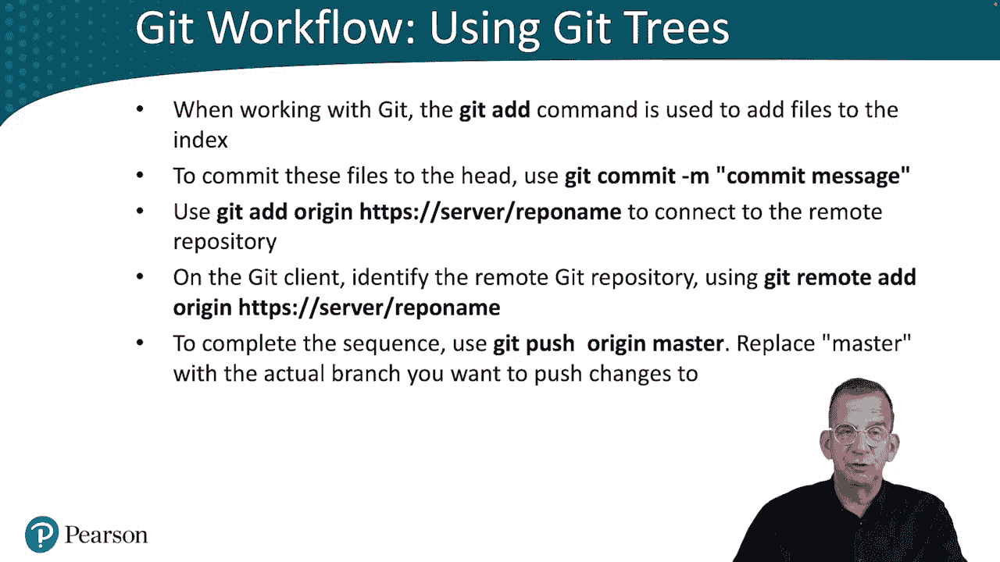
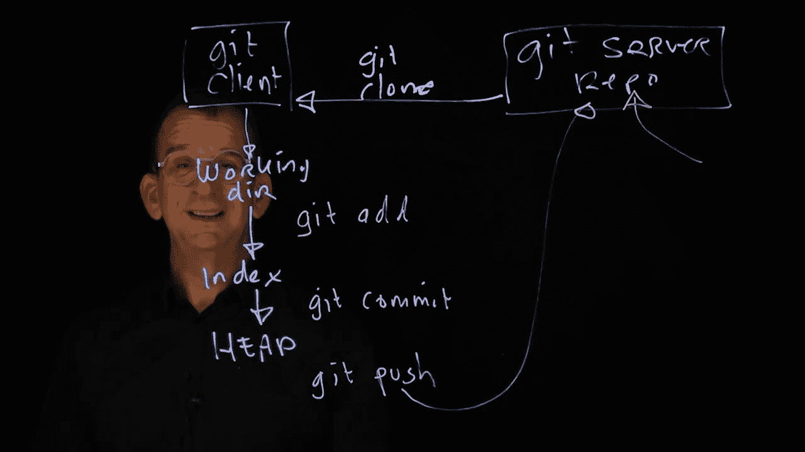
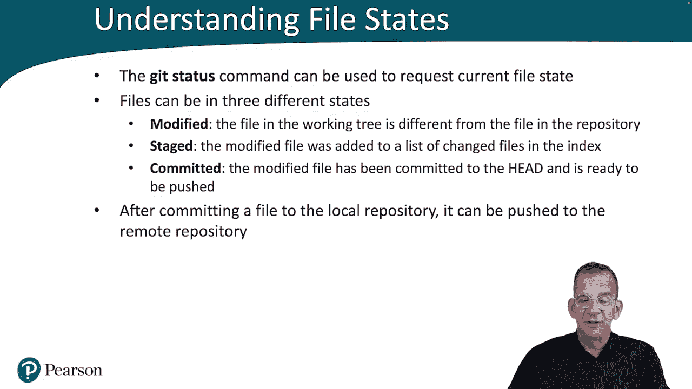

# CompTIA Linux+ V8：434.201：理解 Git 🔧


在本节课中，我们将一起学习什么是 Git，Git 为什么会被创建，以及它在 Linux 环境中是如何使用的。我们还会了解 Git 的工作流程，掌握工作区、暂存区和本地仓库之间的关系，最后学习文件在 Git 中的不同状态。无论你之前是否接触过版本控制，这节课都会用最直白的方式把这些概念讲清楚，让你可以快速上手 Git。


### 什么是 Git

Git 是一个分布式版本控制系统。它本身并不属于 Linux 操作系统的一部分，但是在 Linux 环境中被非常广泛地使用。Git 是由 Linux 内核的创建者 Linus Torvalds 开发的。他创建 Git 的初衷是希望多个人可以高效地一起协作完成同一个项目。在 Git 中，开发者可以共同参与项目开发，系统会保存每个文件的每一个版本，并且会记录是谁在什么时候对哪个文件做了什么修改。因为 Git 是分布式的，开发者可以先把远程仓库克隆到本地，之后即使没有网络也可以继续工作。


### Git 的仓库与平台

Git 的核心是仓库，一个仓库可以包含多个开发分支。开发者和用户都可以很方便地从 Git 仓库上传或下载新文件。要完成这些操作，需要一个 Git 客户端。在 Linux 系统中，通常直接使用 Git 命令行客户端，当然也有其他图形化客户端可选。Git 的托管平台有很多种，比如 GitHub 是非常常见的平台，GitLab 是常见的替代方案，当然你也可以自己搭建私有 Git 服务。无论你选择哪种方式托管，Git 的工作原理始终是一样的。


### Git 工作流程概述

现在我们来看看 Git 的整体工作流程。克隆远程仓库之后，开发者会在本地的工作目录中对文件进行修改。这些修改一开始只存在于本地克隆的仓库里，整个社区暂时看不到这些变化。等到开发者对修改结果满意之后，就可以把更改推送到远程仓库。如果本地仓库可以通过网络访问，仓库的所有者也可以从中拉取更改。


### Git 的三棵树

Git 在处理文件状态时使用了三棵树，这些树保存在 `.git` 目录下，平时我们通常看不到它们，但了解它们有助于理解 Git 的工作流程。以下是这三棵树的具体说明：

1. 工作目录：保存你实际看到并编辑的文件。
2. 暂存区（索引）：充当暂存区域，用于存放准备提交的更改。
3. HEAD：指向最近一次提交的位置。


### 基本 Git 命令

当你使用 Git 工作时，通常会按照一定的顺序使用命令。首先使用 Git add 命令，把文件添加到暂存区。然后使用 Git commit 命令，把更改提交到 HEAD。完整的命令形式如下：

```bash
git add <文件名>
git commit -m "提交信息"
```

此时本地仓库还需要和远程仓库建立连接。如果还没有关联，可以使用下面的命令添加远程仓库：

```bash
git remote add origin https://服务器/仓库名
```

连接完成后，就可以把更改推送到远程仓库的指定分支，命令示例如下：

```bash
git push origin <分支名>
```



这里的 `<分支名>` 需要替换成你实际要推送的分支名称。


### Git 工作的三个阶段

在实际使用 Git 的过程中，我们的工作可以分为三个相关阶段，下面是具体的流程说明：

第一阶段：使用 Git add 命令，将工作目录中的更改放入暂存区。
第二阶段：使用 Git commit 命令，将暂存区的更改提交到 HEAD。
第三阶段：使用 Git push 命令，将 HEAD 中的更改推送到远程 Git 仓库。

整个过程可以用这个简单的公式来表示：

```
工作目录 --git add--> 暂存区 --git commit--> HEAD --git push--> 远程仓库
```

需要注意的是，在你推送更改的同时，其他人也可能对同一个仓库做了修改。如果发生这种情况，你还需要使用 Git pull 和 Git merge 命令来同步代码，我们会在后续的视频中专门讲解这两个命令。


### 文件的三种状态



最后，我们来看看 Git 中文件的状态。Git 里的文件可能处于不同的状态，你可以使用 Git status 命令来查询当前的文件状态。主要有以下三种状态：

以下是这三种状态的详细解释：

1. 已修改（Modified）：工作目录中的文件与仓库中的文件不一致。
2. 已暂存（Staged）：修改过的文件被添加到了暂存区的更改列表中。
3. 已提交（Committed）：修改过的文件已经提交到 HEAD，准备好被推送。

当文件处于已提交状态之后，剩下的唯一操作就是使用 Git push，确保这个文件能够被整个社区共享。




本节课中，我们一起学习了 Git 是什么，了解了它是由 Linus Torvalds 创建的分布式版本控制系统，掌握了 Git 仓库、客户端和平台的基本概念，梳理了从克隆、修改到推送的完整工作流程，并认识了工作目录、暂存区和 HEAD 这三棵树，最后还学习了文件在 Git 中的三种状态。希望这些内容能帮助你建立起对 Git 的初步认识，为后续的版本控制学习打下基础。

